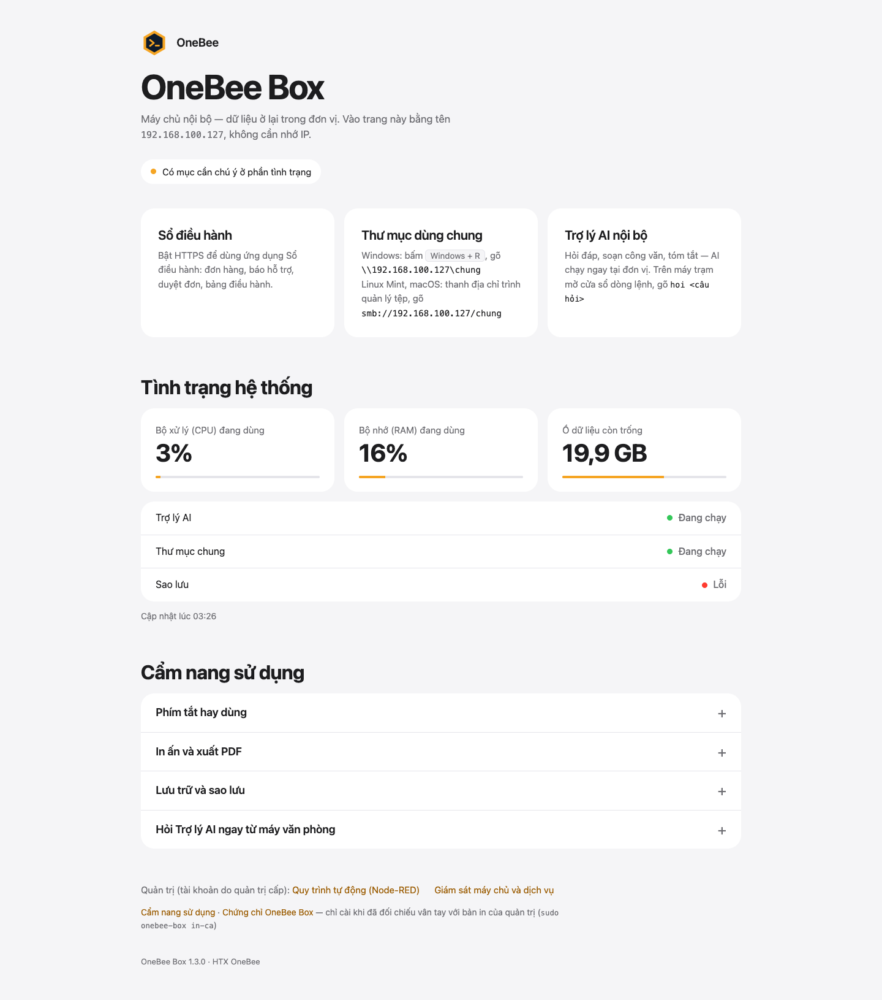
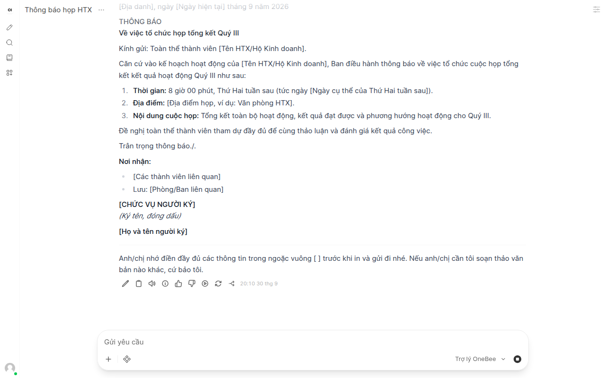

<p align="center">
  
</p>

<h1 align="center">🐧 Hệ điều hành & Tự động hóa Open Source</h1>

<p align="center">
  <strong>OneBee OS — máy văn phòng Linux tiếng Việt + máy chủ nội bộ có AI chạy tại chỗ, cho HTX và doanh nghiệp nhỏ</strong>
</p>

<p align="center">
  <a href="https://github.com/mthien07/da3-he-dieu-hanh-va-tu-dong-hoa-open-source/actions/workflows/ci.yml"></a>
  <a href="https://github.com/mthien07/da3-he-dieu-hanh-va-tu-dong-hoa-open-source/releases"></a>
  <a href="LICENSE"></a>
  <a href="https://github.com/mthien07/da3-he-dieu-hanh-va-tu-dong-hoa-open-source/commits"></a>
  
  
</p>

<p align="center">
  <a href="docs/huong-dan/huong-dan-cai-dat-tu-a-den-z.md"><b>📖 Cài từ A đến Z</b></a> ·
  <a href="#-tài-liệu">Tài liệu</a> ·
  <a href="tests/README.md">Kiểm thử</a> ·
  <a href="docs/kiem-thu-tren-may-that.md">Kết quả kiểm thử</a> ·
  <a href="SECURITY.md">Bảo mật</a> ·
  <a href="CONTRIBUTING.md">Đóng góp</a>
</p>

---

## 🎯 Vấn đề
- Máy văn phòng ở HTX, hộ kinh doanh, doanh nghiệp nhỏ thường dùng phần mềm không bản quyền → rủi ro pháp lý, dễ nhiễm mã độc.
- Không có người chuyên CNTT: không ai sao lưu, cập nhật, không ai hỗ trợ khi máy hỏng.
- Muốn dùng AI nhưng ngại đưa dữ liệu nội bộ lên dịch vụ nước ngoài.

## 💡 Sản phẩm
| Thành phần | Làm gì |
|---|---|
| **OneBee OS Desktop** | Bộ cài biến Linux Mint 22 thành máy văn phòng tiếng Việt: gõ Telex (IBus + Bamboo), LibreOffice lưu mặc định .docx/.xlsx, font thay thế giữ bố cục file Word, tự cập nhật, tự sao lưu lên Box, lệnh `hoi` hỏi Trợ lý AI, báo cần hỗ trợ, hỗ trợ từ xa có đồng ý |
| **OneBee Box** | Bộ cài máy chủ nội bộ **DX-OS Open-Core** (Ubuntu Server 24.04): Cổng API Caddy + Authelia SSO (`forward_auth`, 2FA TOTP), CSDL PostgreSQL + pgvector + PostgREST (RLS, tự sinh OpenAPI), kho tệp SeaweedFS + quét ClamAV (`CLEAN`/`INFECTED`), Trợ lý AI RAG tiếng Việt (`onebee-ai-rag.py` MIT + Ollama Gemma 4), động cơ quy trình Node-RED gửi email (báo cáo sao lưu, nhắc hạn thuế/BHXH, đơn hàng, tóm tắt PDF, sổ hỗ trợ), sao lưu 2 tầng chống mã độc tống tiền, quản lý máy trạm từ 1 lệnh |
| **Dịch vụ** | Khảo sát → sao lưu nguyên ổ Windows → cài → đào tạo 3 buổi → bảo trì (theo dõi báo cáo hằng ngày, xử lý yêu cầu hỗ trợ có đo thời gian) |

```
 Máy trạm (Linux Mint + OneBee OS)                 OneBee Box DX-OS Open-Core (Ubuntu 24.04, trong LAN)
 ├─ gõ tiếng Việt, LibreOffice          HTTPS/SSO  ├─ Caddy Gateway + Authelia SSO (1FA/2FA TOTP, JWT ES256)
 ├─ onebee-sao-luu (12:00)         ───────────────▶├─ PostgreSQL + PostgREST (/api/*) + restic → ổ ngoài 23:00
 ├─ onebee-bao-tinh-trang (mỗi giờ) ──────────────▶├─ Node-RED (/quy-trinh/*): email, phê duyệt 2 bước, hỗ trợ
 ├─ hoi "câu hỏi"                   ──────────────▶├─ Trợ lý AI RAG (onebee-ai-rag.py + Ollama Gemma 4) & SeaweedFS + ClamAV
 └─ onebee-ho-tro (khi người dùng bấm)◀──SSH────── └─ onebee-box: them-may, may-tram, cap-nhat-may, bao-cao-tuan …
```

<table>
  <tr>
    <td width="50%"><br/><sub>Trang giới thiệu của OneBee Box trong mạng LAN</sub></td>
    <td width="50%"><br/><sub>Trợ lý AI tiếng Việt chạy tại chỗ soạn thông báo họp HTX</sub></td>
  </tr>
</table>

<sub>Ảnh chụp từ Box chạy trong môi trường kiểm thử, không phải tại đơn vị thật.</sub>

## 🚀 Cài đặt
> **Người không chuyên**: làm theo [Hướng dẫn cài từ A đến Z](docs/huong-dan/huong-dan-cai-dat-tu-a-den-z.md) — có sơ đồ, từng lệnh dán được, kết quả phải thấy.

Bản phát hành (file nén + SHA256SUMS): [Releases](https://github.com/mthien07/da3-he-dieu-hanh-va-tu-dong-hoa-open-source/releases).
Tự thử trên máy ảo trước khi cài cho đơn vị: [thu-nghiem-tren-may-ao.md](docs/huong-dan/thu-nghiem-tren-may-ao.md).

**Máy trạm** — Linux Mint 22.x 64-bit, có Internet:
```bash
sudo apt install -y git
git clone https://github.com/mthien07/da3-he-dieu-hanh-va-tu-dong-hoa-open-source.git onebee
cd onebee && sudo ./desktop/onebee-install.sh
```
**Box** — Ubuntu Server 24.04 LTS 64-bit trong LAN: như trên, lệnh cuối là `sudo ./box/onebee-box-install.sh`.

## 📚 Tài liệu
| Việc | Tài liệu |
|---|---|
| **Cài từ A đến Z cho người không chuyên** | [huong-dan-cai-dat-tu-a-den-z.md](docs/huong-dan/huong-dan-cai-dat-tu-a-den-z.md) |
| Cài máy trạm / Box | [cai-dat-onebee-os-desktop.md](docs/huong-dan/cai-dat-onebee-os-desktop.md) · [cai-dat-onebee-box.md](docs/huong-dan/cai-dat-onebee-box.md) |
| Cài nhiều máy, sao lưu Windows bằng Clonezilla | [cai-hang-loat.md](docs/huong-dan/cai-hang-loat.md) |
| Trợ lý AI, quy trình tự động, email | [dung-tro-ly-ai-va-quy-trinh-tu-dong.md](docs/huong-dan/dung-tro-ly-ai-va-quy-trinh-tu-dong.md) |
| Quản lý, cập nhật máy trạm, hỗ trợ từ xa | [quan-ly-may-tram.md](docs/huong-dan/quan-ly-may-tram.md) |
| Vào máy từ xa để cài tiếp (máy mới cài hệ điều hành, ở nơi khác) | [truy-cap-tu-xa-khi-cai-may.md](docs/huong-dan/truy-cap-tu-xa-khi-cai-may.md) |
| Kiểm trải nghiệm trên máy thật (phiên Cinnamon, Trợ lý AI, trang chủ Box) | [kiem-thu-trai-nghiem-may-that.md](docs/kiem-thu-trai-nghiem-may-that.md) · kết quả: [reports/trai-nghiem/](reports/trai-nghiem/) |
| Chạy thử tại đơn vị, đào tạo, tờ phím tắt | [chay-thu-tai-don-vi.md](docs/huong-dan/chay-thu-tai-don-vi.md) · [dao-tao-buoi-1-3.md](docs/huong-dan/dao-tao-buoi-1-3.md) · [to-phim-tat.md](docs/huong-dan/to-phim-tat.md) |
| Đo trước/sau | [do-truoc-sau.md](docs/huong-dan/do-truoc-sau.md) |
| Kinh doanh: cách tính giá, mẫu hợp đồng (nháp), khảo sát khách | [docs/kinh-doanh/](docs/kinh-doanh/) |
| Quyết định kiến trúc & API DX-OS | [Kiến trúc DX-OS 3 tầng](docs/kien-truc-dx-os.md) · [Đặc tả API & CLI](docs/api/openapi-dxos.md) · [Lộ trình 2026–2027](ROADMAP.md) · [ADR 0006](docs/adr/0006-loi-dx-os-open-core.md) · [CHANGELOG.md](CHANGELOG.md) · [project-changelog.md](docs/project-changelog.md) |
| Hồ sơ OLP 2026 (PoF & Chung khảo) | [Bảng tự chấm PoF 50/50](docs/olp-2026-tu-cham-pof.md) · [Kịch bản trình diễn](docs/hoi-thi/olp-2026-kich-ban-trinh-dien.md) · [Thư nộp bài PoF](docs/hoi-thi/olp-2026-thu-nop-bai.md) |

## 📌 Trạng thái (1.3.0 DX-OS Open-Core — đã kiểm tự động trong container, chưa thử trên máy thật)
- ✅ Đủ tính năng lõi cho 1 đơn vị & chuẩn **OneBee DX-OS Open-Core** (H-P-D-I Workspace + Headless PaaS 100% OSI):
  máy trạm, Box, Caddy + Authelia SSO + JWT `ES256`, PostgreSQL + pgvector + PostgREST (RLS, CHECK, OpenAPI),
  SeaweedFS + ClamAV (`clamscan` `CLEAN`/`INFECTED`), Node-RED quy trình phê duyệt & email, Trợ lý AI RAG nội bộ (`onebee-ai-rag.py`),
  quản lý máy trạm, hỗ trợ từ xa, sổ hỗ trợ + khảo sát, giám sát, HTTPS nội bộ (CA riêng của Box), xoay khóa,
  **khôi phục toàn bộ Box khi hỏng ổ**; giao diện quen thuộc như Windows (thanh tác vụ ghim sẵn ứng dụng, Win+E/D/L, LibreOffice dạng Ribbon).
- ✅ Nghiệm thu tự động v1.0.0 trong container ngày 14–15/10/2026 ([báo cáo](reports/nghiem-thu-v1-docker.md)):
  **Box đầy đủ 127 PASS / 0 FAIL** với model sản phẩm `gemma4:e2b-it-qat` (từ bản 1.3.0 đã chuyển ngăn xếp quy trình & AI sang Node-RED + `onebee-ai-rag.py` + Authelia + PostgreSQL + SeaweedFS để đạt 100% OSI và kiểm chứng lại bằng bộ unit test + Caddy thật trong container); **Desktop trong container Linux Mint 22.3 71 PASS / 0 FAIL**;
  cả hai bộ cài chạy lần 2 `changed=0 failed=0`. Unit test Box + Desktop + AI cùng lint (`yamllint`, `shellcheck`, kiểm mẫu Jinja) sạch.
- ✅ Model AI chọn bằng bộ chấm 40 câu tiếng Việt (98%): [ADR 0003](docs/adr/0003-chon-model-ai-gemma.md), [reports/ai/](reports/ai/).
- ✅ Nâng cấp trải nghiệm (v1.2.0) & bản chạy thử công khai OLP 2026 (v1.3.0): **Trung tâm OneBee**, **Kiểm tra máy**, 4 gợi ý & mẫu văn bản hành chính NĐ 30, chế độ demo công khai (`onebee_box_che_do_demo`) tự đặt lại dữ liệu giả lập lúc 03:00 mỗi đêm.
  **Chưa kiểm trên máy thật tại đơn vị**: chưa có kết quả trong [reports/trai-nghiem/](reports/trai-nghiem/); phiếu kiểm: [kiem-thu-trai-nghiem-may-that.md](docs/kiem-thu-trai-nghiem-may-that.md).
- ⏳ **Chưa cài trên máy thật tại đơn vị nào** (phiên Cinnamon thật, phần cứng, LAN thật, Windows mở thư mục chung, tốc độ AI) →
  [phiếu kiểm thử máy thật](docs/kiem-thu-tren-may-that.md), [danh sách thử](docs/huong-dan/thu-nghiem-tren-may-ao.md).
- ⏳ Chạy thử 4 tuần tại HTX OneBee → số liệu thật cho giá, video hướng dẫn.

Mọi con số về tốc độ, chi phí, tiết kiệm chỉ công bố khi có file đo trong `reports/`. Hiện **chưa có** số đo trên máy thật.

## 💰 Giá dịch vụ
Chưa có giá chính thức — tính từ chi phí thật của đợt chạy thử: [bang-gia.md](docs/kinh-doanh/bang-gia.md).
Dải giá trong hồ sơ hội thi là giả định nội bộ, chưa có cơ sở chi phí.

## 🤝 Đóng góp và bảo mật
- Báo lỗi / đề xuất: [Issues](https://github.com/mthien07/da3-he-dieu-hanh-va-tu-dong-hoa-open-source/issues) (có mẫu sẵn) · Hướng dẫn đóng góp, cách chạy kiểm thử: [CONTRIBUTING.md](CONTRIBUTING.md)
- Lỗ hổng bảo mật: **báo riêng**, không mở Issue — [SECURITY.md](SECURITY.md) · Quy tắc ứng xử: [CODE_OF_CONDUCT.md](CODE_OF_CONDUCT.md)
- Thấy dự án hữu ích? Bấm ⭐ để nhiều HTX biết tới hơn.

## ⚖️ Giấy phép
- **Mã nguồn dự án OneBee DX-OS:** Phát hành theo giấy phép **MIT** ([LICENSE](LICENSE)). **Mục đích chọn giấy phép MIT:** giúp mọi Hợp tác xã, doanh nghiệp nhỏ & vừa (SME) và đội ngũ sinh viên/cộng đồng tự do triển khai nội bộ, học tập, tùy biến hoặc tích hợp thương mại hóa dịch vụ vận hành mà không bị ràng buộc lan truyền mã nguồn đóng, đồng thời tương thích sạch với mọi thành phần lõi chuẩn OSI.
- **100% thành phần phụ thuộc mặc định đạt chuẩn OSI** ([LICENSES.md](LICENSES.md)):

| Thành phần lõi (v1.3.0) | Giấy phép OSI (SPDX) |
|---|---|
| Linux Mint/Ubuntu, LibreOffice, IBus/Bamboo, PostgreSQL + pgvector, ClamAV (`clamscan`, bỏ `libclamunrar`), restic (`BSD-2-Clause`) | Nguồn mở chuẩn OSI (`GPL-2.0-only` / `MPL-2.0` / `PostgreSQL` / `BSD-2-Clause`) |
| Caddy 2.11.4, Authelia 4.39.28, SeaweedFS 4.53, Node-RED 5.0.9, Gemma 4 (`Apache-2.0`) | `Apache-2.0` (chuẩn OSI) |
| `onebee-ai-rag.py`, `onebee-dinh-danh`, PostgREST 16.5, Ollama 0.34.4, Uptime Kuma 2.5.5, Samba | `MIT` / `GPL-3.0+` (chuẩn OSI) |

## 🖥️ Demo web và hồ sơ hội thi
- `demo/index.html` là giao diện **mô phỏng tĩnh** (số liệu minh họa, không cần máy chủ). Chế độ **bản chạy thử công khai thật** xem `onebee_box_che_do_demo` trong [box/ansible/group_vars/all.yml](box/ansible/group_vars/all.yml).
- Hồ sơ dự thi & OLP 2026: [docs/olp-2026-tu-cham-pof.md](docs/olp-2026-tu-cham-pof.md) · [docs/hoi-thi/](docs/hoi-thi/).

## 📞 Liên hệ

**Tác giả dự án: Dương Minh Thiện**
- 📱 0777 794 089

**Hợp tác xã OneBee**
- 📍 45 đường số 6, KDC Thái Dương, Phường Long An, Tây Ninh
- 📱 0385 944 909
- 🔢 MST: 1102128064
- 👤 Người đại diện: DUONG MINH THIEN

---

<p align="center">
  <em>Dự án dự thi Hội thi Khởi nghiệp Đổi mới Sáng tạo tỉnh Tây Ninh năm 2026</em><br/>
  <strong>🐝 HTX OneBee — Chuyển đổi số cho cộng đồng</strong>
</p>
