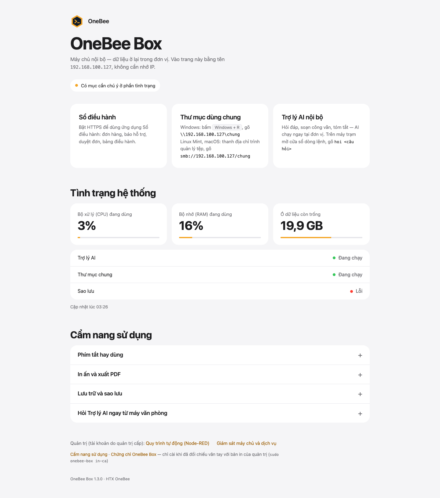

# Hướng dẫn cài OneBee Box

OneBee Box là 1 máy chủ đặt tại đơn vị, trong mạng LAN. Dịch vụ sau khi cài:

| Dịch vụ | Địa chỉ trong LAN | Dùng để |
|---|---|---|
| Trang chủ (Dashboard) | `http://onebee.local/` hoặc `http://<ip-box>/` | Tình trạng Box (CPU, RAM, ổ trống, Trợ lý AI, thư mục chung, sao lưu), lối tắt các dịch vụ, cẩm nang |
| Trợ lý AI (dịch vụ `/ai/` + Ollama) | `https://box.<mã>.onebee.internal/ai/` (qua lệnh `hoi` trên máy trạm) | Hỏi đáp, tóm tắt, tra kho tri thức — AI chạy tại chỗ, không gửi dữ liệu ra ngoài; chỉ mở khi đã bật HTTPS |
| Quy trình tự động (Node-RED) | `https://box.<mã>.onebee.internal/quy-trinh/` | Sau đăng nhập một lần + mật khẩu trình soạn |
| Giám sát (Uptime Kuma) | `http://<ip-box>:3001` | Theo dõi dịch vụ còn chạy không |
| Thư mục chung (Samba) | `smb://onebee.local/chung` (Windows: `\\onebee.local\chung`) | Chia sẻ file trong đơn vị |
| Kho sao lưu máy trạm | cổng 8000 | Máy trạm OneBee OS tự sao lưu lên |

**Tên `onebee.local` (mDNS)**: Box tự quảng bá tên trong mạng LAN bằng avahi — máy Windows 10+, macOS, iOS, Android, Linux Mint gõ
`http://onebee.local` là vào trang chủ, không cần nhớ IP (Box đổi IP thì tên tự trỏ IP mới; các dịch vụ khác vẫn cần IP cố định như mục 1). Đổi tên: `onebee_box_ten_mdns` trong `box/ansible/group_vars/all.yml`
(LAN có 2 Box trùng tên thì Box sau tự thành `onebee-2.local` — hãy đặt tên khác). Tên đơn vị trên trang chủ: `onebee_box_ten_don_vi`.
Tên chỉ dùng trong cùng mạng LAN (không qua router sang mạng khác, không qua Tailscale) và chỉ trỏ IPv4.
Khi đã bật HTTPS, `http://onebee.local` mở trang hướng dẫn cài chứng chỉ (trang chủ ở `https://<ip-box>/`, chứng chỉ không cấp cho tên `.local`).
Kiểm tra trên Box: `avahi-resolve-host-name -4 onebee.local`, hoặc chạy `sudo tests/box/check-mdns-dashboard.sh`.

**Dùng Trợ lý AI:** chỉ qua lệnh `hoi` trên máy trạm, gọi `https://box.<mã đơn vị>.onebee.internal/ai/…` và ghim CA riêng của Box.
Không còn cổng 3000 hay giao diện web riêng; bật HTTPS xong mới dùng được Trợ lý. Mỗi người dùng khóa API riêng do
`sudo onebee-box them-nguoi <tên> <nhóm>` cấp; không cần khai thêm Origin/CORS.
## 1. Chuẩn bị
- Máy 64-bit cài **Ubuntu Server 24.04 LTS**, nối mạng LAN, nên đặt IP cố định (trên router hoặc netplan).
- Ổ dữ liệu đủ lớn cho thư mục chung + sao lưu máy trạm. **1 ổ ngoài riêng** để Box tự sao lưu.
- Cấu hình máy cho AI: chưa chốt — đo ở phần thử nghiệm (Phase 3). Chạy được không cần card đồ họa (chậm hơn).
- **Không mở các cổng trên ra Internet ở router.** Hỗ trợ từ xa qua VPN (Tailscale/WireGuard).
- **Tường lửa tự bật khi cài**: chỉ máy cùng mạng LAN với Box (vd `192.168.1.0/24`) vào được các dịch vụ trên, kể cả
  thư mục chung và SSH. Máy ở mạng khác (Wi-Fi khách tách mạng, mạng ngoài) bị chặn. Đơn vị có nhiều mạng (vd phòng kế toán
  `192.168.2.0/24`): khai báo trong `box/ansible/group_vars/all.yml` → `onebee_box_lan_cho_phep: ["192.168.1.0/24", "192.168.2.0/24"]`
  rồi chạy lại bộ cài. Xem quy tắc: `sudo onebee-tuong-lua xem`. Lưu ý: Wi-Fi khách **cùng mạng** với máy văn phòng thì
  tường lửa không phân biệt được — nên tách Wi-Fi khách ra mạng riêng trên router.
  Tường lửa lọc **mọi cổng mạng** trừ `lo` và mạng Docker: qua cổng mạng chính chỉ mạng LAN cho phép; card mạng phụ, `wg0`, `tun0` bị chặn hết;
  qua **Tailscale** chỉ máy kỹ thuật khai trong `onebee_box_tailscale_cho_phep` (vd `["100.64.1.2"]`) vào được mọi cổng (web/SSH/thư mục chung, nhờ `/etc/onebee-box/samba-tu-xa.conf`)
  và các **máy trạm đi công tác** được duyệt bằng `sudo onebee-box duyet-tu-xa <tên-máy>` chỉ vào được 3 cổng TCP `443, 445, 8000` (xem [may-tram-di-cong-tac.md](may-tram-di-cong-tac.md)) —
  để trống cả hai là chặn hết kết nối Tailscale (bộ cài cảnh báo nếu Box đang nối Tailscale mà chưa khai). Kết nối mới qua Tailscale bị lọc ở bảng `mangle` (trước các quy tắc tailscaled tự chèn), nên vẫn đúng khi
  tailscaled khởi động lại. Nên đặt thêm ACL phía Tailscale làm lớp thứ hai: `tag:kythuat` → Box tcp 22, 80, 443, 445, 3001, 8000; `tag:congtac` → Box tcp 443, 445, 8000; thiết bị khác trong tailnet không vào được Box.
  IPv6: SSH/thư mục chung chỉ nhận mạng nội bộ IPv6 (`fe80::/10`, `fc00::/7`); địa chỉ IPv6 toàn cầu bị **từ chối ngay** (không im lặng) để máy khách lùi về IPv4 ngay thay vì chờ hết giờ (chưa kiểm trên Windows thật — phiếu B15).
  Đổi dải IP của mạng LAN (thay router, DHCP sang dải khác): từ 2.0.3 bộ hẹn giờ `onebee-tuong-lua-kiem-mang.timer` kiểm mỗi phút và tự dựng lại
  tường lửa theo dải mới (không có lúc hở); Box mất mạng thì giữ quy tắc cũ. Đã khai `onebee_box_lan_cho_phep` thì Box không tự đổi — sửa danh sách rồi chạy lại bộ cài.
  Box đổi IP (IP nằm trong CA): đặt `onebee_box_dia_chi` mới và `onebee_box_xoay_ca: true` một lần, chạy lại bộ cài, rồi đặt lại `false`; sau đó `sudo onebee-box dong-bo-may --tat-ca` để đẩy IP và CA mới xuống máy trạm (máy đang tắt: chạy lại cho máy đó khi bật).

## 2. Cài đặt
**Trước khi chạy bộ cài**, mở `box/ansible/group_vars/all.yml` và khai 2 giá trị (thiếu **mã đơn vị** thì bộ cài dừng và báo rõ; thiếu IP thì bộ cài lấy IP hiện có và cảnh báo):
- `onebee_box_ma_don_vi`: **viết tắt tên khách hàng** (chữ thường không dấu, số, gạch giữa; ví dụ `anphu`). Mã nằm trong chứng chỉ CA riêng của Box
  (chỉ cho phép tên `<mã>.onebee.internal`), nên mỗi khách một mã khác nhau.
- `onebee_box_dia_chi`: **IP tĩnh của Box** (cùng giá trị bạn đặt "giữ IP cố định" trên router hoặc netplan). Để trống thì bộ cài lấy IP hiện có
  và cảnh báo. IP và mã nằm trong CA: **đổi một trong hai = xoay CA** (mọi máy trạm phải nhận CA mới) — hãy chốt trước khi cấp máy.

Bộ cài sinh **CA riêng của Box** (khóa gốc ở `/etc/onebee-box/secrets/ca/`, có trong bản sao lưu Box, không gắn vào container nào). CA bị ràng buộc
tên: chỉ cấp được chứng chỉ cho IP của Box và `<mã>.onebee.internal`. Dịch vụ vẫn chạy HTTP ở giai đoạn này; máy trạm nhận CA qua `them-may`/`dong-bo-may`.
Xem vân tay CA để đối chiếu khi cài CA lên máy quản lý/laptop kỹ thuật: `sudo onebee-box in-ca` (cũng nằm ở dòng cuối `in-khoa`).
```bash
sudo apt install -y git
git clone https://github.com/mthien07/da3-he-dieu-hanh-va-tu-dong-hoa-open-source.git onebee
cd onebee
sudo ./box/onebee-box-install.sh
```
Lần đầu tải vài GB image. Xong mở trang chủ `http://onebee.local` (hoặc IP Box in ở cuối bộ cài):



### Bật HTTPS (khuyến nghị — chưa bật mặc định)
Mật khẩu và khóa đang đi qua LAN dạng rõ ở chế độ HTTP. Bật HTTPS (CA riêng của Box + Caddy, xem `docs/adr/0005-https-noi-bo-caddy-ca-rang-buoc-ten.md`):
1. Cài/cập nhật Box như trên → bộ cài tự đẩy CA xuống mọi máy trạm đã cấp (máy tắt thì bật lên rồi `sudo onebee-box dong-bo-may --tat-ca`).
2. Kiểm: `sudo onebee-box may-chua-nhan-ca` không in tên máy nào.
3. Đặt `onebee_box_https: true` trong `box/ansible/group_vars/all.yml`, chạy lại bộ cài. Nếu còn máy chưa nhận CA, bộ cài **giữ HTTP** và nêu tên máy.
4. Từ đó dùng `https://<ip-box>[:cổng]`; các cổng 443/3001/8000 do Caddy giữ (cổng backend đóng hẳn; động cơ quy trình không có cổng riêng); `http://` tới các cổng này tự chuyển sang `https://`.
   Máy trạm nhận URL https + chứng chỉ CA, Firefox mở sẵn Box bằng https. **Máy tắt lúc chuyển**: bật lên rồi `sudo onebee-box dong-bo-may <tên>` (trong 30 ngày với máy đã ghim khóa SSH).
5. **Thiết bị không do OneBee quản lý** (laptop kỹ thuật, điện thoại, máy của quản lý): tải `http://<ip-box>/onebee-ca.crt`, đối chiếu vân tay SHA-256 với `sudo onebee-box in-ca` (hoặc bản in `in-khoa`) rồi mới cài.
   Sau khi đã cài, **mọi** cảnh báo chứng chỉ ở địa chỉ Box là dấu hiệu bị tấn công — không bấm "tiếp tục", báo kỹ thuật.
6. Kỹ thuật vào Box qua Tailscale: thêm dòng `/etc/hosts` `<IP Tailscale của Box> box.<mã đơn vị>.onebee.internal`, mở `https://box.<mã đơn vị>.onebee.internal/` (Trợ lý AI hỏi bằng lệnh `hoi` trên máy trạm; mở bằng IP 100.x trần không dùng được).
   Mỗi khách dùng **một hồ sơ Firefox riêng** (CA của khách A chỉ cấp cho tên của khách A, nhưng các khách hay trùng dải `192.168.1.x`).
7. Hoàn tác: `onebee_box_https: false` → chạy lại bộ cài (máy trạm tự nhận cờ `BOX_HTTPS=0`, về HTTP).
Hết hạn CA trung gian (1 năm) được gia hạn tự động mỗi đêm khi lệnh sao lưu 23:00 chạy — bước gia hạn chạy trước khi kiểm ổ sao lưu, nên vẫn chạy cả khi chưa gắn ổ;
`sudo onebee-box trang-thai` hiện số ngày còn lại.

### Thư mục chung (Samba): chỉ SMB 3.1.1 + mã hóa
Từ bản này thư mục chung bắt buộc **SMB 3.1.1 và mã hóa** (`server min protocol = SMB3_11`, `server smb encrypt = required`): giữ nguyên nội dung khi đi qua LAN, chống hạ cấp.
Chỉ **Windows 10 trở lên và Linux** nối được. Máy Windows 7/8, máy photocopy/quét cũ **không** nối được — nếu cần, đặt `onebee_box_samba_smb3: false` (chấp nhận bỏ bảo vệ này).
Thử trước trên 1 máy Windows 10 và 1 máy Linux Mint rồi mới áp cho cả đơn vị; kiểm trên Box: `sudo smbstatus` (cột Encryption/Protocol).

## 3. Việc làm ngay sau khi cài
0. **SSH vào Box chỉ bằng khóa** (Box giữ khóa vào được mọi máy trạm): từ máy kỹ thuật `ssh-copy-id <tài-khoản>@<ip-box>`,
   thử `ssh <tài-khoản>@<ip-box>` vào được, rồi chạy lại `sudo ./box/onebee-box-install.sh` → Box tắt đăng nhập SSH bằng mật khẩu
   và không cho root. Chưa có khóa thì bộ cài giữ nguyên mật khẩu và in cảnh báo (không tự khóa anh ở ngoài).
1. **Trợ lý AI**: tài khoản quản trị `quantri@onebee.lan` đã tạo sẵn, đăng ký tự do đã tắt. Mật khẩu: `sudo onebee-box in-khoa`
   (dòng `webui-admin-password`). Model AI (`gemma4:e2b-it-qat`) tự tải khi cài. Trình soạn luồng Node-RED dùng tài khoản `kythuat`,
   mật khẩu dòng `quy-trinh-soan-luong`.
2. **Giám sát (Uptime Kuma, `:3001`)**: tài khoản `quantri` tạo sẵn (mật khẩu dòng `uptime-kuma-password`), đã có 5 mục theo dõi
   các dịch vụ của Box; khi đã cấu hình email, dịch vụ nào ngừng sẽ có email báo.
3. **Email báo cáo**: làm theo mục 4 của [dung-tro-ly-ai-va-quy-trinh-tu-dong.md](dung-tro-ly-ai-va-quy-trinh-tu-dong.md).
4. **Thư mục chung**: tài khoản `onebee`, mật khẩu xem bằng `sudo cat /etc/onebee-box/secrets/samba-onebee`.
5. **Ổ sao lưu**: gắn ổ ngoài vào `/mnt/onebee-sao-luu`. Khai báo trong `/etc/fstab` có `nofail` để máy vẫn khởi động
   khi rút ổ, ví dụ: `UUID=<uuid-ổ> /mnt/onebee-sao-luu ext4 defaults,nofail,x-systemd.device-timeout=10s 0 2`
   (xem UUID bằng `sudo blkid`). Rồi chạy lần lượt:
   - `sudo onebee-box khoi-tao` — tạo kho sao lưu (mã hóa) trên ổ ngoài
   - `sudo onebee-box in-khoa` — **in khóa ra giấy hoặc chép USB, cất két**. Hỏng ổ Box mà mất khóa thì bản sao lưu vô dụng.
   - `sudo onebee-box khoi-phuc-thu` — phải thấy dòng `ĐẠT`
   Chưa gắn ổ thì lệnh sao lưu **từ chối chạy** (không ghi vào ổ hệ thống) — lịch 23:00 sẽ báo lỗi trong nhật ký.

## 3b. Tài khoản (đăng nhập một lần)
Chỉ có khi đã bật HTTPS. Một tài khoản dùng cho dữ liệu (`/api/`), kho tệp (`/files/`), hỏi đáp AI qua API (`/ai/`) và trang giám sát.
Mở bằng **tên** `https://box.<mã đơn vị>.onebee.internal/dangnhap/` — vào bằng IP thì chỉ có trang chủ (ADR 0006, QĐ2).
Máy trạm OneBee tự có dòng `/etc/hosts` cho tên này (dòng `BOX_TEN` trong cấu hình máy, đẩy bằng `dong-bo-may`). Điện thoại, máy ngoài quản lý:
thêm bản ghi DNS tĩnh `box.<mã>.onebee.internal → <IP Box>` trên router của đơn vị (hoặc một dòng hosts), và vẫn phải cài CA của Box.

| Nhóm | Ai | Đăng nhập |
|---|---|---|
| `nhan_vien` | Nhân viên | Mật khẩu |
| `ky_thuat` | Kỹ thuật (thêm: trang giám sát) | Mật khẩu + mã TOTP trên điện thoại |
| `quan_ly` | Quản lý | Mật khẩu + mã TOTP trên điện thoại |

```bash
sudo onebee-box them-nguoi an nhan_vien      # in mật khẩu tạm MỘT lần — đưa trực tiếp, không gửi qua Zalo/email
sudo onebee-box danh-sach-nguoi
sudo onebee-box xoa-nguoi an                 # mất quyền ngay ở lần gọi kế tiếp, ghi danh TOTP cũng bị xóa
```
Ghi danh hai lớp (kỹ thuật, quản lý) khi Box chưa có email: người dùng đăng nhập, bấm ghi danh TOTP trên trang; trang đòi mã xác minh 8 ký tự —
quản trị chạy `sudo onebee-box ma-xac-nhan` và đọc mã cho đúng người đó. Khóa TOTP chỉ hiện trên máy người dùng.
Trang giám sát (`https://box.<mã>.onebee.internal:3001/`) chỉ mở cho nhóm `ky_thuat` đã qua hai lớp, không phải đăng nhập Uptime Kuma lần nữa.

Dịch vụ định danh hỏng, không ai đăng nhập được:
```bash
sudo onebee-box tat-sso-tam   # /api/, /files/, /ai/ trả 503 (dữ liệu khóa, không mở toang); giám sát dùng mật khẩu riêng (in-khoa)
sudo docker logs --tail 50 onebee-authelia
sudo onebee-box bat-sso-lai   # sau khi đã sửa
```
Khi dấu tạm tắt còn, mỗi lần chạy bộ cài và `onebee-box chan-doan` đều cảnh báo.
Sao lưu Box có cả tài khoản và ghi danh hai lớp (`/srv/onebee/authelia`). `xoay-khoa --box` đổi khóa phiên (mọi người đăng nhập lại) và
khóa ký JWT; khóa mã hóa ghi danh hai lớp (`authelia-storage-key`) không xoay. `in-khoa` không in mật khẩu người dùng (Box chỉ giữ bản băm).

## 3c. Dữ liệu và sao lưu (cơ sở dữ liệu PostgreSQL, API dữ liệu)
Đơn hàng, yêu cầu hỗ trợ, xử lý, khảo sát, tình trạng máy trạm nằm trong một cơ sở dữ liệu PostgreSQL (`onebee-postgres`, lược đồ `onebee`).
API dữ liệu (PostgREST, `onebee-postgrest`) chỉ đi qua cổng `https://box.<mã>.onebee.internal/api/<bảng>` sau đăng nhập một lần —
hai dịch vụ này không mở cổng nào ra LAN. Ai được làm gì do chính CSDL kiểm (phân quyền tới từng dòng):

| Nhóm | Được làm |
|---|---|
| `nhan_vien` | Thêm đơn hàng, yêu cầu hỗ trợ, khảo sát; chỉ thấy dòng mình tạo; không sửa, không xóa |
| `ky_thuat` | Như nhân viên; thấy mọi yêu cầu hỗ trợ và tình trạng máy; ghi dòng xử lý |
| `quan_ly` | Như nhân viên; thấy mọi đơn và yêu cầu; duyệt/từ chối đơn của **người khác** (không tự duyệt đơn của mình); khảo sát chỉ xem tổng hợp theo tuần (`/api/khao_sat_tong_hop`), không thấy góp ý |

Ví dụ duyệt đơn: `PATCH /api/don_hang?id=eq.12` với `{"trang_thai_duyet":"DA_DUYET","ly_do_duyet":"Đủ hàng"}` — người duyệt và giờ duyệt do CSDL tự ghi.

Bản cũ vẫn ghi sổ CSV (biểu mẫu đơn hàng, hỗ trợ, khảo sát). Chuyển sổ cũ vào CSDL:
```bash
sudo onebee-box chuyen-du-lieu   # chạy lại bao nhiêu lần cũng được: chỉ nạp dòng mới; in số dòng tệp / mới nạp / tổng trong bảng
```
Lần đầu mỗi tệp được chép sang `<tên>.truoc-chuyen`; tệp gốc không bị sửa. Tệp có dòng hỏng (thiếu cột, sai kiểu số) bị từ chối **cả tệp**,
lệnh in tên tệp + số dòng lỗi: sửa dòng đó trong tệp rồi chạy lại. `bao-cao-tuan` tự chuyển trước rồi đọc từ CSDL.

Sao lưu: `sao-luu` kết xuất CSDL (`/srv/onebee/postgres-ket-xuat/onebee.dump`) **trước** khi tạm dừng dịch vụ rồi đưa vào bản sao lưu;
kết xuất lỗi thì cả lần sao lưu báo lỗi. `khoi-phuc-toan-bo` đổ lại bản kết xuất vào CSDL. Mỗi lần nâng cấp có thay đổi lược đồ, bộ cài
kết xuất trước vào `postgres-ket-xuat/truoc-luoc-do-<tệp>.dump`. `chan-doan` báo khi CSDL hay API dữ liệu không trả lời, hoặc bản kết xuất
cũ quá 48 giờ. `xoay-khoa --box` đổi cả mật khẩu CSDL (đổi trong CSDL trước, rồi mới ghi tệp bí mật).

## 4. Cấp cho máy trạm (sao lưu, Trợ lý AI, quản lý tập trung)
Trên Box:
```bash
sudo onebee-box them-may ketoan-01
```
Dán các dòng in ra (13 dòng: `MAY_TRAM`, `BOX_IP`, `BOX_TEN`, `RESTIC_REPOSITORY`, `RESTIC_PASSWORD`, `HOI_URL`, `HOI_API_KEY`, `TINH_TRANG_URL`, `TINH_TRANG_KEY`,
`QUAN_TRI_SSH_KEY`, `BOX_CA`, `BOX_CA_VAN_TAY`, `BOX_HTTPS`; không có `HOI_API_KEY`/`TINH_TRANG_KEY` khi đã tắt 2 biến chuyển tiếp) vào máy trạm tại
`/etc/onebee/may-tram.env`, rồi chạy lại `sudo ./desktop/onebee-install.sh` trên máy trạm. Máy trạm sẽ:
- tự sao lưu `/home` lúc 12:00 hằng ngày (máy tắt thì chạy bù khi bật); sao lưu ngay: `sudo onebee-sao-luu`;
- dùng được lệnh `hoi` (Trợ lý AI chưa chạy lúc cấp thì thiếu dòng `HOI_API_KEY` — chạy lại lệnh sau);
- báo tình trạng về Box mỗi giờ và cho Box vào cập nhật qua SSH — xem [quan-ly-may-tram.md](quan-ly-may-tram.md).
Máy trạm cài bản v0.1 (file `sao-luu.env`) được bộ cài tự đổi tên sang `may-tram.env`.

## 5. Lệnh quản trị
| Lệnh | Việc |
|---|---|
| `sudo onebee-box trang-thai` | Dịch vụ đang chạy, dung lượng ổ |
| `sudo onebee-box chan-doan [--json]` | **Tự chẩn đoán** khi có sự cố: mạng (router < 5 ms, Internet, Tailscale), ổ `/` và dữ liệu (> 80% vàng, > 90% đỏ), RAM trống (< 1,5 GB), tải CPU, các container, AI trả lời thử (> 5 giây là chậm), Samba ghi được, bản sao lưu Box (> 26 giờ), CA và chứng chỉ HTTPS (< 15 ngày) — mỗi dòng [OK]/[CẢNH BÁO]/[LỖI] kèm gợi ý sửa. Mã thoát 0/1/2; `--json` cho trang chủ |
| `sudo onebee-box them-may <tên>` | Cấp cho máy trạm: sao lưu, khóa Trợ lý AI, quản lý tập trung |
| `sudo onebee-box may-tram` | Tình trạng các máy trạm (sao lưu, cập nhật, ổ đĩa, liên lạc cuối) |
| `sudo onebee-box cap-nhat-may <tên>` / `--tat-ca` | Cập nhật phần mềm máy trạm từ Box (lần đầu máy phải chứng minh rồi mới ghim khóa SSH) |
| `sudo onebee-box dong-bo-may <tên>` / `--tat-ca` | Đẩy lại cấu hình (`may-tram.env`) từ Box xuống máy trạm |
| `sudo onebee-box thu-hoi-may <tên>` | Thu hồi máy (mất máy, nghỉ việc, nghi giả mạo); giữ kho sao lưu |
| `sudo onebee-box duyet-tu-xa <tên> [--ip <IPv4>] [--ngay 1-365] [--dong-y]` | Cho máy trạm đi công tác kết nối Box qua Tailscale (cổng 443, 445, 8000) — xem [may-tram-di-cong-tac.md](may-tram-di-cong-tac.md) |
| `sudo onebee-box thu-hoi-tu-xa <tên>` | Thu hồi quyền kết nối từ xa của máy công tác (đóng tường lửa và cắt ngay kết nối đang mở) |
| `sudo onebee-box tu-xa` | Bảng các lượt duyệt máy công tác đang có |
| `sudo onebee-box tu-xa-ap-dung` | Áp dụng danh sách lượt duyệt vào tường lửa + Samba, tự thu hồi lượt hết hạn (bộ hẹn giờ gọi) |
| `sudo onebee-box ghim-lai-may <tên>` | Máy cài lại hệ điều hành: bỏ khóa SSH đã ghim để ghim lại |
| `sudo onebee-box bao-cao-tuan [YYYY-MM-DD]` | Nhật ký tuần: yêu cầu hỗ trợ, khảo sát, tình trạng máy (ẩn tên) |
| `sudo onebee-box nap-tri-thuc` | Nạp kho tri thức (NĐ 30, mẫu soạn văn bản, tài liệu đơn vị) vào CSDL |
| `sudo onebee-box cap-khoa-hoi <tên>` / `go-khoa-hoi <tên>` | Cấp lại / thu hồi khóa Trợ lý AI của một người |
| `sudo onebee-box dat-mat-khau-email` / `email-thu` | Đặt mật khẩu hộp thư gửi / gửi email thử |
| `sudo onebee-box khoi-tao` | Tạo kho sao lưu Box trên ổ ngoài (1 lần) |
| `sudo onebee-box sao-luu` | Sao lưu Box ra ổ ngoài ngay + dọn bản cũ (tự chạy 23:00 hằng ngày) |
| `sudo onebee-box in-khoa` | In khóa bí mật để cất ngoài Box |
| `sudo onebee-box khoi-phuc-thu` | Thử khôi phục 1 file — kiểm tra sao lưu dùng được |
| `sudo onebee-box khoi-phuc-toan-bo [file-khóa]` | Hỏng ổ Box: lấy lại toàn bộ trên Box cài lại (mục dưới) |

## Khôi phục toàn bộ khi hỏng ổ Box
1. Cài lại Ubuntu Server 24.04 + chạy `sudo ./box/onebee-box-install.sh` (như máy mới).
2. Gắn ổ sao lưu cũ vào `/mnt/onebee-sao-luu` (mục 3). Chép file khóa đã in từ `in-khoa` (hoặc gõ tay dòng `restic-box`).
3. `sudo onebee-box khoi-phuc-toan-bo /đường/dẫn/khoa.txt` — lấy lại dữ liệu Trợ lý AI, động cơ quy trình, giám sát, sổ hỗ trợ, CSDL (đơn hàng…), thư mục chung,
   toàn bộ khóa bí mật (mật khẩu cũ dùng lại được), khóa SSH quản trị máy trạm.
4. Chạy lại bộ cài, rồi `sudo onebee-box khoi-phuc-thu`. **Máy trạm không phải làm gì**: sao lưu, `hoi`, cập nhật từ Box chạy tiếp
   (kho sao lưu máy trạm là bản sao nên không nằm trong bản sao lưu Box — máy trạm tự tạo kho mới ở lần sao lưu sau).
Đã diễn tập tự động trong container (`tests/box/check-khoi-phuc-toan-bo.sh`); nên diễn tập 1 lần trên máy ảo trước khi bán.

## Nâng cấp phiên bản dịch vụ
Phiên bản các dịch vụ (Caddy, Ollama, dịch vụ Trợ lý AI dùng image Python, Node-RED, Uptime Kuma, rest-server, PostgreSQL, PostgREST) ghim cả **tag lẫn digest** trong
`box/ansible/group_vars/all.yml` (`onebee_box_images`). Nâng cấp = sửa cả hai rồi chạy lại bộ cài. Node-RED giữ luồng trong
`/srv/onebee/node-red`; nâng cấp không chạy migration CSDL, nhưng nên sao lưu thư mục này trước khi đổi image. Hoàn tác:
ghim lại image cũ rồi chạy lại bộ cài.

## Quyền riêng tư
Box giữ mật khẩu kho sao lưu của từng máy trạm (để tự dọn bản cũ) → người quản trị Box **đọc được** bản sao lưu `/home`
của mọi máy. Box còn có **quyền quản trị (root) trên máy trạm** qua SSH để cập nhật. Cần thông báo 2 điều này cho đơn vị
khi triển khai, và giữ Box kín (chỉ kỹ thuật viên có mật khẩu). Lịch sử hỏi Trợ lý AI của nhân viên: mỗi người chỉ đọc được dòng
của chính mình, nhưng người có quyền root trên Box vẫn đọc được CSDL (`onebee.lich_su_hoi_ai`) và bản sao lưu, và quản trị vẫn cấp lại
được khóa Trợ lý AI của nhân viên — cũng cần nói rõ với đơn vị.

## Giới hạn đã biết
- Chưa giới hạn dung lượng từng máy trạm trên Box; theo dõi bằng `sudo onebee-box trang-thai`.
- Sao lưu lỗi được báo qua email (cần cấu hình email); nhật ký: `journalctl -u onebee-box-sao-luu`.
- Chưa kiểm trên máy thật; đã kiểm tự động trong container "Ubuntu 24.04 + systemd" (xem `tests/box/`).
- HTTP trong LAN, chưa có TLS nội bộ.
- Chưa có bản sao ngoài đơn vị (chưa đủ quy tắc 3-2-1).
- Giám sát (Uptime Kuma) chưa theo dõi Samba và chính máy Box (CPU, ổ đĩa) — kiểm tra bằng `sudo onebee-box chan-doan` (chưa tự chạy theo lịch, chưa gửi cảnh báo).
