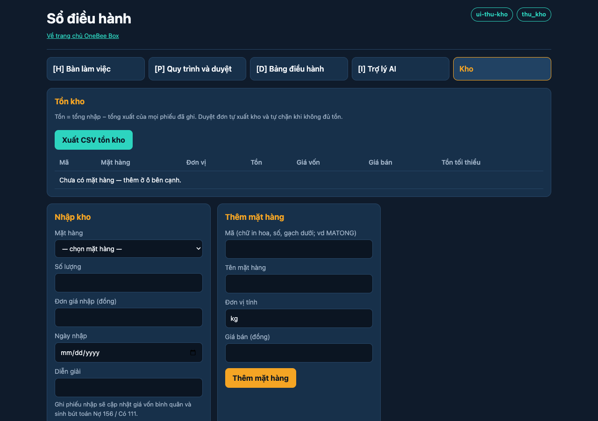
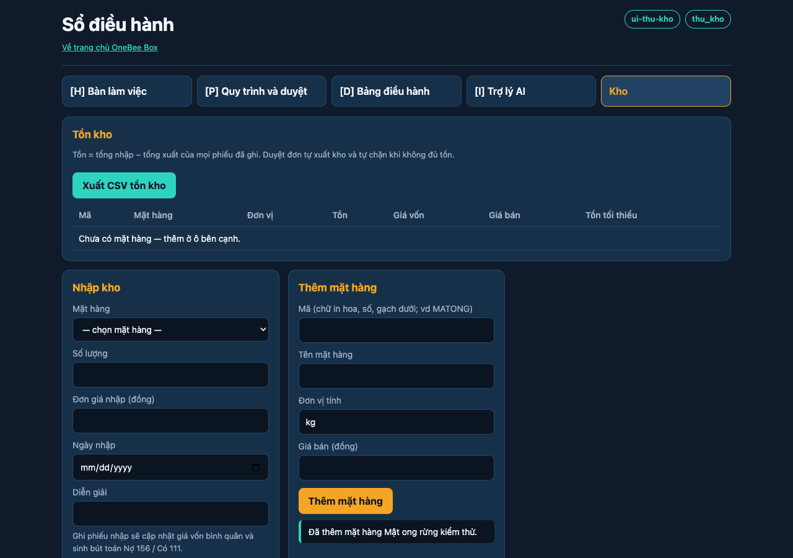
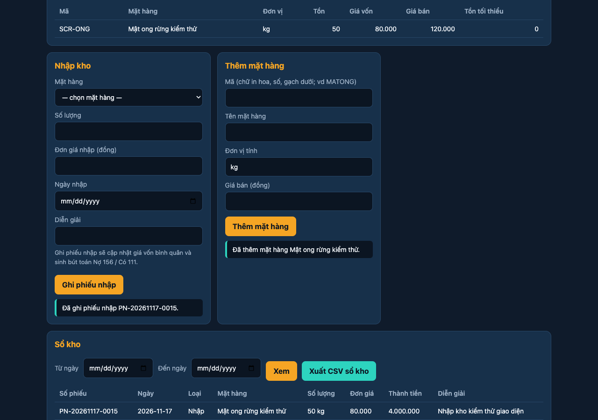
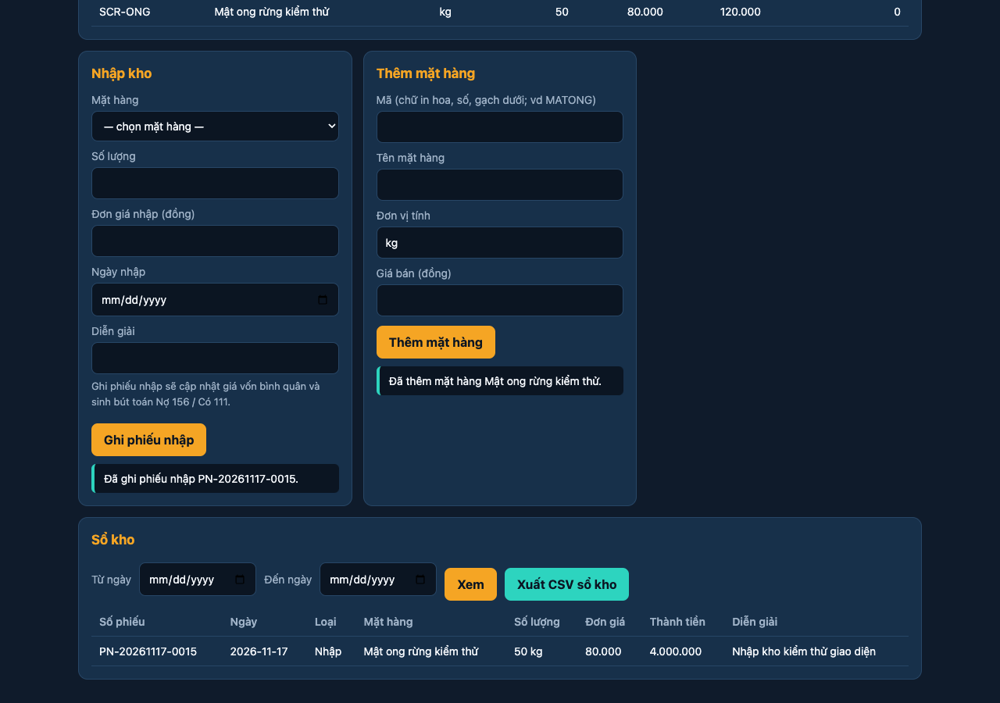
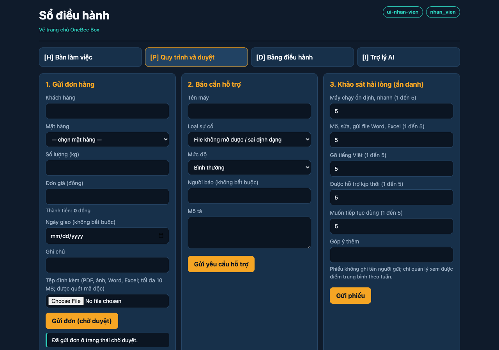
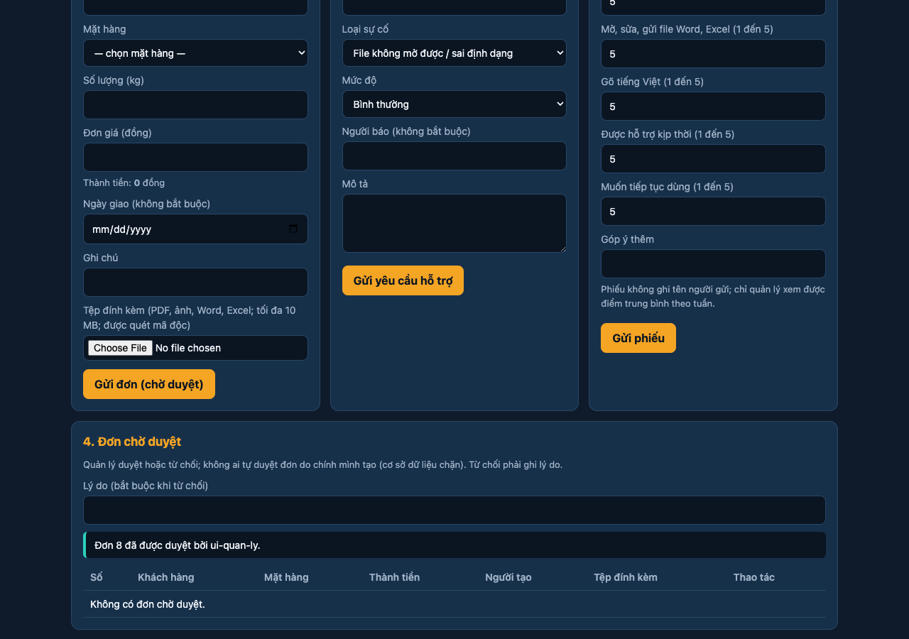
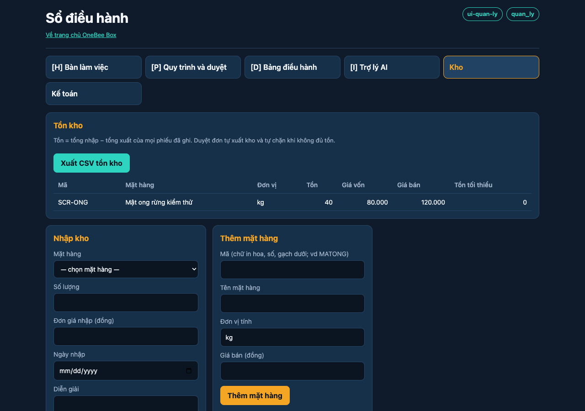
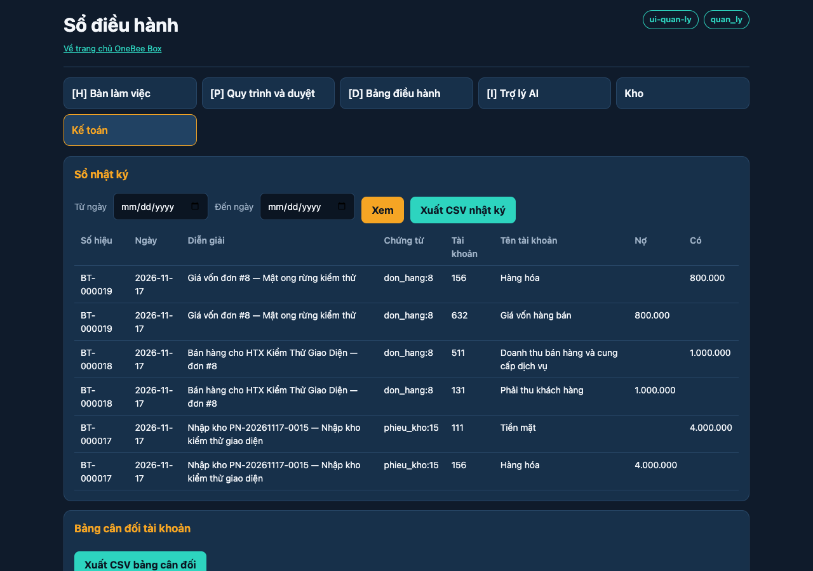
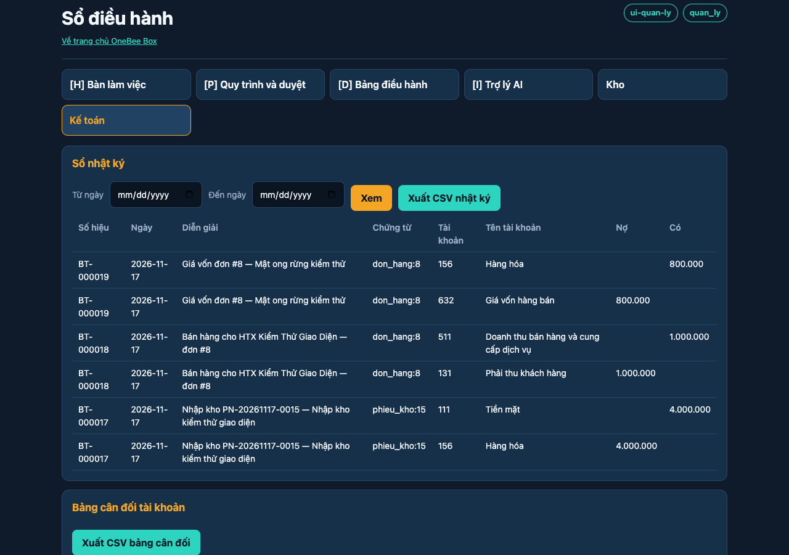
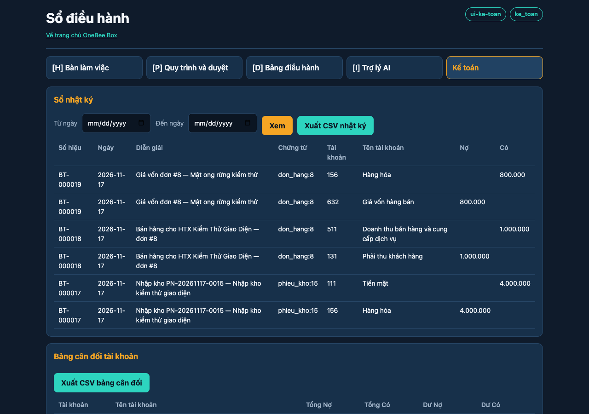

# Dùng sổ kho và sổ kế toán trên OneBee Box

Tài liệu này hướng dẫn thủ kho, kế toán và quản lý dùng hai khu **Kho** và **Kế toán** trong Sổ điều hành
(`https://box.<mã đơn vị>.onebee.internal/so-dieu-hanh/`).

## 1. Ai làm được gì

| Vai trò | Xem tồn kho | Nhập kho, thêm mặt hàng | Duyệt đơn | Xem sổ kế toán | Xuất CSV |
|---|---|---|---|---|---|
| `nhan_vien` | Không (chỉ thấy danh sách mặt hàng khi gửi đơn) | Không | Không | Không | Không |
| `thu_kho` | Có | Có | Không | Không | Sổ kho, tồn kho |
| `ke_toan` | Có (chỉ đọc) | Không | Không | Có | Sổ kho, nhật ký, cân đối |
| `quan_ly` | Có | Có | Có | Có | Tất cả |

Tạo tài khoản (trên Box, cần quyền quản trị):

```bash
sudo onebee-box them-nguoi thu-kho-1 thu_kho
sudo onebee-box them-nguoi ke-toan-1 ke_toan
```

Hai nhóm này đăng nhập hai lớp như kỹ thuật và quản lý: lần đầu tự ghi danh mã TOTP trên điện thoại,
mã xác minh lấy bằng `sudo onebee-box ma-xac-nhan`.

## 2. Quy trình bán hàng đầy đủ

### Bước 1 — Thủ kho tạo thẻ kho (làm một lần cho mỗi mặt hàng)

Khu **Kho** → ô *Thêm mặt hàng*: nhập mã (chữ in hoa, số, gạch dưới — ví dụ `MATONG`), tên, đơn vị tính, giá bán.

### Bước 2 — Thủ kho nhập kho

Khu **Kho** → ô *Nhập kho*: chọn mặt hàng, số lượng, đơn giá nhập, ngày, diễn giải → **Ghi phiếu nhập**.

Hệ quả tự động, trong cùng một giao dịch:

- Sinh phiếu nhập `PN-…`, tồn kho tăng.
- Giá vốn của mặt hàng cập nhật theo **bình quân gia quyền**.
- Sinh bút toán **Nợ 156 / Có 111** đúng giá trị nhập.

### Bước 3 — Nhân viên gửi đơn hàng

Khu **[P]** → *Gửi đơn hàng*: chọn khách hàng, chọn mặt hàng trong danh mục, số lượng, đơn giá.
Đơn vào trạng thái `CHO_DUYET`.

### Bước 4 — Quản lý duyệt đơn

Khu **[P]** → *Đơn chờ duyệt* → **Duyệt**.

Hệ quả tự động, cùng giao dịch với thao tác duyệt:

- Sinh phiếu xuất kho `PX-…` cho đúng số lượng và mặt hàng của đơn.
- Sinh bút toán doanh thu **Nợ 131 / Có 511** = thành tiền của đơn.
- Sinh bút toán giá vốn **Nợ 632 / Có 156** = số lượng × giá vốn bình quân.
- Nếu tồn không đủ, việc duyệt **bị chặn**, đơn vẫn `CHO_DUYET`, màn hình báo:
  *Không đủ tồn kho: mặt hàng "…" còn …, cần …*. Thủ kho nhập thêm rồi quản lý duyệt lại.
- Nếu mặt hàng của đơn chưa có trong danh mục, màn hình báo *Mặt hàng chưa có trong danh mục kho* —
  thủ kho thêm thẻ kho rồi duyệt lại.

### Bước 5 — Kế toán xem sổ và xuất dữ liệu

Khu **Kế toán** (và khu **Kho** ở chế độ chỉ đọc để đối chiếu tồn với tài khoản 156):

- *Sổ nhật ký*: từng dòng Nợ/Có, số hiệu `BT-…`, chứng từ gốc (`don_hang:<id>` hoặc `phieu_kho:<id>`),
  lọc theo khoảng ngày. Doanh thu do CSDL tự tính bằng số lượng × đơn giá; đơn ghi lệch thành tiền sẽ bị chặn khi duyệt.
- *Bảng cân đối tài khoản*: tổng Nợ, tổng Có, dư Nợ hoặc dư Có của từng tài khoản.
- Nút **Xuất CSV nhật ký** và **Xuất CSV bảng cân đối**: tệp UTF-8 có BOM, phân cách dấu `;`, số thập phân
  dùng dấu phẩy — mở trực tiếp bằng LibreOffice Calc hoặc Excel, tiếng Việt không lỗi font.

Khu **Kho** có **Xuất CSV tồn kho** và **Xuất CSV sổ kho** (lọc theo khoảng ngày trước khi xuất).

## 3. Tài khoản kế toán đang dùng

Hệ thống tài khoản tối thiểu theo Thông tư 133, đủ cho một HTX/hộ kinh doanh bán hàng:

| Tài khoản | Tên | Dùng ở đâu |
|---|---|---|
| 111 | Tiền mặt | Có khi nhập kho trả tiền mặt |
| 112 | Tiền gửi ngân hàng | Chưa tự động dùng (chờ phiếu thu/chi riêng) |
| 131 | Phải thu khách hàng | Nợ khi bán hàng |
| 152 | Nguyên liệu, vật liệu | Chưa tự động dùng |
| 156 | Hàng hóa | Nợ khi nhập, Có khi xuất bán |
| 331 | Phải trả người bán | Chưa tự động dùng |
| 411 | Vốn đầu tư của chủ sở hữu | Chưa tự động dùng |
| 511 | Doanh thu bán hàng | Có khi bán hàng |
| 632 | Giá vốn hàng bán | Nợ khi bán hàng |
| 642 | Chi phí quản lý | Chưa tự động dùng |

Mọi bút toán do hệ thống sinh đều cân Nợ = Có; CSDL từ chối bút toán lệch hoặc dòng ghi cả hai bên.

## 4. Câu hỏi thường gặp

**Muốn sửa một phiếu nhập đã ghi?** Chưa hỗ trợ sửa/xóa chứng từ (giữ nguyên dấu vết kế toán). Cách xử lý tạm:
ghi một phiếu nhập/xuất điều chỉnh qua giao diện khi có tính năng, hoặc nhờ quản trị CSDL — báo trước khi làm.

**Bán trước, nhập sau được không?** Không. Hệ thống chặn duyệt khi thiếu tồn để số liệu kế toán luôn khớp kho.
Nhập kho trước rồi duyệt.

**Đơn của nhân viên dùng mặt hàng gõ tay (đơn cũ) thì sao?** Khi duyệt, hệ thống khớp tên mặt hàng với danh mục
(không phân biệt hoa thường). Chưa có thẻ kho thì chặn duyệt và báo rõ.

**Xuất CSV mở bằng Excel bị dồn một cột?** Dùng LibreOffice Calc (mặc định trên máy OneBee) hoặc trong Excel chọn
*Data → From Text/CSV*, phân cách `;`, encoding UTF-8.

**Ai xóa được chứng từ?** Không ai qua giao diện. Quyền ghi chứng từ chỉ có trong hàm CSDL, không cấp trực tiếp cho
vai trò nào; xóa dữ liệu phải làm bằng quản trị CSDL trên Box.

**Số liệu có nhảy khi hai người duyệt cùng lúc?** Không: CSDL khóa dòng thẻ kho khi xuất nên hai giao dịch xếp hàng,
người sau thấy tồn đã trừ của người trước.

## 5. Giới hạn đã biết

- Một kho duy nhất (chưa quản lý nhiều kho/địa điểm).
- Giá vốn bình quân gia quyền, chưa có giá vốn theo lô/FIFO, chưa theo hạn dùng.
- Chưa có khóa sổ cuối kỳ, chưa có tờ khai thuế và kết chuyển.
- Chưa tự động ghi phiếu thu tiền (111/112/131) khi khách trả tiền.
- **Một người chỉ giữ một vai trò**: người vừa làm thủ kho vừa làm kế toán chỉ nhận vai trò ưu tiên cao hơn (`ke_toan`),
  nên không nhập kho được. Với HTX ít người, hãy lập hai tài khoản riêng, hoặc để quản lý kiêm cả hai việc.
- Đơn đã duyệt mà bị chuyển sang `TU_CHOI` không tự sinh bút toán đảo; cần điều chỉnh tay (chưa có màn hình điều chỉnh).
- Xuất CSV tối đa 20.000 dòng mỗi lần; quá mức đó phải thu hẹp khoảng ngày (màn hình báo rõ nếu chạm trần).
- Nhân viên chỉ thấy mã, tên, đơn vị, trạng thái mặt hàng — không thấy giá vốn/giá bán trong danh mục.

## 6. Ảnh chụp giao diện

Ảnh chụp từ Box test ngày 17/11/2026 (dữ liệu kiểm thử, tài khoản `ui-*`).

| Thủ kho: tồn kho, nhập kho, thẻ kho | Thêm mặt hàng |
|---|---|
|  |  |

| Đã nhập 50 kg | Xuất CSV |
|---|---|
|  |  |

| Nhân viên gửi đơn | Quản lý duyệt đơn |
|---|---|
|  |  |

| Tồn còn 40 kg sau khi duyệt | Sổ nhật ký kế toán |
|---|---|
|  |  |

| Bảng cân đối tài khoản | Kế toán đăng nhập (chỉ thấy khu Kế toán) |
|---|---|
|  |  |
