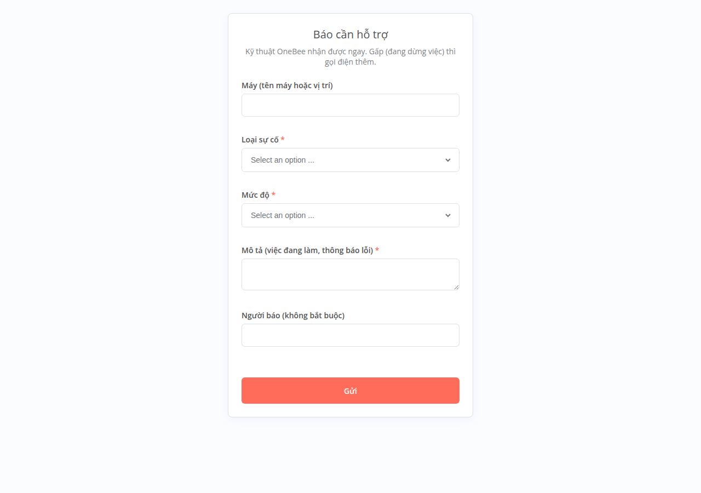

# Hướng dẫn dùng Trợ lý AI và quy trình tự động (OneBee Box v0.2)

## 1. Trợ lý AI (dịch vụ Trợ lý AI trên Box)
- Trợ lý trả lời bằng tiếng Việt, chạy hoàn toàn trên Box (Gemma 4 qua Ollama), tra kho tri thức pháp lý và mẫu soạn văn bản
  trong PostgreSQL. Không có giao diện web riêng: người dùng hỏi bằng lệnh `hoi` trên máy trạm (mục 2), luôn qua HTTPS trên tên
  `box.<mã>.onebee.internal`; bật HTTPS xong mới dùng được Trợ lý.
- **Mỗi nhân viên một khóa riêng** (không dùng chung): quản trị chạy trên Box
  `sudo onebee-box them-nguoi <tên> <nhóm>` — lệnh in **mật khẩu tạm và khóa Trợ lý AI đúng MỘT lần** để đưa trực tiếp cho người đó.
  Cấp lại khóa: `sudo onebee-box cap-khoa-hoi <tên>` (khóa cũ mất hiệu lực ngay). Thu hồi: `sudo onebee-box go-khoa-hoi <tên>`
  hoặc `sudo onebee-box xoa-nguoi <tên>`. Khóa chỉ mở đúng hai đường hỏi đáp và tóm tắt, không mở API quản trị nào khác.
- **Lịch sử hỏi đáp** lưu trong bảng `onebee.lich_su_hoi_ai`: mỗi người chỉ đọc được dòng của chính mình; người có quyền root
  trên Box vẫn đọc được CSDL và bản sao lưu (xem "Quyền riêng tư" trong hướng dẫn cài Box). Đây là kiểm soát quyền, **không phải mã hóa**.
- **Kho tri thức:** `sudo onebee-box nap-tri-thuc` nạp Nghị định 30/2020/NĐ-CP, Luật Hợp tác xã 2023, 4 mẫu soạn văn bản
  và tài liệu đơn vị tự thêm trong `/srv/onebee/knowledge`; chạy lại cập nhật đúng đoạn cũ, không tạo bản trùng.
- **Lời dặn tiếng Việt** cố định (không bịa số liệu, hướng dẫn máy OneBee, biết ngày hôm nay, được nhờ soạn văn bản thì soạn ngay,
  chỗ thiếu để [trong ngoặc vuông]). Câu trả lời luôn kèm dòng nhắc kiểm tra lại và danh sách nguồn tham khảo khi tra được tri thức.
- Model đang dùng: `gemma4:e2b-it-qat` (Gemma 4 của Google, giấy phép Apache-2.0, tải 4,3 GB) — bản Gemma nhẹ nhất vượt
  ngưỡng chất lượng khi chấm 40 câu × 3 lần (xem ADR 0003, `reports/ai/`). Model nhúng kho tri thức:
  `nomic-embed-text:v1.5`. Đổi model: sửa `onebee_box_ai_model` (hoặc `onebee_box_ai_model_nhung`) trong
  `box/ansible/group_vars/all.yml` rồi chạy lại bộ cài. **Tốc độ trên máy Box thật chưa đo.**

## 2. Lệnh `hoi` trên máy trạm
```bash
hoi cách xuất file PDF
hoi "tóm tắt đoạn này thành 3 ý" < bien-ban.txt
hoi --tom-tat < bien-ban.txt        # gọi đường tóm tắt của Trợ lý
```
Bật cho 1 máy: trên Box chạy `sudo onebee-box them-may <tên-máy>` → dán kết quả vào máy trạm tại
`/etc/onebee/may-tram.env` → chạy lại bộ cài OneBee OS trên máy trạm (vừa bật sao lưu vừa bật `hoi`).
`hoi` chỉ gửi qua `https://box.<mã>.onebee.internal/ai/…`, ghim CA riêng của Box; gặp địa chỉ `http://` thì từ chối, không gửi khóa.

**Mỗi nhân viên dùng khóa riêng do quản trị cấp** (thu hồi được từng người). Làm một lần trên máy:
```bash
hoi --dan-khoa    # dán khóa obk-… quản trị vừa cấp; hoi thử khóa trước khi lưu
hoi --dang-xuat   # xóa khóa của bạn khỏi máy này
```
Khóa lưu ở `~/.config/onebee/hoi-khoa` (chỉ chính tài khoản Linux đó đọc; máy nhiều người thì mỗi người một khóa).
**Thu hồi**: quản trị chạy `sudo onebee-box go-khoa-hoi <tên>` → khóa mất hiệu lực (`hoi` báo "đã bị thu hồi").
**Chuyển tiếp**: nhân viên chưa có khóa riêng thì `hoi` tạm dùng khóa chung của máy (`/etc/onebee-hoi.conf`, **mọi tài khoản trên máy đọc được**) kèm nhắc.
Khi mọi nhân viên đã dùng khóa riêng: đặt `onebee_box_hoi_khoa_may: false` trong `box/ansible/group_vars/all.yml`, chạy lại bộ cài, `sudo onebee-box dong-bo-may --tat-ca`,
rồi `sudo onebee-box go-khoa-hoi-may`. Từ đó `them-may` thôi cấp khóa theo máy. Cấu hình địa chỉ ở `/etc/onebee-hoi.conf`;
mật khẩu sao lưu ở `/etc/onebee/` chỉ root đọc được.

**Xoay khóa:** `sudo onebee-box xoay-khoa --box` đổi mật khẩu giám sát, CSDL, mật khẩu soạn luồng và khóa webhook động cơ quy trình,
khóa phiên đăng nhập một lần rồi chạy lại bộ cài; khóa Trợ lý AI của từng người cấp lại bằng `sudo onebee-box cap-khoa-hoi <tên>`.
Mật khẩu trình soạn luồng do bộ cài quản lý — **không đổi trên giao diện Node-RED**.

## 3. Quy trình tự động (Node-RED, `https://box.<mã>.onebee.internal/quy-trinh/` sau đăng nhập một lần)
Tài khoản trình soạn: `kythuat`, mật khẩu dòng `quy-trinh-soan-luong` trong `sudo onebee-box in-khoa` (nhóm `ky_thuat` đăng nhập một lần hai lớp trước).

| Quy trình | Chạy khi | Kết quả |
|---|---|---|
| Báo cáo sao lưu | Sau mỗi lần sao lưu 23:00 (và `onebee-box email-thu`) | Email ĐẠT/LỖI + tình trạng từng máy trạm (sao lưu, cập nhật, ổ đĩa, mất liên lạc) |
| Nhắc hạn nộp báo cáo, thuế | 7:30 hằng ngày | Email khi còn 7, 3, 1 ngày và đúng ngày hạn |
| Tóm tắt văn bản PDF | Nhân viên mở mục Tóm tắt văn bản của Sổ điều hành (giai đoạn 4) | Bản tóm tắt 3/5/7 ý (AI trên Box) |
| Nhập đơn hàng | Nhân viên mở mục Nhập đơn hàng của Sổ điều hành (giai đoạn 4) | Ghi thẳng CSDL `onebee.don_hang`, chờ quản lý duyệt |
| Tổng hợp đơn hàng | 17:00 hằng ngày | Email số đơn, tổng tiền, theo mặt hàng |
| Báo cần hỗ trợ | Nhân viên mở menu "Báo cần hỗ trợ" hoặc `/form/onebee-ho-tro` | Ghi sổ + email kỹ thuật (GẤP ghi ở tiêu đề) |
| Xử lý yêu cầu hỗ trợ | Kỹ thuật mở `/form/onebee-xu-ly` (tài khoản `kythuat`) | Ghi cách xử lý, số phút |
| Khảo sát hài lòng | Gửi link `/form/onebee-khao-sat` (ẩn danh) | Ghi phiếu; `onebee-box bao-cao-tuan` tổng hợp |
| Nhận tình trạng máy trạm | Máy trạm gửi mỗi giờ | Lưu tình trạng cho `onebee-box may-tram` và email báo cáo 23:00 ([quan-ly-may-tram.md](quan-ly-may-tram.md)) |



Biểu mẫu đòi tài khoản `nhanvien`, mật khẩu dòng `bieu-mau-nhanvien` trong `in-khoa` (biểu mẫu xử lý: tài khoản `kythuat`, dòng `bieu-mau-kythuat`).
Sổ hỗ trợ và khảo sát nằm ở `/srv/onebee/ho-tro/` trên Box (chỉ root đọc, có trong bản sao lưu Box).

### Lịch nhắc hạn
Sửa `onebee_box_lich_han` trong `box/ansible/group_vars/all.yml` rồi chạy lại bộ cài. Lịch mặc định là **bản mẫu**:
- Thuế — Điều 44 Luật Quản lý thuế 38/2019/QH14: tờ khai tháng ngày 20 tháng sau; tờ khai quý ngày cuối tháng đầu quý sau;
  quyết toán năm ngày cuối tháng thứ 3. Luật Quản lý thuế 108/2025/QH15 (hiệu lực 1/7/2026) **chưa được đối chiếu**.
- BHXH — Điều 34 khoản 4 điểm a Luật BHXH 2024: đóng hằng tháng chậm nhất ngày cuối cùng của tháng tiếp theo.
- **Kế toán kiểm lại theo quy định hiện hành và cách khai của đơn vị.** Hạn trùng ngày nghỉ được lùi sang ngày làm việc kế tiếp
  (email chỉ nhắc theo ngày trên lịch, không tự lùi).

## 4. Cấu hình email (làm 1 lần)
1. Khai báo `onebee_box_email` trong `box/ansible/group_vars/all.yml`: `smtp_host`, `smtp_port`, `smtp_user`, `gui_tu`, `nhan`.
   (Gmail/Google Workspace: `smtp.gmail.com`, cổng 587, cần "mật khẩu ứng dụng".)
2. `sudo onebee-box dat-mat-khau-email` (nhập mật khẩu, không hiện trên màn hình).
3. Chạy lại `sudo ./box/onebee-box-install.sh`.
4. `sudo onebee-box email-thu` → kiểm tra hộp thư (cả mục Spam).

## Giới hạn (v0.2)
- AI có thể sai; model tạm chưa chấm trên máy Box thật.
- Tóm tắt chỉ đọc PDF có chữ (không đọc ảnh scan); tối đa 30 trang, cắt bớt nếu quá dài.
- Email đi qua máy chủ thư của đơn vị (ra Internet) và **có chứa dữ liệu kinh doanh** (tên khách, số lượng, số tiền trong
  email tổng hợp đơn hàng). Không gửi văn bản PDF hay câu hỏi AI qua email.
- Chưa kiểm trên máy thật; kiểm tự động trong container (xem `tests/README.md` — kết quả lần chạy gần nhất ghi trong changelog).
- Luồng mẫu chỉ là bản khởi tạo: bộ cài không ghi đè luồng đã sửa trong trình soạn Node-RED — muốn sửa riêng thì
  nhân bản quy trình rồi sửa bản sao.
- Node-RED tắt kiểm bản mới, danh mục gói và thống kê; không cài thêm gói từ Internet (Box có thể không có mạng).
