# Cài OneBee OS từ A đến Z — cho người không chuyên

Tài liệu này dẫn từng bước, từ lúc chuẩn bị máy đến khi nhân viên dùng được. Không cần biết Linux: chỉ cần **gõ (hoặc dán) đúng các lệnh
trong khung xám**, mỗi lần một khung, và đọc dòng kết quả cuối cùng.

> Lưu ý trung thực: bộ cài đã chạy đạt toàn bộ kiểm thử tự động trong máy ảo/container (Docker), nhưng **chưa được cài trên máy thật tại đơn vị nào**.
> Hãy làm thử trên máy ảo hoặc máy cũ trước ([thu-nghiem-tren-may-ao.md](thu-nghiem-tren-may-ao.md)), và gặp lỗi thì gửi file nhật ký cho kỹ thuật OneBee.

---

## Phần 0. Hiểu nhanh: OneBee OS gồm 2 loại máy

| Máy | Là gì | Bao nhiêu máy |
|---|---|---|
| **OneBee Box** | Máy chủ nhỏ đặt tại đơn vị, bật suốt ngày đêm. Chứa Trợ lý AI tiếng Việt (chạy tại chỗ, không gửi dữ liệu ra ngoài), đăng nhập một lần (SSO), Sổ điều hành H-P-D-I & sổ kho/kế toán, kho tệp có kiểm dịch, thư mục chung & thư mục phòng ban, kho sao lưu tự động, tự động gửi email | **1 máy** |
| **Máy trạm OneBee OS** | Máy văn phòng của nhân viên (Linux Mint + bộ cài OneBee): gõ tiếng Việt, mở file Word/Excel, gắn sẵn thư mục phòng ban (`/mnt/phongban`), cài sẵn phần mềm của phòng, tự sao lưu lên Box, hỏi Trợ lý AI, kết nối từ xa qua Tailscale khi đi công tác | Mỗi nhân viên 1 máy |

### Hình 1. Sau khi cài xong, văn phòng của bạn trông như thế này
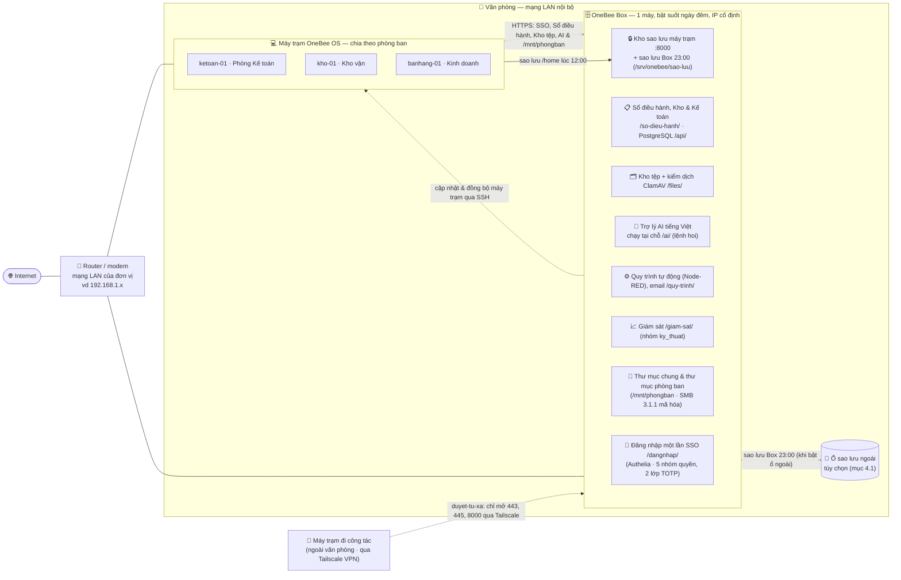
Điểm cần nhớ: dữ liệu và câu hỏi gửi Trợ lý AI **chỉ đi trong mạng LAN của văn phòng** (hoặc qua đường hầm Tailscale mã hóa cho máy đi công tác đã được Box duyệt — không mở cổng nào trên router). Internet chỉ dùng để tải phần mềm, cập nhật và gửi email báo cáo.

**Thứ tự làm:** Phần 1 (chuẩn bị) → Phần 2–3 (cài Box) → Phần 4 (sao lưu Box, in khóa) → Phần 5–6 (tạo phòng ban, cài từng máy trạm) → Phần 7 (kiểm tra) → Phần 8.3 (bật HTTPS & tạo tài khoản SSO để mở AI, Sổ điều hành, Kho tệp) → Phần 8.1–8.2 & 9 (email, SSH khóa, máy đi công tác).

### Hình 2. Các bước cài, theo thứ tự
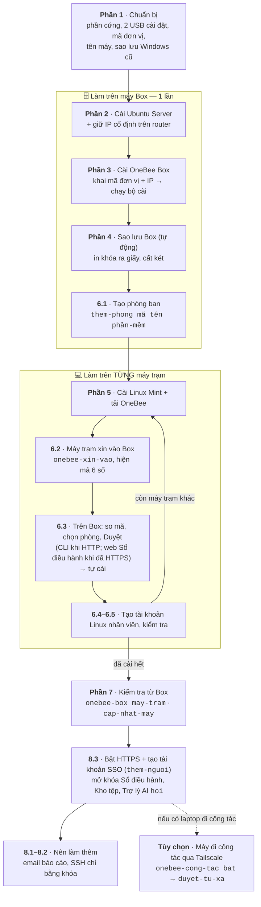

### Vài điều cần biết trước khi gõ lệnh
- **Mở cửa sổ lệnh (Terminal)**: trên máy trạm Linux Mint bấm **Ctrl + Alt + T**. Trên Box (Ubuntu Server) thì màn hình đen chính là cửa sổ lệnh.
- **Dán lệnh** vào Terminal: **Ctrl + Shift + V** (không phải Ctrl + V). Gõ xong bấm **Enter**.
- Lệnh có chữ `sudo` sẽ hỏi **mật khẩu của tài khoản bạn đang dùng**. Khi gõ mật khẩu, màn hình **không hiện gì** (kể cả dấu *) — cứ gõ rồi Enter.
  Trên máy trạm OneBee, **bấm Super + Space sang tiếng Anh trước khi gõ mật khẩu** (khay hệ thống hiện `en`): cửa sổ lệnh không biết đó là mật khẩu,
  bộ gõ Telex sẽ biến `ee`, `aa`, `s`, `f`… thành chữ có dấu và báo sai mật khẩu. Hộp thoại **Yêu cầu Xác thực** cũng vậy.
- Chỗ nào ghi trong dấu `< >` (ví dụ `<ip-box>`) là **bạn phải thay** bằng giá trị thật, và **bỏ cả dấu `< >`**.
- Sửa file bằng `nano`: dùng phím mũi tên để di chuyển, sửa chữ như bình thường. **Lưu: Ctrl + O rồi Enter. Thoát: Ctrl + X.**

---

## Phần 1. Chuẩn bị (làm 1 lần)

### 1.1. Phần cứng
| | OneBee Box | Mỗi máy trạm |
|---|---|---|
| CPU | 64-bit, 4 nhân trở lên | 64-bit (máy 32-bit **không** cài được) |
| RAM | **Tối thiểu 8 GB** (Trợ lý AI chiếm khoảng 4 GB). Nên 16 GB cho thoải mái *(khuyến nghị, chưa đo trên máy thật)* | 4 GB trở lên |
| Ổ cứng | 120 GB trở lên (chứa thư mục chung + sao lưu của các máy trạm) | 40 GB trở lên |
| Thêm | *(Tùy chọn, khuyến nghị)* **1 ổ cứng gắn ngoài riêng** để bản sao lưu Box nằm khác ổ hệ thống (mặc định Box tự sao lưu vào ổ trong, xem mục 4.1) | — |
| Mạng | Cắm dây mạng (LAN), có Internet khi cài | Có Internet khi cài |

Không cần card đồ họa. Trợ lý AI chạy được bằng CPU, chỉ trả lời chậm hơn.

### 1.2. Đồ cần chuẩn bị
- 2 USB (≥ 8 GB): một USB cài **Ubuntu Server 24.04 LTS** (tải ở ubuntu.com), một USB cài **Linux Mint 22.3 Cinnamon** (tải ở linuxmint.com).
  Ghi file cài vào USB bằng **balenaEtcher** hoặc **Rufus**.
- Tên viết tắt của đơn vị, **chữ thường, không dấu, không cách**, ví dụ HTX An Phú → `anphu`. Gọi là **mã đơn vị**.
- Đặt tên cho từng máy trạm theo bộ phận: `ketoan-01`, `kho-01`, `banhang-01`… (chữ thường, số, gạch giữa).
- Giấy và bút: bạn sẽ phải **in hoặc chép tay một số khóa bí mật** để cất két (Phần 4).

### 1.3. Máy đang chạy Windows? Sao lưu trước
Cài OneBee **xóa sạch ổ cứng**. Trước khi cài lên máy đang dùng Windows, sao lưu nguyên ổ bằng Clonezilla theo
[cai-hang-loat.md](cai-hang-loat.md) mục 1 (đường lui nếu muốn quay lại Windows), và chép riêng dữ liệu quan trọng ra ổ ngoài.
Nên thử USB Linux Mint ở chế độ "chạy thử" trước để chắc wifi, máy in, âm thanh hoạt động.

---

## Phần 2. Cài Ubuntu Server cho máy Box

1. Cắm USB Ubuntu Server, bật máy, bấm phím chọn thiết bị khởi động (thường là **F12**, **F11**, **F8** hoặc **Esc** tùy hãng) → chọn USB.
2. Làm theo trình cài:
   - Ngôn ngữ: **English** (bản Server không có tiếng Việt; không ảnh hưởng OneBee).
   - Bàn phím: English (US).
   - Kiểu cài: **Ubuntu Server** (không chọn bản "minimized").
   - Mạng: để tự nhận (DHCP). Ghi lại địa chỉ hiện ra, ví dụ `192.168.1.50`.
   - Ổ đĩa: **Use an entire disk** — chọn ổ trong của máy (**không** chọn ổ ngoài để sao lưu).
   - Tài khoản: đặt tên máy `onebee-box`, tên đăng nhập ví dụ `quantri`, và một **mật khẩu mạnh**. Ghi lại.
   - **Đánh dấu "Install OpenSSH server"** (để sau này chép cấu hình sang máy trạm).
   - Phần "Featured server snaps": **không chọn gì**.
3. Cài xong chọn **Reboot**, rút USB. Đăng nhập bằng tài khoản vừa tạo.

### 2.1. Giữ cho Box một địa chỉ IP cố định
Máy trạm tìm Box theo địa chỉ IP, nên **IP của Box không được đổi**. Xem IP hiện tại:
```bash
hostname -I
```
Số đầu tiên (ví dụ `192.168.1.50`) là IP của Box. Vào trang quản trị của **router/modem**, tìm mục **"DHCP Reservation"**, **"Gán IP tĩnh"**
hoặc **"Address Reservation"**, rồi gán IP này cho máy Box. Nếu không vào được router, nhờ bên lắp mạng làm giúp.
Về sau có **thay router** hoặc Box lỡ nhận IP khác: xem dòng "Thay router, Box đổi IP" ở [Phần 9](#phần-9-khi-có-sự-cố).

---

## Phần 3. Cài OneBee Box

### 3.1. Tải bộ cài
```bash
sudo apt update && sudo apt install -y git
git clone https://github.com/mthien07/da3-he-dieu-hanh-va-tu-dong-hoa-open-source.git onebee
cd onebee
```

### 3.2. Khai 2 thông tin bắt buộc
```bash
nano box/ansible/group_vars/all.yml
```
Tìm 2 dòng sau (gần đầu file) và điền vào giữa dấu ngoặc kép:
```yaml
onebee_box_ma_don_vi: "anphu"            # mã đơn vị ở mục 1.2
onebee_box_dia_chi: "192.168.1.50"       # IP cố định của Box ở mục 2.1
```
Lưu (**Ctrl + O**, Enter) và thoát (**Ctrl + X**).

> **Chốt 2 giá trị này trước khi cài máy trạm.** Đổi mã đơn vị hoặc IP về sau thì mọi máy trạm phải nhận lại chứng chỉ bảo mật mới
> (cách làm: dòng "Thay router, Box đổi IP" ở [Phần 9](#phần-9-khi-có-sự-cố)).

Đơn vị có **nhiều mạng** (ví dụ phòng kế toán ở `192.168.2.x`)? Trong cùng file, sửa
`onebee_box_lan_cho_phep: ["192.168.1.0/24", "192.168.2.0/24"]`. Mặc định Box chỉ cho máy **cùng mạng** với nó truy cập.

### 3.3. Chạy bộ cài
```bash
sudo ./box/onebee-box-install.sh
```
- Lần đầu sẽ **tải nhiều GB** (phần mềm + Trợ lý AI; riêng phần AI đã hơn 7 GB). Thời gian phụ thuộc tốc độ mạng: lần thử trên một mạng gia đình
  khoảng 0,2–2 MB/s mất **hơn 3 giờ**. **Cứ để máy chạy, không tắt.**
- Thành công khi thấy dòng:
  `[OneBee Box] Hoàn tất. Mở trình duyệt vào http://<ip-box>/ để xem các dịch vụ.`
- Nếu báo `LỖI: …`, đọc kỹ câu báo (thường chỉ đúng chỗ cần sửa, ví dụ "Chưa khai onebee_box_ma_don_vi"), sửa rồi **chạy lại đúng lệnh trên**.
  Chạy lại nhiều lần là an toàn. Vẫn lỗi: gửi file nhật ký trong `/var/log/onebee/` cho kỹ thuật.

Mở `http://<ip-box>/` từ máy khác trong mạng, bạn thấy trang giới thiệu Box như sau (giao diện sáng hoặc tối tự theo cài đặt của máy bạn; trên điện thoại tự xếp thành một cột):

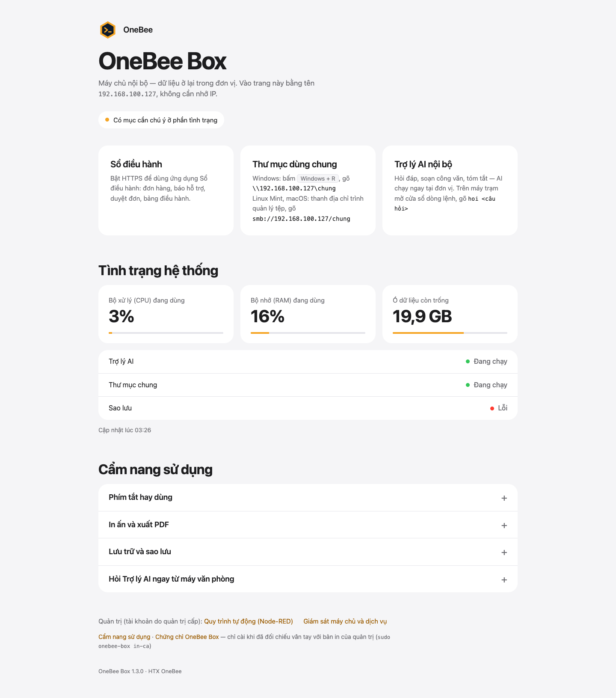

*Ảnh chụp từ một Box thử bản 1.3.0 trên máy ảo, khi Box còn bắt buộc gắn ổ sao lưu ngoài nên dòng **Sao lưu** hiện đỏ "Lỗi". Từ bản này Box tự sao lưu vào ổ dữ liệu của nó, dòng này xanh sau lần sao lưu 23:00 đầu tiên. Chế độ tối: [ảnh](anh/07-box-giao-dien-toi.png). Điện thoại: [ảnh](anh/08-box-giao-dien-dien-thoai.png).*

### 3.4. Lấy mật khẩu quản trị
```bash
sudo onebee-box in-khoa
```
Lệnh in ra mọi khóa trong `/etc/onebee-box/secrets/` và vân tay CA của Box, trong đó:
- `quy-trinh-soan-luong`: mật khẩu **trình soạn luồng** Node-RED (lớp hai, độc lập với đăng nhập một lần).
- `uptime-kuma-password`: mật khẩu **Giám sát**.
- `samba-onebee`: mật khẩu **thư mục chung**.
- `van-tay-ca-onebee-box`: vân tay CA để đối chiếu khi cài chứng chỉ lên thiết bị khác.

Tài khoản người dùng tạo bằng `sudo onebee-box them-nguoi <tên> <nhóm>` (`nhan_vien`, `thu_kho`, `ke_toan`, `quan_ly`, `ky_thuat`; bốn nhóm sau cần mã 2 lớp TOTP khi đăng nhập lần đầu, lấy mã xác minh bằng `sudo onebee-box ma-xac-nhan`). Trợ lý AI vào bằng chính tài khoản đó sau khi đăng nhập một lần, hoặc bằng khóa `obk-` cấp riêng cho từng người (chỉ in một lần lúc cấp).

Từ một máy khác cùng mạng, mở trình duyệt vào `http://<ip-box>/`. Trang giới thiệu có nút tới từng dịch vụ:

| Dịch vụ | Địa chỉ | Dùng để |
|---|---|---|
| Đăng nhập một lần (SSO) | `https://box.<mã>.onebee.internal/dangnhap/` | Đăng nhập dùng chung cho các dịch vụ web bên dưới (cần HTTPS) |
| Sổ điều hành H-P-D-I, Kho & Kế toán | `https://box.<mã>.onebee.internal/so-dieu-hanh/` | Gửi đơn kèm tệp, duyệt đơn, sổ kho/kế toán, thẻ `[M] Máy trạm` (cần HTTPS và đăng nhập một lần) |
| Kho tệp (có kiểm dịch) | `https://box.<mã>.onebee.internal/files/` | Lưu trữ, chia sẻ tệp có quét mã độc ClamAV (cần HTTPS và đăng nhập một lần) |
| Trợ lý AI | `https://box.<mã>.onebee.internal/ai/` hoặc lệnh `hoi` | Hỏi đáp, tóm tắt, soạn văn bản bằng tiếng Việt (cần HTTPS) |
| Quy trình tự động (Node-RED) | `https://box.<mã>.onebee.internal/quy-trinh/` | Email báo cáo, nhắc hạn thuế/BHXH, đơn hàng, phê duyệt |
| Giám sát | `https://box.<mã>.onebee.internal/giam-sat/` | Xem dịch vụ nào đang ngừng (chỉ nhóm `ky_thuat`) |
| Thư mục chung & thư mục phòng ban | `smb://<ip-box>/chung` · `smb://<ip-box>/pb-<mã>` | Chia sẻ file toàn đơn vị (`onebee`) và riêng từng phòng (máy trạm gắn sẵn tại `/mnt/phongban`) |

### 3.5. Nâng cấp Box lên bản mới
Box cài bằng `git clone` ở mục 3.1 thì nâng cấp như sau. Bước đầu cất bản đã khai ở mục 3.2 vì `git pull` không chạy được khi file đó đã bị sửa:
```bash
cd ~/onebee
cp box/ansible/group_vars/all.yml ~/group_vars-sao-luu.yml    # cất bản đã khai 2 dòng ở mục 3.2
git checkout -- box/ansible/group_vars/all.yml                 # trả về bản gốc để kéo bản mới
git pull --ff-only
nano box/ansible/group_vars/all.yml                            # khai lại ĐÚNG 2 dòng như cũ (xem trong ~/group_vars-sao-luu.yml)
sudo ./box/onebee-box-install.sh
```
- **Trước khi nâng cấp:** Box chạy máy ảo thì chụp snapshot; Box máy thật thì chạy `sudo onebee-box sao-luu` (Phần 4).
- Lần thử nâng cấp từ 1.2.0 lên 1.3.0 trên máy ảo mất khoảng **25 phút** (tải thêm các dịch vụ mới).
- Xong, chân trang của trang giới thiệu Box ghi đúng số phiên bản mới (ví dụ `OneBee Box 1.3.0`). Chạy `sudo onebee-box chan-doan` để xem lại tình trạng.

Trang giới thiệu Box của cùng một máy, trước và sau khi nâng cấp từ 1.2.0 lên 1.3.0 (chế độ sáng):

| Trước (1.2.0) | Sau (1.3.0) |
|---|---|
| 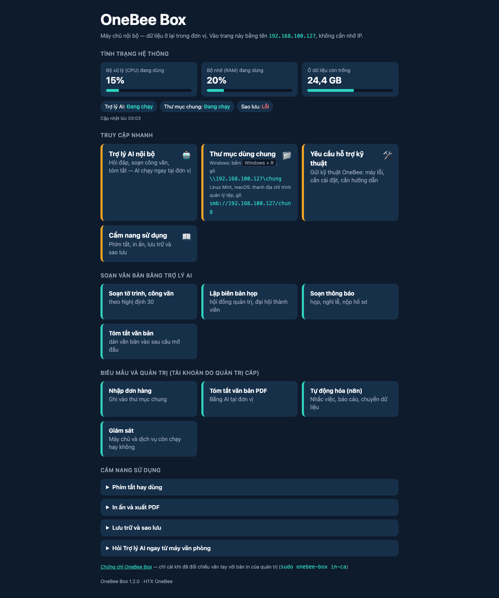 |  |

---

## Phần 4. Sao lưu của Box (tự động) và ổ ngoài (tùy chọn)

### Hình 3. Dữ liệu được sao lưu thế nào
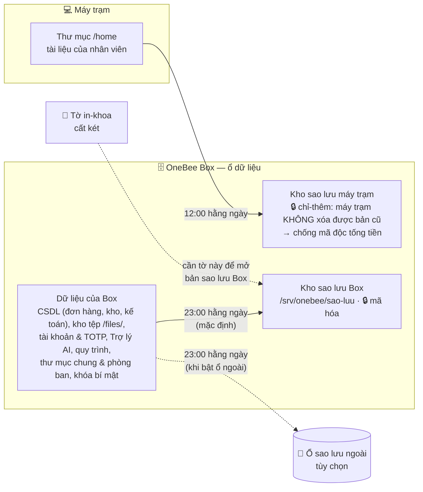
**Mặc định Box tự sao lưu mỗi đêm 23:00 vào chính ổ dữ liệu của nó** (`/srv/onebee/sao-luu`). Bộ cài đã tạo sẵn kho sao lưu,
**không cần gắn ổ nào**. Bản sao lưu cứu được khi xóa nhầm, sửa nhầm, mã độc trên máy trạm hay lỗi phần mềm.

> ⚠️ Bản sao lưu nằm **cùng ổ** với dữ liệu: **hỏng ổ Box là mất cả hai**. Đơn vị có dữ liệu quan trọng nên bật thêm **ổ sao lưu ngoài**
> (phần dưới). Ổ dữ liệu đã dùng trên 90% thì Box **dừng sao lưu** để không làm đầy ổ (trang chủ và `chan-doan` báo đỏ).

Việc cần làm (cả hai cách):
1. **In khóa ra giấy**:
   ```bash
   sudo onebee-box in-khoa
   ```
   **Chép tay hoặc chụp ảnh toàn bộ nội dung `in-khoa`, cất két.** Mất tờ khóa này thì bản sao lưu **không mở được**.
2. Thử khôi phục:
   ```bash
   sudo onebee-box khoi-phuc-thu
   ```
   Phải thấy chữ **`ĐẠT`**.

### 4.1. Ổ sao lưu ngoài (tùy chọn — phương án phụ)

Bật khi muốn bản sao lưu Box nằm **trên ổ khác**, để hỏng ổ Box vẫn còn. Khi bật, bản sao lưu 23:00 của Box ghi ra ổ ngoài thay cho ổ Box.

1. Cắm ổ ngoài vào Box. Xem tên ổ:
   ```bash
   lsblk -o NAME,SIZE,MODEL,MOUNTPOINT
   ```
   Tìm ổ có **dung lượng đúng với ổ ngoài** và **không có** `/` ở cột MOUNTPOINT (ví dụ `sdb`). **Đọc kỹ — chọn nhầm ổ sẽ xóa mất hệ thống.**
2. Định dạng ổ ngoài (**xóa sạch dữ liệu trên ổ đó**), thay `sdb` bằng tên bạn thấy:
   ```bash
   sudo mkfs.ext4 -L onebee-sao-luu /dev/sdb
   ```
3. Cho Box tự gắn ổ mỗi lần bật máy. Lệnh dưới có thêm `nofail`, nên rút ổ ra thì máy vẫn khởi động được:
   ```bash
   sudo mkdir -p /mnt/onebee-sao-luu
   echo 'LABEL=onebee-sao-luu /mnt/onebee-sao-luu ext4 defaults,nofail,x-systemd.device-timeout=10s 0 2' | sudo tee -a /etc/fstab
   sudo systemctl daemon-reload && sudo mount -a && df -h /mnt/onebee-sao-luu
   ```
   Dòng cuối phải hiện dung lượng của ổ ngoài.
4. Bật ổ ngoài: mở `box/ansible/group_vars/all.yml`, sửa dòng `onebee_box_backup_o_ngoai: false` thành `true`, rồi chạy lại bộ cài
   và tạo kho trên ổ ngoài:
   ```bash
   sudo ./box/onebee-box-install.sh
   sudo onebee-box khoi-tao
   sudo onebee-box khoi-phuc-thu
   ```
   Phải thấy chữ **`ĐẠT`**. Kho cũ trong ổ Box (`/srv/onebee/sao-luu`) vẫn giữ nguyên, mở được bằng cùng khóa `in-khoa`.

Muốn quay về mặc định: đặt lại `false` và chạy lại bộ cài.

---

## Phần 5. Cài Linux Mint cho máy trạm

> Máy đặt ở nơi khác mạng (kỹ thuật không ngồi cạnh) và vừa cài xong hệ điều hành? Người tại máy chạy một script để kỹ thuật vào cài tiếp từ xa:
> [truy-cap-tu-xa-khi-cai-may.md](truy-cap-tu-xa-khi-cai-may.md). Đây là cầu nối **tạm** khi cài, tắt khi bàn giao; khác với hỗ trợ từ xa
> `onebee-ho-tro` (người dùng bấm Cho phép mỗi lần) sau khi đã cài OneBee.

1. Cắm USB Linux Mint, khởi động từ USB (như Phần 2 bước 1) → chọn **Start Linux Mint** → trên màn hình nền bấm **Install Linux Mint**.
2. Làm theo trình cài:
   - Ngôn ngữ **Tiếng Việt**.
   - Đánh dấu cài phần mềm bên thứ ba (codec đa phương tiện).
   - **Xóa ổ đĩa và cài Linux Mint** (đã sao lưu ở mục 1.3).
   - Múi giờ **Hồ Chí Minh**.
   - Tên máy: đặt **đúng tên đã chọn ở mục 1.2** (ví dụ `ketoan-01`).
   - Tài khoản đầu tiên: dùng làm **tài khoản quản trị máy**, ví dụ `quantri`. **Không giao tài khoản này cho nhân viên** (xem Phần 6.4).
3. Cài xong khởi động lại, rút USB, đăng nhập. Mở Terminal (**Ctrl + Alt + T**) và tải bộ cài:
   ```bash
   sudo apt update && sudo apt install -y git
   git clone https://github.com/mthien07/da3-he-dieu-hanh-va-tu-dong-hoa-open-source.git onebee
   ```

---

## Phần 6. Nối máy trạm với Box và cài OneBee OS

Từ bản 2.1.0, máy trạm **tự xin vào Box qua mạng LAN**, không phải chép file cấu hình bằng tay. Mỗi máy thuộc một **phòng ban**.
Máy của phòng nào chỉ vào được **thư mục riêng** của phòng đó (phòng khác không vào được, không thấy), và được cài sẵn **phần mềm của phòng**.
Chi tiết: [phong-ban-va-may-xin-vao.md](phong-ban-va-may-xin-vao.md).

**Hình 4.** Máy trạm xin vào, Box duyệt:
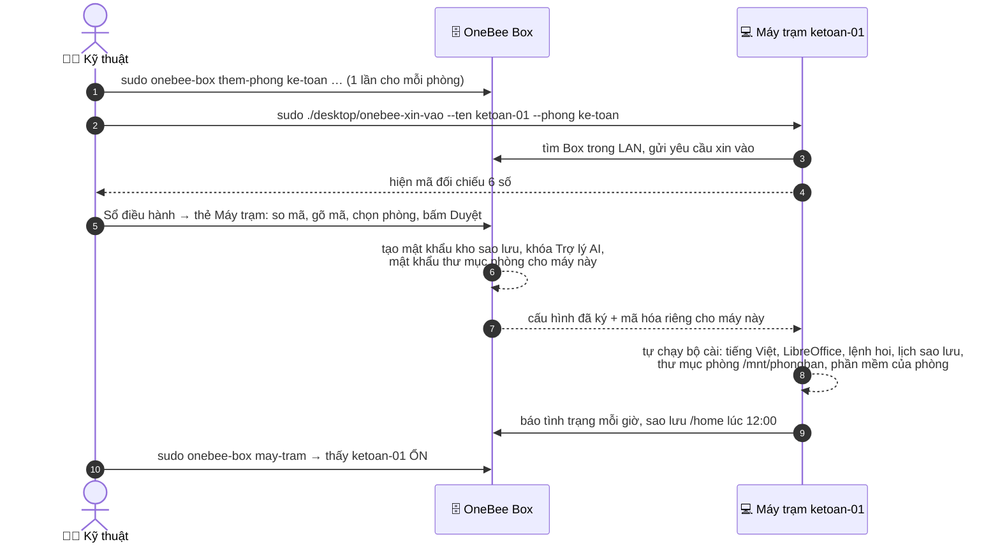

### 6.1. Trên Box: tạo phòng ban (làm 1 lần cho mỗi phòng)
```bash
sudo onebee-box them-phong ke-toan "Phòng Kế toán" gnucash
sudo onebee-box them-phong kho "Kho vận"
sudo onebee-box danh-sach-phong
```
- Mã phòng (`ke-toan`, `kho`) viết chữ thường không dấu, có thể có dấu gạch ngang. Tên trong ngoặc kép là tên hiển thị.
- Phía sau là **phần mềm riêng của phòng**: tên gói của Linux Mint/Ubuntu (ví dụ `gnucash`, `vlc`, `gimp`). Không cần thì bỏ trống.
- Đơn vị nhỏ, không chia phòng: vẫn tạo một phòng (ví dụ `them-phong van-phong "Văn phòng"`) để máy trạm dùng chung thư mục phòng.

### 6.2. Trên máy trạm: xin vào Box
Máy trạm đã cài Linux Mint và đã tải OneBee về thư mục `~/onebee` (Phần 5 bước 3). Thay `ketoan-01` bằng tên máy, `ke-toan` bằng mã phòng:
```bash
cd ~/onebee
sudo ./desktop/onebee-xin-vao --ten ketoan-01 --phong ke-toan
```
- Máy tự tìm Box trong mạng LAN và in `Đã kết nối OneBee Box <IP>`. Không tìm được thì máy hỏi IP của Box (Phần 2.1); cũng có thể ghi sẵn `--box <ip-box>`.
- Máy in **MÃ ĐỐI CHIẾU** 6 số rồi hỏi lại mã. **Chưa gõ vội**, chuyển sang bước 6.3.

### 6.3. Trên Box: so mã và duyệt
**Box đã bật HTTPS** (Phần 8.3): trên một máy đã nối Box, mở `https://box.<mã-đơn-vị>.onebee.internal/so-dieu-hanh/`, đăng nhập bằng tài khoản nhóm `quan_ly` hoặc `ky_thuat` → thẻ **[M] Máy trạm**.
1. Thấy dòng `ketoan-01` thì **so mã 6 số** trên web với mã trên màn hình máy trạm. **Khác mã thì bấm Từ chối và báo kỹ thuật**: có máy lạ trong mạng.
2. Trùng mã: gõ mã vào ô **Mã trên máy trạm**, chọn phòng, bấm **Duyệt**.

**Box chưa bật HTTPS** (máy đầu tiên của đơn vị thường như vậy): duyệt trên màn hình Box:
```bash
sudo onebee-box xin-vao                          # bảng yêu cầu: tên máy, IP, mã đối chiếu, mã yêu cầu
sudo onebee-box duyet-may <mã-yêu-cầu> ke-toan     # gõ lại mã 6 số thấy trên máy trạm để xác nhận
```
Cuối cùng quay lại **máy trạm**, gõ mã 6 số vào câu hỏi đang chờ rồi bấm Enter. Máy nhận cấu hình (ghi vào `/etc/onebee/may-tram.env`) rồi **tự chạy bộ cài OneBee OS** (mục 6.3b).

> **Cách cũ, chép file cấu hình bằng tay** (khi không dùng được cách trên):
> trên Box chạy `sudo onebee-box them-may ketoan-01 ke-toan | grep -E '^[A-Z_]+=' > ~/ketoan-01.env`.
> File này chứa mật khẩu sao lưu và khóa riêng của máy, **không gửi qua Zalo/email**.
> Trên máy trạm chép file về bằng `scp quantri@<ip-box>:ketoan-01.env /tmp/may-tram.env`, rồi
> `sudo mkdir -p /etc/onebee && sudo install -m 600 /tmp/may-tram.env /etc/onebee/may-tram.env && rm /tmp/may-tram.env`.
> Trên Box xóa bản tạm `rm ~/ketoan-01.env`, rồi chạy bộ cài như mục 6.3b.

### 6.3b. Bộ cài OneBee OS
Cách xin vào (6.2–6.3) tự chạy bước này. Cách cũ thì chạy bằng tay như dưới đây.

Máy trạm lúc này vẫn là Linux Mint nguyên bản, chưa có OneBee (ảnh chụp từ máy ảo Mint 22.3 vừa cài xong):


```bash
cd ~/onebee
sudo ./desktop/onebee-install.sh
```
Mất từ vài phút đến vài chục phút tùy mạng. Thành công khi thấy `[OneBee] Hoàn tất. Giao diện OneBee đã áp cho phiên đang mở. Khởi động lại máy để áp dụng ngôn ngữ và bộ gõ tiếng Việt.` → **khởi động lại máy**.
Lỗi: đọc câu báo, sửa, chạy lại. Nhật ký ở `/var/log/onebee/`.

**Bộ cài dừng giữa chừng vì mạng?** Nếu thấy `fatal` kèm `Could not connect to archive.ubuntu.com … connection timed out`, đó là mạng chập chờn, không phải máy hỏng. Kiểm tra mạng rồi **chạy lại đúng lệnh trên**: bộ cài làm tiếp phần còn lại (lần thử trên máy sạch: lần chạy lại mất khoảng 1 phút và thành công).

**Cách gọn hơn, không cần `git clone`:** máy chưa cần giữ thư mục `~/onebee`, dán nguyên khối này vào Terminal. Khối lệnh tải bản phát hành mới nhất, kiểm SHA256 (sai là dừng), giải nén rồi chạy bộ cài:
```bash
cd "$(mktemp -d)" && R=mthien07/da3-he-dieu-hanh-va-tu-dong-hoa-open-source \
 && V=$(curl -fsSL "https://api.github.com/repos/$R/releases/latest" | sed -n 's/.*"tag_name": *"v\([^"]*\)".*/\1/p') \
 && curl -fsSLO "https://github.com/$R/releases/download/v$V/onebee-os-$V.tar.gz" -O "https://github.com/$R/releases/download/v$V/SHA256SUMS" \
 && sha256sum -c SHA256SUMS && tar xzf "onebee-os-$V.tar.gz" && cd "onebee-os-$V" && sudo ./desktop/onebee-install.sh
```
Muốn máy xin vào Box bằng bản phát hành này thì thay lệnh cuối `sudo ./desktop/onebee-install.sh` bằng `sudo ./desktop/onebee-xin-vao --ten <tên-máy> --phong <mã-phòng>`.
Thư mục giải nén nằm trong thư mục tạm, thường bị xoá khi khởi động lại. Mục 6.5 dùng `~/onebee/tests/…`, nên nếu muốn chạy kiểm tra đó hãy dùng cách `git clone` ở trên.

### 6.4. Tạo tài khoản cho nhân viên (không có quyền quản trị)
Mở **Menu → Cài đặt hệ thống → Người dùng và nhóm** → **Thêm**, chọn loại **Tiêu chuẩn**, đặt tên và mật khẩu cho nhân viên.
Nhân viên chỉ dùng tài khoản này. Tài khoản quản trị (`quantri`) để kỹ thuật/quản lý giữ.

### 6.5. Kiểm tra máy trạm
```bash
sudo ~/onebee/tests/desktop/verify-desktop-install.sh
```
Mọi dòng phải là `PASS`, dòng cuối `KẾT QUẢ: tất cả mục đạt`. Thêm vài việc thử bằng tay:
- Bấm **Super + Space** (phím Windows + phím cách) để bật/tắt tiếng Việt, gõ Telex "Hợp tác xã" ra đúng dấu.
- Mở LibreOffice Writer, gõ vài chữ, Ctrl + S → mặc định lưu `.docx`.
- Kiểm thư mục phòng ban đã gắn sẵn tại `/mnt/phongban` (hoặc lối tắt trong menu).
- Sao lưu ngay: `sudo onebee-sao-luu` → báo sao lưu xong.
- Hỏi Trợ lý AI: `hoi cách xuất file PDF` → có câu trả lời tiếng Việt *(chỉ chạy được sau khi đã bật HTTPS và tạo tài khoản/khóa ở mục 8.3)*.
- Đăng xuất, đăng nhập bằng tài khoản nhân viên vừa tạo ở 6.4: cửa sổ **Trung tâm OneBee** phải tự mở.

**Sau khi khởi động lại, bạn sẽ thấy lần lượt** (ảnh chụp từ máy ảo Linux Mint 22.3 cài mới hoàn toàn rồi cài OneBee bằng đúng các lệnh ở trên):

1. **Màn hình khởi động (Plymouth):** logo lục giác mật ong và thanh tiến trình, nền xanh tối. Chỉ hiện vài giây.

   

2. **Màn hình đăng nhập:** nền xanh tối, chỉ có logo, tên máy ở góc trên bên trái.

   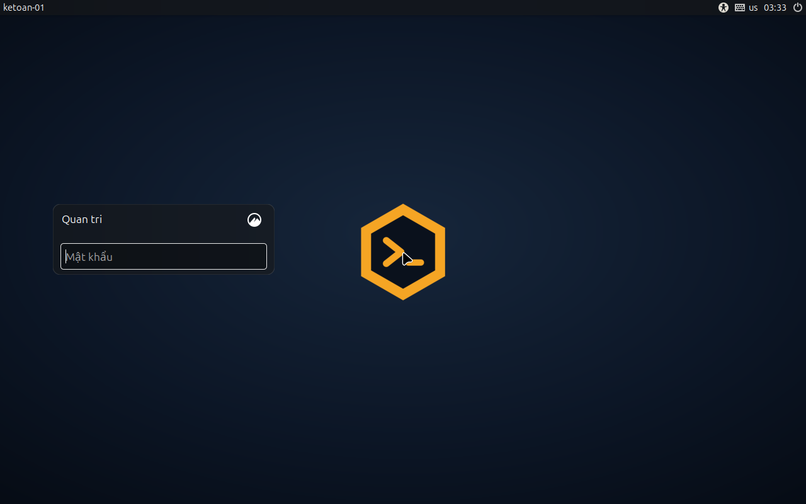

   Nếu bạn xem màn hình đăng nhập **trước khi khởi động lại** (ví dụ đăng xuất ngay sau khi cài), nó vẫn là màn hình của Mint vì đã chạy từ trước. Khởi động lại máy là hết:

   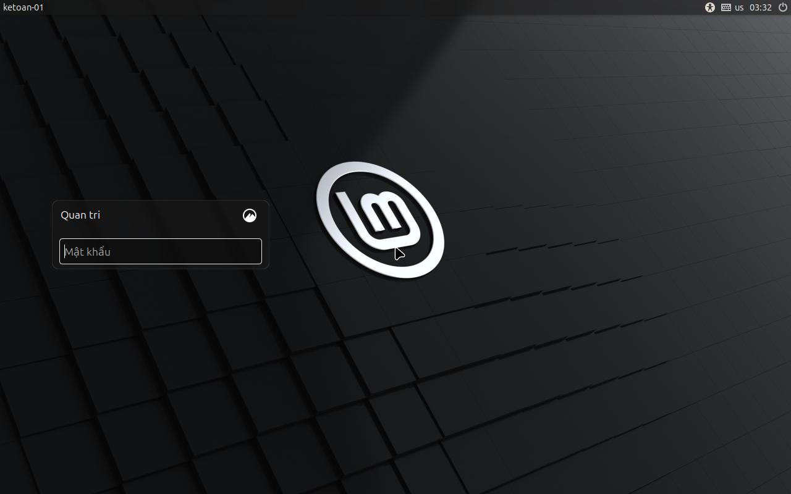

3. **Lần đăng nhập đầu tiên:** cửa sổ **Trung tâm OneBee** tự mở với bốn thẻ Bắt đầu, Phím tắt, Kiểm tra máy, Cần giúp đỡ.

   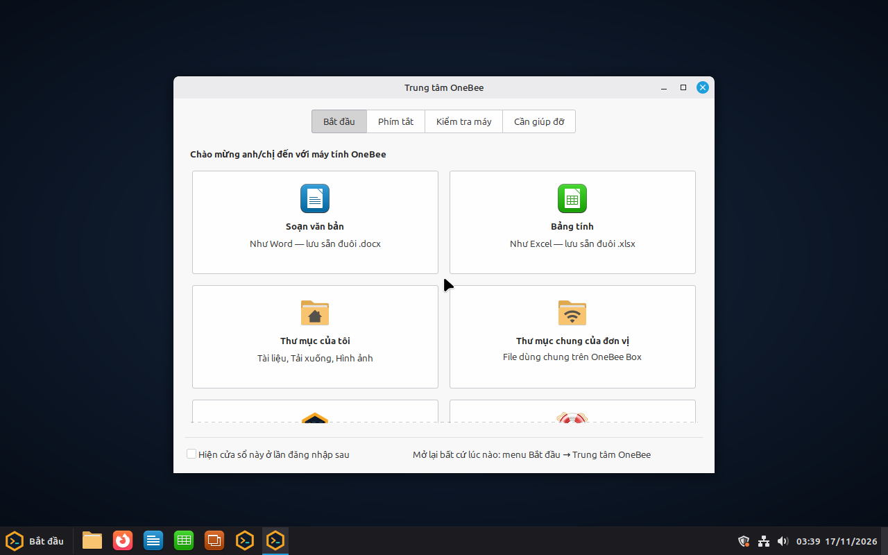

4. **Màn hình làm việc:** hình nền chỉ có logo, nút **Bắt đầu** mang logo OneBee, thanh tác vụ có sẵn Thư mục, Trình duyệt, Soạn văn bản, Bảng tính.

   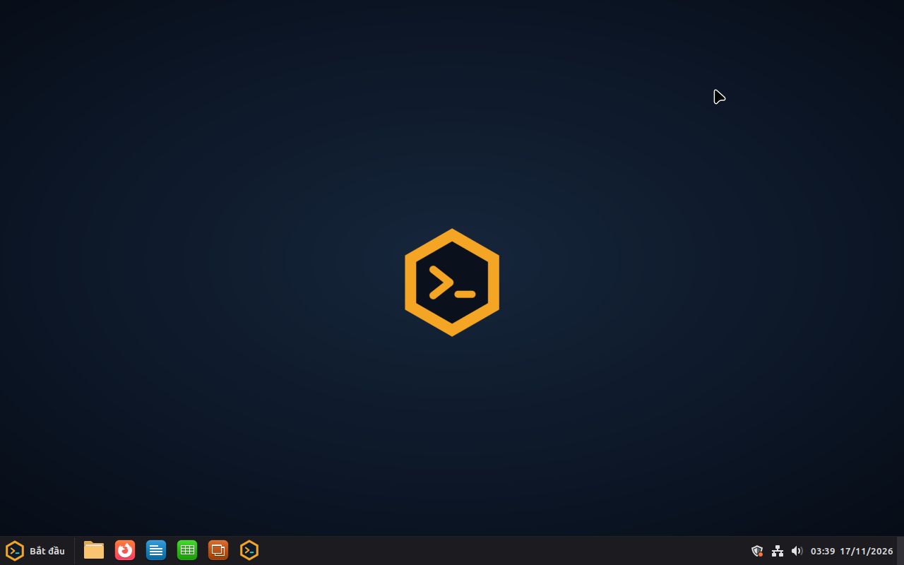

5. **Menu Bắt đầu:** bấm nút Bắt đầu ở góc dưới bên trái để mở danh sách ứng dụng.

   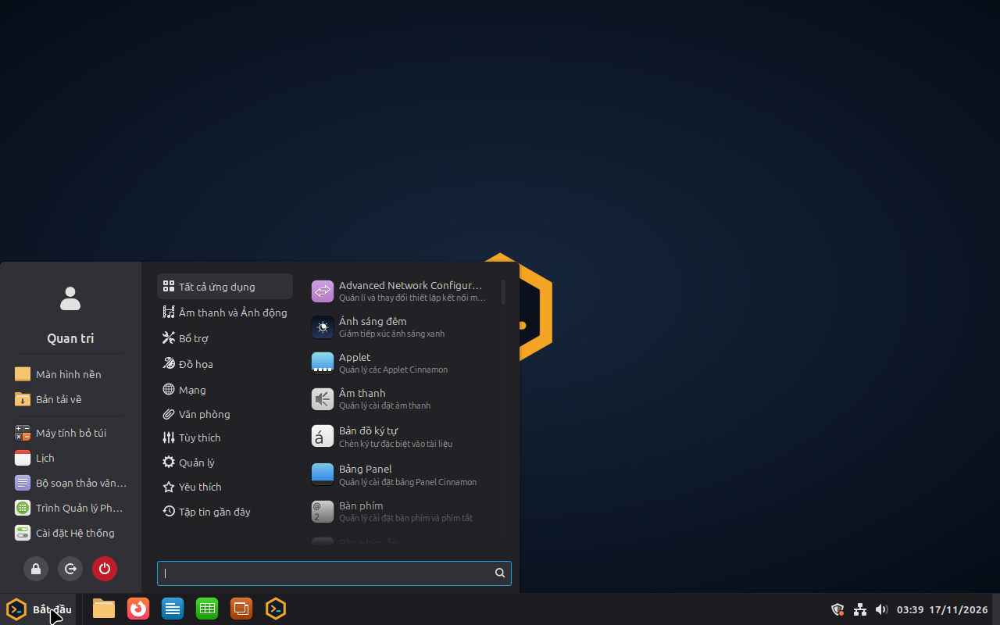

Xem cả quá trình từ lúc cài Mint đến lúc đăng nhập (ảnh động khoảng 20 giây): [may-sach-tu-dau-den-cuoi.gif](anh/may-sach-tu-dau-den-cuoi.gif).

**Làm lại Phần 5–6 cho từng máy trạm.** Có nhiều máy giống hệt nhau: xem cách nhân bản ở [cai-hang-loat.md](cai-hang-loat.md).

---

## Phần 7. Kiểm tra toàn bộ từ Box

Khoảng 5–10 phút sau khi máy trạm khởi động lại, trên Box chạy:
```bash
sudo onebee-box may-tram
```
Phải thấy tên từng máy trạm cùng tình trạng: lần sao lưu cuối, ổ trống, gói chờ cập nhật.

Cập nhật phần mềm cho máy trạm ngay từ Box. Lần đầu Box sẽ ghi nhận khóa của máy:
```bash
sudo onebee-box cap-nhat-may --tat-ca
```

| Việc hằng ngày | Ai làm | Cách |
|---|---|---|
| Sao lưu máy trạm | Tự động 12:00 (máy tắt thì làm bù khi bật) | — |
| Sao lưu Box ra ổ ngoài | Tự động 23:00 | Ổ ngoài phải luôn cắm |
| Xem tình trạng máy trạm | Kỹ thuật | `sudo onebee-box may-tram` |
| Nhân viên cần hỗ trợ | Nhân viên | Menu → **"Báo cần hỗ trợ (OneBee)"** |
| Kỹ thuật xem màn hình giúp | Nhân viên bấm **"Cho phép hỗ trợ từ xa (OneBee)"**, đọc mã cho kỹ thuật | Xem [quan-ly-may-tram.md](quan-ly-may-tram.md) |

---

## Phần 8. Nên làm thêm (tăng an toàn)

### 8.1. Email báo cáo
Để Box tự gửi email báo sao lưu, dịch vụ ngừng, yêu cầu hỗ trợ:
1. Dùng một hộp thư Gmail/Google Workspace riêng cho Box. Bật xác minh 2 bước, rồi tạo **"Mật khẩu ứng dụng"** (App password) trong tài khoản Google.
2. Trên Box:
   ```bash
   cd ~/onebee && nano box/ansible/group_vars/all.yml
   ```
   Trong mục `onebee_box_email`, điền:
   - `smtp_host: "smtp.gmail.com"`, giữ `smtp_port: 587`.
   - `smtp_user`: địa chỉ Gmail đó.
   - `gui_tu: "OneBee Box <địa-chỉ-gmail>"`.
   - `nhan`: email người nhận báo cáo; nhiều người thì ngăn cách bằng dấu phẩy.

   Lưu, thoát.
3. Nhập mật khẩu ứng dụng (không hiện trên màn hình), cài lại, rồi gửi thử:
   ```bash
   sudo onebee-box dat-mat-khau-email
   sudo ./box/onebee-box-install.sh
   sudo onebee-box email-thu
   ```
   Kiểm hộp thư, cả mục Spam. Chi tiết: [dung-tro-ly-ai-va-quy-trinh-tu-dong.md](dung-tro-ly-ai-va-quy-trinh-tu-dong.md) mục 4.

### 8.2. SSH vào Box chỉ bằng khóa
Box giữ quyền quản trị mọi máy trạm, nên không nên cho đăng nhập Box bằng mật khẩu. Trên **máy của kỹ thuật**:
```bash
ssh-keygen -t ed25519            # Enter 3 lần nếu chưa có khóa
ssh-copy-id quantri@<ip-box>
ssh quantri@<ip-box>             # phải vào được mà không hỏi mật khẩu Box
```
Sau đó trên Box chạy lại `sudo ./box/onebee-box-install.sh`. Box tự **tắt đăng nhập SSH bằng mật khẩu** và không cho đăng nhập root.
Chưa có khóa nào thì Box giữ nguyên mật khẩu và in cảnh báo, để bạn không tự khóa mình ở ngoài.

### 8.3. Bật HTTPS (mã hóa trong mạng LAN)
Ở chế độ mặc định (HTTP), mật khẩu đi qua mạng LAN không mã hóa. Ngoài ra, **bật HTTPS là điều kiện bắt buộc để mở khóa Đăng nhập một lần (`/dangnhap/`), Sổ điều hành (`/so-dieu-hanh/`), Kho tệp (`/files/`) và Trợ lý AI (`hoi` / `/ai/`)**. Nên bật HTTPS **sau khi đã cài xong mọi máy trạm**:
1. Trên Box, kiểm mọi máy trạm đã nhận chứng chỉ:
   ```bash
   sudo onebee-box may-chua-nhan-ca
   ```
   Lệnh này **không được in tên máy nào**. Có máy đang tắt thì bật lên rồi chạy `sudo onebee-box dong-bo-may --tat-ca`.
2. Trong `box/ansible/group_vars/all.yml`, đổi `onebee_box_https: false` thành `onebee_box_https: true`, lưu lại, rồi chạy `sudo ./box/onebee-box-install.sh`.
   Nếu còn máy chưa nhận chứng chỉ, bộ cài **giữ HTTP** và nêu tên máy đó (không làm hỏng gì).
3. Từ đây dùng `https://<ip-box>/` (hoặc `https://box.<mã>.onebee.internal/`)… Máy trạm tự chuyển sang HTTPS. **Điện thoại, laptop cá nhân** muốn dùng thì cài chứng chỉ theo
   [cai-dat-onebee-box.md](cai-dat-onebee-box.md) mục "Bật HTTPS" bước 5.
   **Đã cài chứng chỉ rồi mà vẫn thấy cảnh báo bảo mật khi vào Box thì không bấm "tiếp tục".** Báo ngay cho kỹ thuật.
4. **Tạo tài khoản đăng nhập một lần** (để nhân viên vào Sổ điều hành, Kho tệp và dùng `hoi`):
   ```bash
   sudo onebee-box them-nguoi an nhan_vien    # nhóm: nhan_vien, thu_kho, ke_toan, quan_ly, ky_thuat
   ```
   Ghi lại mật khẩu tạm và khóa `obk-` (chỉ hiện **một lần**). Bốn nhóm sau cần 2 lớp TOTP ở lần đăng nhập đầu tại `https://box.<mã>.onebee.internal/dangnhap/` — khi trang hỏi mã xác minh 8 ký tự, quản trị chạy `sudo onebee-box ma-xac-nhan` để lấy. Trên máy trạm, nhân viên dùng `hoi --dan-khoa` để dán khóa `obk-` (hoặc `hoi --dang-nhap`).
5. Muốn quay lại HTTP: đặt lại `false` rồi chạy bộ cài.

---

## Phần 9. Khi có sự cố

| Tình huống | Làm gì |
|---|---|
| Nhân viên mang laptop đi công tác ngoài văn phòng | Trước khi đi: chạy `sudo onebee-cong-tac bat` trên máy trạm và `sudo onebee-box duyet-tu-xa <tên-máy>` trên Box; khi về chạy `sudo onebee-box thu-hoi-tu-xa <tên-máy>`. Xem [may-tram-di-cong-tac.md](may-tram-di-cong-tac.md) |
| Mất máy, nhân viên nghỉ việc | Trên Box: `sudo onebee-box thu-hoi-may <tên-máy>`. Máy đó mất quyền vào kho sao lưu, Trợ lý AI và kết nối từ xa qua VPN **ngay lập tức**. Máy thuộc một phòng thì đổi luôn mật khẩu thư mục phòng: `sudo onebee-box doi-mat-khau-phong <mã-phòng>` (lệnh tự gửi mật khẩu mới xuống các máy còn lại trong phòng) |
| Lỡ xóa tài liệu trong thư mục phòng | Trên Box: `sudo onebee-box khoi-phuc-phong <mã-phòng>`. Bản sao lưu đêm gần nhất của riêng phòng đó được chép vào thư mục `khoi-phuc-<ngày-giờ>` ngay trong thư mục phòng, nhân viên tự lấy lại tệp cần dùng |
| Máy trạm chuyển sang phòng khác | `sudo onebee-box chuyen-phong <tên-máy> <mã-phòng-mới>`, rồi `sudo onebee-box dong-bo-may <tên-máy>`, rồi đổi mật khẩu phòng cũ bằng `doi-mat-khau-phong <mã-phòng-cũ>` |
| Nghi lộ mật khẩu | `sudo onebee-box xoay-khoa --tat-ca --box`, gõ `xoay khoa` để xác nhận. Đổi toàn bộ mật khẩu/khóa, máy trạm đang bật tự nhận khóa mới (máy đang tắt: bật lên rồi `sudo onebee-box dong-bo-may --tat-ca`). Sau đó **in lại khóa** (`in-khoa`) cất két |
| Nhân viên lỡ xóa file | Khôi phục từ bản sao lưu của máy trạm, xem [quan-ly-may-tram.md](quan-ly-may-tram.md) |
| **Hỏng ổ Box** | Chỉ cứu được khi đã bật **ổ sao lưu ngoài** (mục 4.1); sao lưu mặc định nằm trên chính ổ Box nên hỏng ổ là mất theo. Cài lại Ubuntu (Phần 2) và Box (Phần 3, **cùng mã đơn vị và IP**, `onebee_box_backup_o_ngoai: true`), gắn lại ổ sao lưu (mục 4.1 bước 3, **không** chạy lại `mkfs`). Chép nội dung tờ `in-khoa` vào file `~/khoa.txt`, rồi chạy: `sudo onebee-box khoi-phuc-toan-bo ~/khoa.txt` → `sudo ./box/onebee-box-install.sh` → `sudo onebee-box khoi-phuc-thu`. Mật khẩu cũ dùng lại được, **máy trạm không phải làm gì** |
| **Thay router, Box đổi IP** (máy trạm, SSH không vào được Box) | Từ bản **2.0.3**, Box tự nhận dải mạng mới trong khoảng **1 phút** (bản cũ hơn: khởi động lại Box). Sau đó: (1) gán lại IP cố định cho Box trên router mới (mục 2.1); (2) nếu IP Box đã khác, sửa `onebee_box_dia_chi` thành IP mới **và** đặt `onebee_box_xoay_ca: true` trong `box/ansible/group_vars/all.yml`, chạy `sudo ./box/onebee-box-install.sh`, rồi đặt lại `onebee_box_xoay_ca: false`. Cuối cùng chạy `sudo onebee-box dong-bo-may --tat-ca` để đẩy IP mới và chứng chỉ mới xuống máy trạm (máy đang tắt: bật lên rồi `sudo onebee-box dong-bo-may <tên-máy>`). Đơn vị đã khai `onebee_box_lan_cho_phep` thì sửa danh sách đó theo dải mới rồi chạy lại bộ cài |
| Bộ cài (Box hoặc máy trạm) dừng giữa chừng, báo `fatal` và `connection timed out` | Mạng chập chờn. Kiểm tra mạng rồi **chạy lại đúng lệnh cài**. Bộ cài làm tiếp phần còn lại, chạy lại nhiều lần là an toàn |
| `onebee-box chan-doan` báo `onebee-quy-trinh` "không khỏe (unhealthy)" nhưng trình soạn luồng vẫn mở được | Chỉ có ở Box **1.3.0** (phép kiểm tra sức khỏe của dịch vụ này sai, không phải lỗi thật). Nâng cấp lên 1.3.1 trở lên theo mục 3.5 là hết |
| Dịch vụ không vào được | `sudo onebee-box trang-thai` xem dịch vụ nào ngừng. Thử khởi động lại Box. Vẫn lỗi: gửi `/var/log/onebee/` và `journalctl -b > ~/nhat-ky.txt` cho kỹ thuật |
| Box hết chỗ trống | `sudo onebee-box trang-thai` xem dung lượng. Box tự dọn bản sao lưu cũ theo lịch |

---

## Phụ lục: các lệnh hay dùng trên Box
| Lệnh | Việc |
|---|---|
| `sudo onebee-box trang-thai` | Dịch vụ đang chạy, dung lượng ổ, hạn chứng chỉ |
| `sudo onebee-box chan-doan` | Tự kiểm tra sức khỏe tổng thể toàn bộ Box |
| `sudo onebee-box them-phong <mã> "<tên>" [phần-mềm…]` / `danh-sach-phong` | Tạo phòng ban / xem các phòng |
| `sudo onebee-box xin-vao` / `duyet-may <mã-yêu-cầu> <mã-phòng>` / `tu-choi-may <mã-yêu-cầu>` | Xem, duyệt, từ chối máy trạm xin vào (trên web: Sổ điều hành → thẻ Máy trạm) |
| `sudo onebee-box them-may <tên> [<mã-phòng>]` | Cấp cho máy trạm mới theo cách cũ (chép file cấu hình bằng tay) |
| `sudo onebee-box them-nguoi <tên> <nhóm>` / `danh-sach-nguoi` / `ma-xac-nhan` | Tạo / xem tài khoản SSO và lấy mã xác minh 2 lớp TOTP |
| `sudo onebee-box khoi-phuc-phong <mã-phòng>` | Lấy lại bản sao lưu gần nhất của một phòng |
| `sudo onebee-box may-tram` | Tình trạng các máy trạm |
| `sudo onebee-box cap-nhat-may <tên>` / `--tat-ca` | Cập nhật phần mềm máy trạm từ Box |
| `sudo onebee-box thu-hoi-may <tên>` | Thu hồi máy |
| `sudo onebee-box duyet-tu-xa <tên>` / `thu-hoi-tu-xa <tên>` | Duyệt / thu hồi quyền kết nối từ xa cho máy đi công tác |
| `sudo onebee-box tu-xa` | Xem danh sách máy đang được duyệt kết nối từ xa |
| `sudo onebee-box sao-luu` | Sao lưu Box ngay (vào ổ Box, hoặc ổ ngoài khi đã bật; mỗi phòng một bản riêng) |
| `sudo onebee-box khoi-phuc-thu` | Thử khôi phục (kiểm sao lưu còn dùng được) |
| `sudo onebee-box in-khoa` | In khóa bí mật để cất két |
| `sudo onebee-box bao-cao-tuan` | Nhật ký tuần: yêu cầu hỗ trợ, tình trạng máy |

Tài liệu chi tiết cho kỹ thuật: [cai-dat-onebee-box.md](cai-dat-onebee-box.md) · [cai-dat-onebee-os-desktop.md](cai-dat-onebee-os-desktop.md) ·
[quan-ly-may-tram.md](quan-ly-may-tram.md) · [phong-ban-va-may-xin-vao.md](phong-ban-va-may-xin-vao.md) · [dung-tro-ly-ai-va-quy-trinh-tu-dong.md](dung-tro-ly-ai-va-quy-trinh-tu-dong.md).
