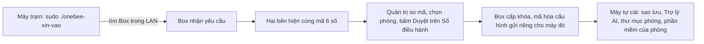

# Phòng ban và máy trạm xin vào Box

Mỗi phòng ban có **thư mục riêng** trên Box và **danh sách phần mềm riêng**. Máy của phòng nào chỉ vào được thư mục của phòng đó, và
không thấy thư mục của phòng khác. Máy trạm mới không cần chép cấu hình bằng tay: máy **xin vào** Box qua mạng LAN, quản trị **bấm duyệt
trên web Box** và chọn phòng, máy tự nhận cấu hình rồi tự cài. Thiết kế và lý do: [ADR 0009](../adr/0009-phong-ban-va-may-tram-xin-vao.md).



## 1. Tạo phòng ban (trên Box, làm một lần)
```bash
sudo onebee-box them-phong ke-toan "Phòng Kế toán" gnucash
sudo onebee-box them-phong kho "Kho vận"
sudo onebee-box danh-sach-phong
```
- Mã phòng: chữ thường không dấu, số, gạch ngang; 2–20 ký tự, bắt đầu bằng chữ (vd `ke-toan`).
- Tên hiển thị: tối đa 60 ký tự, không có dấu nháy kép.
- Phần mềm: tên **gói apt** của Ubuntu 24.04 / Linux Mint 22 (vd `gnucash`, `vlc`, `gimp`), cách nhau dấu cách. Chạy lại `them-phong`
  cùng mã để đổi tên hay danh sách phần mềm, rồi `sudo onebee-box dong-bo-may --tat-ca` để các máy của phòng nhận thay đổi.

Box tạo cho mỗi phòng:

| Thứ | Ở đâu |
|---|---|
| Thư mục riêng | `/srv/onebee/phong-ban/<mã>` (chỉ nhóm của phòng ghi được) |
| Chia sẻ Samba | `\\<Box>\pb-<mã>`, chỉ tài khoản `pb-<mã>` vào được; danh sách chia sẻ ẩn với mọi tài khoản khác |
| Mật khẩu Samba của phòng | sinh tự động, chỉ gửi xuống máy của phòng đó (`sudo onebee-box in-khoa` in kèm) |

Thư mục chung `\\<Box>\chung` vẫn như cũ cho mọi người.

## 2. Máy trạm xin vào
Trên máy Linux Mint mới cài, tải mã OneBee về như thường lệ rồi chạy:
```bash
sudo ./desktop/onebee-xin-vao --ten kt-01 --phong ke-toan
```
- Không có `--box` thì máy tự tìm `onebee.local` trong LAN. Không tìm được thì máy hỏi địa chỉ IP của Box (xem trên màn hình Box hoặc router).
- Máy in **mã đối chiếu 6 số**. Mở web Box (mục 3), thấy cùng mã thì **gõ lại mã đó vào máy trạm**; khác mã thì bấm Ctrl+C.
  Máy chờ duyệt tối đa 60 phút (`--cho <phút>` để đổi).
- Được duyệt thì máy ghi `/etc/onebee/may-tram.env` và tự chạy bộ cài OneBee OS. Thêm `--khong-cai` nếu chỉ muốn nhận cấu hình.

## 3. Duyệt trên web Box
Cần **HTTPS và đăng nhập một lần đã bật** (Sổ điều hành chỉ có ở chế độ này). Người duyệt thuộc nhóm `quan_ly` hoặc `ky_thuat`.
1. Mở `https://box.<mã-đơn-vị>.onebee.internal/so-dieu-hanh/` → thẻ **[M] Máy trạm**. Danh sách tự làm mới mỗi 10 giây.
2. **So mã 6 số** trên web với mã đang hiện trên màn hình máy trạm. **Khác mã thì bấm Từ chối**: có máy khác đang đứng giữa.
3. Gõ mã thấy trên máy trạm vào ô **Mã trên máy trạm**, chọn phòng (mặc định là phòng máy xin), bấm **Duyệt**. Mã gõ sai thì Box không duyệt. Từ chối thì phải ghi lý do; máy trạm sẽ thấy lý do đó.

Chưa bật HTTPS, hoặc muốn làm trên dòng lệnh của Box:
```bash
sudo onebee-box xin-vao                       # bảng yêu cầu, có mã đối chiếu
sudo onebee-box duyet-may <mã-yêu-cầu> ke-toan # gõ lại mã 6 số thấy trên máy trạm để xác nhận
sudo onebee-box tu-choi-may <mã-yêu-cầu> "Máy không thuộc đơn vị"
```
Yêu cầu chưa duyệt quá 24 giờ thì Box tự xóa (yêu cầu bỏ dở trước khi hiện mã: sau 10 phút); máy trạm chạy lại lệnh để xin lại. Mỗi lúc tối đa 20 yêu cầu đang chờ.

## 4. Máy trạm sau khi vào phòng
- Thư mục của phòng hiện ở **`/mnt/phongban`** (tự gắn khi mở, tự nhả sau 10 phút không dùng). Lối tắt "Thư mục phòng: <tên>" có trong menu.
  Mọi tài khoản trên máy đó dùng được thư mục phòng: máy thuộc phòng nào thì người ngồi máy đó làm việc của phòng đó.
- Phần mềm của phòng được cài sẵn. Gỡ phòng khỏi máy không gỡ phần mềm đã cài.
- Sao lưu `/home` lúc 12:00 vẫn như cũ, có thêm nhãn `phong-<mã>` để tra theo phòng.

## 5. Chuyển phòng, xóa phòng
```bash
sudo onebee-box chuyen-phong kt-01 kho && sudo onebee-box dong-bo-may kt-01
sudo onebee-box xoa-phong kho      # chỉ xóa được khi không còn máy nào trong phòng
```
`xoa-phong` không xóa dữ liệu: thư mục được đổi tên thành `/srv/onebee/phong-ban/.da-xoa-<mã>-<thời-điểm>`, kỹ thuật tự xử lý sau.
Máy cấp kiểu cũ bằng `them-may <tên>` vẫn chạy như trước. Gán phòng cho máy đó: `them-may` đã chạy rồi thì dùng `chuyen-phong`.

## 6. Sao lưu và khôi phục theo phòng
Lúc 23:00, ngoài bản chụp dữ liệu Box và thư mục chung, Box chụp **mỗi phòng một bản riêng** (nhãn `phong-<mã>`).
Lấy lại dữ liệu một phòng mà không đụng phòng khác:
```bash
sudo onebee-box khoi-phuc-phong ke-toan
```
Bản mới nhất được chép vào `/srv/onebee/phong-ban/ke-toan/khoi-phuc-<ngày-giờ>/`, ngay trong thư mục của phòng. Người trong phòng tự chép lại tệp
cần dùng, không có tệp nào đang dùng bị ghi đè. `khoi-phuc-toan-bo` (hỏng ổ Box) lấy lại mọi phòng và dựng lại chia sẻ Samba.

## An toàn
- Cổng 80 nhận yêu cầu xin vào mà không cần đăng nhập. Box **không cấp gì** cho tới khi một người thuộc nhóm `quan_ly`/`ky_thuat` bấm Duyệt.
- Mã 6 số chống máy giả làm Box (hoặc giả làm máy trạm) trong LAN. Máy giả không thể làm cho hai bên ra cùng mã, vì mỗi bên đã cam kết
  phần số ngẫu nhiên của mình trước khi thấy phần của bên kia.
- Cấu hình (mật khẩu sao lưu, khóa, mật khẩu Samba của phòng) được **Box ký** bằng CA riêng của Box, rồi mã hóa bằng khóa chỉ máy xin vào có
  (CMS, AES-256-GCM). Máy chỉ nhận khi chữ ký hợp lệ với đúng CA đã dùng để so mã, chữ ký gắn với đúng yêu cầu này, và vân tay CA khớp.
- Mỗi lần cấp máy qua xin vào, Box gửi cảnh báo (Telegram/email) nêu tên máy, phòng, người duyệt. Tối đa 10 máy mỗi 24 giờ; nhiều hơn thì
  dùng `them-may` trên Box.
- Thu hồi máy: `sudo onebee-box thu-hoi-may <tên>` như cũ. Máy cũ vẫn biết mật khẩu Samba của phòng, nên khi mất máy phải đổi mật khẩu phòng:
  `sudo onebee-box doi-mat-khau-phong <mã>`. Lệnh này đẩy mật khẩu mới xuống các máy còn lại trong phòng; máy tắt lúc đó thì chạy
  `dong-bo-may <tên>` khi máy bật lại.
