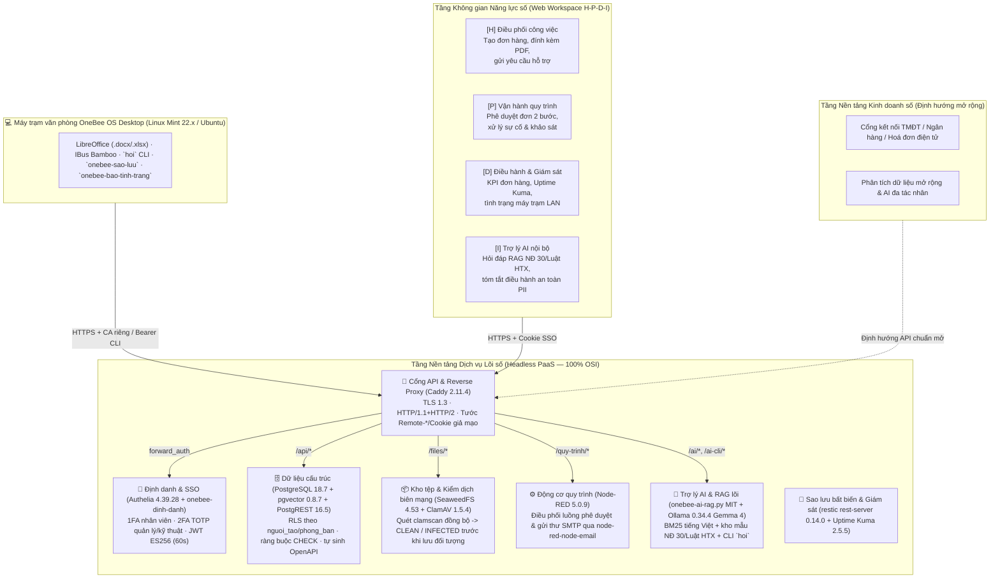

<!-- SPDX-License-Identifier: MIT -->
<!-- Copyright (c) 2026 Dương Minh Thiện, HTX OneBee -->
# Kiến trúc OneBee DX-OS Open-Core (3 tầng & 4 nguyên lý thiết kế)

Tài liệu này mô tả kiến trúc tổng thể của **OneBee DX-OS Open-Core** — hệ điều hành và nền tảng số lõi mở dành cho Hợp tác xã và doanh nghiệp nhỏ & vừa (SME), kế thừa OneBee OS và nâng cấp đáp ứng trọn vẹn định hướng nền tảng chuyển đổi số (DX-OS) OLP 2026.

---

## 1. Sơ đồ kiến trúc 3 tầng (theo chuẩn Đề thi OLP 2026)

---

## 2. Bảng ánh xạ thành phần lõi & Giấy phép OSI (100% Open-Core)

Mọi thành phần cài đặt mặc định trên OneBee DX-OS đều sử dụng giấy phép nguồn mở được **OSI phê duyệt** (chi tiết tệp giấy phép kiểm chứng tại [LICENSES.md](../LICENSES.md) và [ADR 0006](adr/0006-loi-dx-os-open-core.md)):

| Nhóm chức năng lõi (DX-OS) | Thành phần hiện thực | Phiên bản ghim | Giấy phép OSI (SPDX) |
|---|---|---|---|
| **Tầng Không gian Năng lực số** (`H-P-D-I`) | Giao diện Web H-P-D-I thuần HTML/CSS/JS tĩnh & `onebee-ai-rag.py` UI | 1.3.0 | `MIT` |
| **Tầng Nền tảng Dịch vụ Lõi số** — Cổng API & TLS | Caddy | 2.11.4 | `Apache-2.0` |
| Định danh tập trung & SSO (`forward_auth`) | Authelia + cầu nối Python `onebee-dinh-danh` | 4.39.28 + 3.14 | `Apache-2.0` + `MIT` |
| CSDL quan hệ + Vector RAG | PostgreSQL + pgvector | 18.7 + 0.8.7 | `PostgreSQL` |
| API dữ liệu tự sinh & phân quyền RLS | PostgREST | 16.5 | `MIT` |
| Kho tệp đối tượng & API S3/Filer | SeaweedFS | 4.53 | `Apache-2.0` |
| Kiểm dịch mã độc biên mạng | ClamAV (`clamscan`, loại bỏ `libclamunrar` non-OSI) + `cvdupdate` | 1.5.4 + 1.2.0 | `GPL-2.0-only` + `Apache-2.0` |
| Động cơ quy trình nghiệp vụ | Node-RED + `node-red-node-email` | 5.0.9 + 5.2.5 | `Apache-2.0` |
| Trợ lý AI nội bộ & RAG tiếng Việt | `onebee-ai-rag.py` + Ollama + Gemma 4 (`gemma4:e2b-it-qat`) | MIT + 0.34.4 | `MIT` + `Apache-2.0` |
| Giám sát hệ thống & dịch vụ | Uptime Kuma | 2.5.5 | `MIT` |
| Sao lưu 2 tầng chống mã độc tống tiền | `restic` + `rest-server` (`--append-only`) | 0.14.0 | `BSD-2-Clause` |
| Tự động hóa hạ tầng & máy trạm | Ansible + Bash/Python (`onebee-box`, `hoi`) | GPL-3.0+ / MIT | `MIT` (mã nguồn OneBee) |

---

## 3. Đối chiếu 4 nguyên lý thiết kế (theo Mục 4 Đề thi)

> **Nguyên tắc trung thực kỹ thuật:** Bảng dưới đây phân tách rạch ròi giữa phần **đã triển khai chạy thật** trong mã nguồn/kiểm thử và phần **định hướng kiến trúc** trong lộ trình tiếp theo.

| Nguyên lý thiết kế | Phần đã chạy thật trên OneBee DX-OS | Phần định hướng mở rộng (Roadmap) |
|---|---|---|
| **(i) Tách dữ liệu nóng/lạnh** | **Dữ liệu nóng:** PostgreSQL 18.7 OLTP phục vụ truy vấn tác nghiệp độ trễ thấp (`don_hang`, `yeu_cau_ho_tro`, `khao_sat`, `tep_dinh_kem`). **Dữ liệu lạnh:** `restic` sao lưu đóng băng bất biến 2 tầng (`--private-repos --append-only`, đồng bộ hằng đêm 23:00 ra ổ ngoài). | Bổ sung phân tầng lưu trữ phân tích dạng **Lakehouse (Apache Iceberg)** trên kho đối tượng SeaweedFS cho dữ liệu lịch sử dài hạn và báo cáo BI đa kỳ. |
| **(ii) Hội tụ IT/OT & Bản sao số** | Công cụ máy trạm `onebee-bao-tinh-trang` gửi định kỳ trạng thái phần cứng/hệ điều hành/bản sao lưu có chữ ký HMAC về chung CSDL tác nghiệp của Box (hội tụ telemetry CNTT vào **Không gian Điều hành [D]** và **Tầng Nền tảng Dịch vụ Lõi số**). | Mở rộng chuẩn kết nối **IoT / NGSI-LD** thu nhận dữ liệu cảm biến nhà kho/vườn trồng HTX (nhiệt độ, độ ẩm, điện năng) hội tụ về cùng đường ống PostgreSQL/Node-RED. |
| **(iii) Quản trị dữ liệu & chất lượng** | Mọi bảng tác nghiệp trong PostgreSQL áp đặt ràng buộc `CHECK` (trạng thái hợp lệ, giá trị dương), **Row-Level Security (RLS)** cô lập dữ liệu theo vai trò (`nhan_vien`, `ky_thuat`, `quan_ly`), **PostgREST** tự động sinh đặc tả OpenAPI phản ánh đúng schema, kèm bảng lịch sử thay đổi và kiểm soát chống rò rỉ PII ở `/ai/tom-tat`. | Tích hợp danh mục dữ liệu & truy xuất nguồn gốc tập trung (**OpenMetadata**) khi HTX/SME có nhiều cơ sở dữ liệu liên phòng ban. |
| **(iv) Zero-Trust + GitOps + Kiểm dịch biên mạng** | **Zero-Trust:** Mọi cổng backend đóng hoàn toàn ra LAN; chỉ Caddy công bố cổng; xác thực bắt buộc qua Authelia `forward_auth` + cầu nối JWT `ES256` thời hạn ngắn (`60s`); tự động tước header giả mạo (`Remote-*`, `Authorization`, `Cookie`) trước khi định tuyến. **Kiểm dịch biên mạng:** mọi tệp tải lên `/files/` đi qua `clamscan` trả trạng thái `CLEAN` / `INFECTED` trước khi ghi SeaweedFS. **GitOps:** toàn bộ Box & Desktop quản trị bằng playbook Ansible idempotent (`changed=0` khi chạy lại). | Tích hợp ký ảnh container (Cosign) và tự động đối chiếu chính sách bảo mật khi đồng bộ cấu hình đa chi nhánh. |
