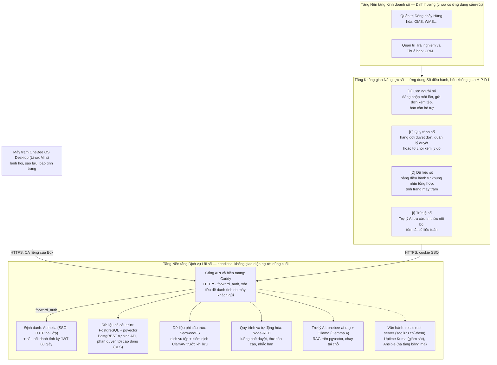

# Kiến trúc OneBee DX-OS Open-Core

OneBee DX-OS Open-Core là OneBee Box (máy chủ nội bộ đặt tại đơn vị) làm lại theo Khung kiến trúc Hệ điều hành Chuyển đổi số (DX-OS) của Đề thi
OLP Phần mềm nguồn mở 2026: một nền tảng lõi chạy ngầm (headless) ở Tầng 1, một ứng dụng minh họa H-P-D-I ở Tầng 2, mọi thành phần có giấy phép OSI.
Tài liệu này mô tả **kiến trúc đích** và nói rõ phần nào mới là **định hướng**. Quyết định chọn thành phần, số đo RAM và các phương án đã loại:
[ADR 0006](adr/0006-loi-dx-os-open-core.md). Đặc tả giao diện: [openapi-dxos.md](api/openapi-dxos.md). Điểm tự chấm có lệnh kiểm: [olp-2026-tu-cham-pof.md](olp-2026-tu-cham-pof.md).

## 1. Ba tầng theo Đề thi

| Tầng (tên theo Đề) | Trong OneBee DX-OS | Trạng thái |
|---|---|---|
| **Tầng Nền tảng Dịch vụ Lõi số** | Bảy dịch vụ trong sơ đồ, đều không có giao diện cho người dùng cuối (trang đăng nhập của Authelia và trình soạn luồng của Node-RED là công cụ quản trị) | Chạy trên Box, kiểm bằng bộ kiểm Box (mục 5) |
| **Tầng Không gian Năng lực số** (H-P-D-I) | Ứng dụng Sổ điều hành `/so-dieu-hanh/` đi trọn H → P → D → I chỉ qua API của Tầng 1; máy trạm Desktop là phía người dùng của [H] | Chạy trên Box |
| **Tầng Nền tảng Kinh doanh số** | Chưa có ứng dụng cắm-rút nào. Bài toán minh họa (đơn hàng nông sản có duyệt, yêu cầu hỗ trợ) chỉ là ví dụ nhỏ cho hai nhóm Dòng chảy Hàng hóa và Trải nghiệm | Định hướng |

Nguyên tắc phân tách: Tầng 2 chỉ gọi `/api/`, `/files/`, `/ai/`, `/quy-trinh/` của Tầng 1; muốn đổi nghiệp vụ thì thay trang ở Tầng 2, không đụng dịch vụ nền.

## 2. Thành phần và giấy phép

Mọi thành phần cài mặc định đều dùng giấy phép OSI. Bản ghim (tag và digest) nằm ở
[`box/ansible/group_vars/all.yml`](../box/ansible/group_vars/all.yml); nguồn giấy phép từng thành phần: [LICENSES.md](../LICENSES.md).
Số liệu RAM, thời gian khởi động và lý do loại Flowable, Kestra: [ADR 0006](adr/0006-loi-dx-os-open-core.md).

<!-- bang-thanh-phan -->
| Thành phần | Việc trong Tầng 1 | Bản ghim | Giấy phép |
|---|---|---|---|
| Caddy | Cổng API, TLS, chuyển tiếp có xác thực | 2.11.4 | Apache-2.0 |
| Authelia | Định danh, đăng nhập một lần, TOTP hai lớp | 4.39.28 | Apache-2.0 |
| Python | Chạy cầu nối danh tính và dịch vụ tệp (mã trong kho, MIT) | 3.14.10 | PSF-2.0 |
| PostgreSQL | CSDL giao dịch (OLTP), RLS | 18.7 | PostgreSQL License |
| pgvector | Vector nhúng cho tra cứu tri thức | 0.8.7 | PostgreSQL License |
| PostgREST | API tự sinh từ lược đồ `onebee` | 16.5 | MIT |
| SeaweedFS | Kho tệp kiểu đối tượng | 4.53 | Apache-2.0 |
| ClamAV | Kiểm dịch mã độc từng lượt (`clamscan`), không kèm `libclamunrar` | 1.5.4 | GPL-2.0-only |
| Node-RED | Động cơ quy trình | 5.0.9 | Apache-2.0 |
| Ollama | Chạy mô hình AI tại chỗ | 0.34.4 | MIT |
| Gemma 4 | Mô hình `gemma4:e2b-it-qat` | Gemma 4 | Apache-2.0 |
| Uptime Kuma | Giám sát dịch vụ | 2.5.5 | MIT |
| restic | Sao lưu mã hóa, bản cũ không xóa được từ máy trạm | rest-server 0.14.0 | BSD-2-Clause |
| Docker | Chạy các dịch vụ trên Box | gói Ubuntu | Apache-2.0 |
| Samba | Thư mục chung trong LAN | gói Ubuntu | GPL-3.0 |
| Ansible | Cài đặt và cấu hình bằng mã, chạy lại không đổi | ansible-core | GPL-3.0+ |
<!-- het-bang-thanh-phan -->

Mã do dự án viết (cầu nối danh tính, dịch vụ tệp, `onebee-ai-rag`, trang Sổ điều hành, lệnh `onebee-box`, `hoi`): MIT, toàn văn ở [LICENSE](../LICENSE).

### Đối chiếu với giải pháp tham chiếu 7 lớp của Đề
Đề cho bảng 7 lớp "để minh họa", đội thi toàn quyền chọn công nghệ. Bảng dưới nói thật phần nào dùng, phần nào thay bằng gì, phần nào chưa làm.

| Lớp của Đề | Tham chiếu trong Đề | OneBee DX-OS chọn | Chưa làm |
|---|---|---|---|
| 1. Trải nghiệm và giao diện | Nuxt 3, Flutter, Centrifugo, Tailwind | HTML, CSS, JavaScript thuần (dưới 40 KB, không tải gì từ Internet) | Ứng dụng di động, WebSocket |
| 2. Biên mạng, cổng, an toàn | APISIX, Keycloak, Vault, ClamAV, Coraza | Caddy, Authelia, ClamAV; bí mật sinh ngẫu nhiên, chỉ root đọc, xoay bằng một lệnh | Vault, WAF |
| 3. Tác nghiệp, logic, trạng thái | Hasura, PostgreSQL, MongoDB, Orion | PostgreSQL + PostgREST (REST thay GraphQL) | GraphQL, PostGIS, NGSI-LD |
| 4. Tự động hóa, quy trình, DevSecOps | ArgoCD, GitLab CI, Flowable, Kestra, Velero | Ansible, GitHub Actions, Node-RED (đã đo Flowable và Kestra, loại vì RAM), restic | GitOps kiểu ArgoCD, BPMN |
| 5. Dữ liệu hội tụ, truyền phát, sổ cái | Redpanda, Iceberg, MinIO, ImmuDB | SeaweedFS (kho đối tượng) | Redpanda, Lakehouse, sổ cái bất biến |
| 6. Phân tích, không gian, trí tuệ | Trino, DuckDB, GeoServer, Metabase, Ollama | Khung nhìn tổng hợp trong PostgreSQL, Ollama | GIS, công cụ BI riêng |
| 7. Quản trị, tìm kiếm, giám sát | Vector, OpenMetadata, Meilisearch, Qdrant, Grafana | pgvector (tìm kiếm ngữ nghĩa), Uptime Kuma | OpenMetadata, tìm kiếm toàn văn, Grafana |

## 3. Bốn nguyên lý thiết kế (Mục 4 của Đề)

| Nguyên lý | Đã làm | Định hướng |
|---|---|---|
| **(i) Tách theo vòng đời và tốc độ dữ liệu** | Đường **nóng**: giao dịch đơn hàng, yêu cầu hỗ trợ ghi thẳng PostgreSQL, tệp ghi SeaweedFS. Đường **lạnh**: bản sao lưu restic ra ổ ngoài lúc 23:00, chế độ chỉ-thêm, khôi phục toàn bộ Box bằng một lệnh. Hai đường không chặn nhau | Chưa có Lakehouse: dữ liệu lịch sử chưa tự đẩy xuống hồ dữ liệu phân tích (Apache Iceberg trên SeaweedFS, xem [ROADMAP](../ROADMAP.md)) |
| **(ii) Hội tụ IT/OT: dữ liệu hành chính (IT) và vận hành (OT)** | Tình trạng máy trạm (ổ đĩa, bản sao lưu, gói chờ cập nhật) gửi định kỳ kèm chữ ký HMAC, lưu vào `onebee.tinh_trang_may` cùng CSDL với đơn hàng và hỗ trợ; hiện trên bảng điều hành | Chưa có cảm biến hiện trường, chưa có bản sao số (digital twin), chưa có NGSI-LD |
| **(iii) Quản trị dữ liệu: phả hệ, nguồn gốc, chất lượng** | Ràng buộc `CHECK` và danh mục chặn dữ liệu sai ngay ở CSDL; RLS bật và ép trên mọi bảng; dòng nhập từ sổ cũ giữ `nguon` và `dong` (truy ngược tới tệp, dòng gốc); lược đồ đổi qua tệp đánh số, ghi sổ `onebee.lich_su_luoc_do` | Chưa có danh mục dữ liệu và phả hệ tập trung (OpenMetadata) |
| **(iv) Zero-Trust gắn với GitOps, kiểm dịch ngay biên mạng, tự phục hồi** | Chỉ Caddy công bố cổng; tuyến lõi chỉ có ở HTTPS trên tên `box.<mã>.onebee.internal`, mọi yêu cầu qua `forward_auth`; Caddy xóa `Remote-*`, `Authorization` do máy khách gửi; mạng Docker tách `sso`, `api`, `csdl`; JWT sống 60 giây, quyền cuối cùng do RLS ở CSDL quyết định; tệp tải lên qua ClamAV rồi mới vào kho; toàn bộ Box và máy trạm cài bằng Ansible, chạy lần hai `changed=0`; hỏng ổ thì `khoi-phuc-toan-bo` | Ký image (Cosign), đồng bộ cấu hình nhiều chi nhánh |

## 4. Luồng một yêu cầu đi qua các tầng

1. Người dùng mở `https://box.<mã>.onebee.internal/so-dieu-hanh/`. Chưa có phiên thì Authelia đưa tới `/dangnhap/`; `nhan_vien` một lớp, `ky_thuat` và `quan_ly` hai lớp (mật khẩu + TOTP).
2. Trang gọi `/api/don_hang`. Caddy xóa mọi `Remote-*` do trình duyệt tự gửi, hỏi Authelia (`forward_auth`), chép `Remote-User` và `Remote-Groups` hợp lệ vào yêu cầu.
3. Cầu nối danh tính đổi hai tiêu đề đó thành JWT HS256 sống 60 giây (`sub` = tên đăng nhập, `role` = vai trò cao nhất), bỏ `Authorization`, `Cookie` rồi chuyển tới PostgREST.
4. PostgREST chuyển sang vai trò trong JWT; PostgreSQL áp chính sách RLS theo `sub`. Nhân viên chỉ thấy đơn của mình; tự duyệt đơn của mình bị ràng buộc `khong_tu_duyet` chặn.
5. Đính kèm tệp: `/files/` nhận tệp, `clamscan` kiểm dịch, tệp sạch mới vào SeaweedFS, metadata ghi vào `onebee.tep_dinh_kem` bằng chính JWT của người tải lên.
6. Quản lý duyệt: điểm nhận phê duyệt của Node-RED lấy người duyệt từ `Remote-User`, ghi trạng thái qua PostgREST bằng JWT của người duyệt; trigger và ràng buộc ở CSDL là rào chắn cuối.
7. Hỏi AI: `/ai/` chỉ mở các đường dẫn hỏi đáp và tóm tắt; mọi API khác của Ollama trả 404. Tóm tắt chỉ nhận số liệu tổng hợp, không có tên người.

## 5. Cách kiểm từng khẳng định

| Khẳng định | Lệnh kiểm |
|---|---|
| Không dịch vụ nào lộ cổng ra LAN ngoài Caddy; giả mạo `Remote-User` không lọt; ở HTTP không có tuyến lõi | `tests/box/kiem-bat-bien.sh` (chạy trên Box, gọi từ `check-https.sh`) |
| SSO, vai trò, JWT 60 giây, xoay khóa làm cookie cũ hết hiệu lực | [`tests/box/check-sso-cong-api.sh`](../tests/box/check-sso-cong-api.sh), `python3 -m unittest tests/box/test_onebee_cau_noi_danh_tinh.py` |
| RLS bật trên mọi bảng, nhân viên không đọc đơn người khác | [`tests/box/check-csdl-rls.sh`](../tests/box/check-csdl-rls.sh), [`tests/box/check-du-lieu-qua-cong.sh`](../tests/box/check-du-lieu-qua-cong.sh) |
| Kiểm dịch, tải lại đúng SHA-256, tệp thử EICAR bị chặn | `tests/box/check-kho-tep-inside.sh` |
| Luồng phê duyệt, từ chối cần lý do, gọi không phiên bị từ chối | `tests/box/check-quy-trinh-inside.sh` |
| Luồng H → P → D → I trọn vẹn | `tests/box/check-so-dieu-hanh.sh` |
| Hỏng ổ Box, khôi phục, dữ liệu và tệp còn nguyên | [`tests/box/check-khoi-phuc-toan-bo.sh`](../tests/box/check-khoi-phuc-toan-bo.sh) |
| Cài trên máy sạch, lần hai không đổi gì | `tests/box/run-box-test-in-systemd-container.sh` (CI: `gh workflow run ci.yml -f box=true`) |

Giới hạn đã biết: số đo RAM và thời gian ở [ADR 0006](adr/0006-loi-dx-os-open-core.md) lấy trên máy ảo 4 vCPU, 10 GB; chưa đo trên Box thật hay có tải thật.
Quét ClamAV chạy từng lượt (khoảng 10 giây mỗi lượt) nên tệp có độ trễ tới lần quét kế tiếp.
