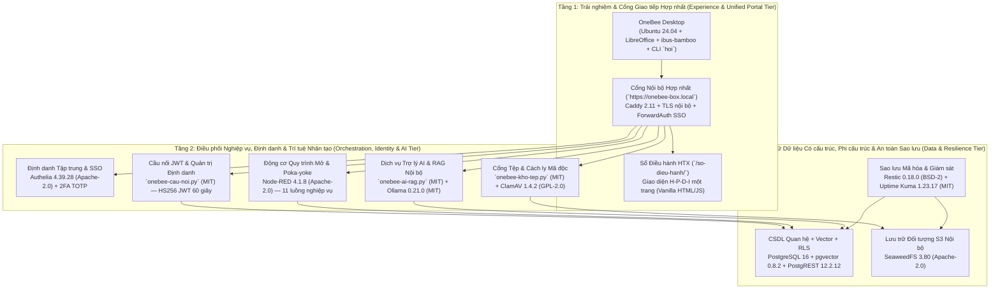

# Kiến trúc Lõi Mở DX-OS (Open-Core Architecture) — OneBee OS v1.3.0

Tài liệu này mô tả kiến trúc 3 tầng của **OneBee OS v1.3.0 (DX-OS Open-Core)** đáp ứng toàn diện đề bài Khối Phần mềm nguồn mở — OLP 2026: **"Phát triển khung nền tảng số mở (Open-Core) cho Doanh nghiệp Siêu nhỏ và Hợp tác xã (MSME/HTX)"**.

---

## 1. Sơ đồ Kiến trúc 3 Tầng (3-Tier DX-OS Architecture)

---

## 2. Đối chiếu 4 Nguyên tắc Thiết kế Cốt lõi (OLP 2026)

| Nguyên tắc | Yêu cầu đề thi OLP 2026 | Hiện thực hóa trong OneBee OS v1.3.0 |
|---|---|---|
| **1. Tối giản thao tác & Chống sai sót (Poka-yoke)** | Giao diện 1 trang cho nhân viên HTX; ngăn chặn tự duyệt phiếu của chính mình và bắt buộc nhập lý do khi từ chối. | • **Sổ điều hành HTX (`/so-dieu-hanh/`)**: Gom 4 trụ cột `[H]-[P]-[D]-[I]` vào một giao diện tiếng Việt duy nhất. • **Poka-yoke kép (3 lớp)**: (1) Giao diện vô hiệu hóa nút Duyệt nếu `nguoi_tao == remote_user`; (2) Node-RED kiểm tra header `Remote-User` từ Authelia; (3) PostgreSQL ràng buộc `CHECK (nguoi_duyet IS NULL OR nguoi_duyet <> nguoi_tao)` và `CHECK (trang_thai <> 'TU_CHOI' OR length(btrim(ly_do_quyet_dinh)) >= 3)`. |
| **2. Kiến trúc Mở & Chống khóa chặt (Anti-Vendor Lock-in)** | 100% thành phần trong đường dẫn thực thi có giấy phép chuẩn OSI; giao thức mở (OpenAPI/REST, S3, SQL, OpenAI API). | • Thay thế hoàn toàn công cụ fair-code cũ (Sustainable Use License) bằng **Node-RED** (`Apache-2.0`) và thay **giao diện AI bên thứ ba** (BSD-3 kèm điều khoản bảo hộ thương hiệu từ v0.6.6+) bằng **`onebee-ai-rag.py`** (`MIT`). • Mọi dữ liệu xuất/nhập qua SQL chuẩn, REST JSON (`PostgREST`), S3 API (`SeaweedFS`) và kho sao lưu `Restic`. |
| **3. Tự chủ Dữ liệu & Vận hành Ngoại tuyến (Offline-First & Sovereignty)** | Hoạt động 100% trong mạng LAN nội bộ khi đứt cáp quang hoặc mất Internet; hỗ trợ bộ cài USB Air-gapped. | • Toàn bộ 11 container và mô hình ngôn ngữ tiếng Việt (`qwen2.5:1.5b` / `qwen2.5:3b`) chạy nội bộ trên OneBee Box (Mini PC 8–16 GB RAM). • Hỗ trợ xác thực 2 lớp ngoại tuyến (`sudo onebee-box ma-xac-minh <user>`) và nạp chữ ký ClamAV qua USB (`sudo onebee-box cap-nhat-chu-ky-clamav`). |
| **4. Bảo mật Mặc định theo Vai trò (Zero-Trust RBAC & Malware Quarantine)** | Phân quyền rõ `nhan_vien`, `ky_thuat`, `quan_ly`; quét mã độc mọi tệp tải lên trước khi lưu trữ. | • **Authelia ForwardAuth + Cầu nối JWT 60s (`onebee-cau-noi.py`)**: Chuyển tiếp định danh xuống **PostgreSQL Row-Level Security (RLS)** theo từng dòng dữ liệu. • **ClamAV + SeaweedFS**: Mọi tệp tải lên qua `/files/upload` được quét bằng `clamscan`; tệp chứa mã độc/EICAR bị đánh dấu `INFECTED` và chuyển vào `/var/lib/onebee/kho-tep/quarantine` trước khi chạm tới kho S3. |

---

## 3. Phân rã Trách nhiệm theo Vai trò (RBAC Matrix)

| Vai trò | Quyền trên Cổng & Sổ điều hành (`[H]-[P]`) | Quyền trên Dữ liệu (`[D]` — PostgreSQL RLS) | Quyền Quản trị & Kỹ thuật |
|---|---|---|---|
| **`nhan_vien`** (Nhân viên HTX) | Tạo phiếu Đơn hàng / Hỗ trợ / Khảo sát; tải tệp đính kèm; hỏi AI & tạo văn bản Nghị định 30. | Chỉ đọc/sửa phiếu của đơn vị mình khi ở trạng thái `CHO_DUYET`; không được cập nhật cột `nguoi_duyet`. | Không truy cập Uptime Kuma / Node-RED quản trị. |
| **`ky_thuat`** (Tổ kỹ thuật) | Như `nhan_vien`, cộng thêm xem trạng thái đội máy trạm (`may_tram`) và sự cố kỹ thuật. | Đọc toàn bộ bảng `may_tram` và `phieu_nghiep_vu` của đơn vị để xử lý kỹ thuật. | Xem bảng giám sát Uptime Kuma và hỗ trợ từ xa MeshCentral. |
| **`quan_ly`** (Ban Giám đốc HTX) | Phê duyệt / Từ chối phiếu trong hàng đợi quản lý (trừ phiếu do chính mình tạo); xem báo cáo tổng hợp tuần. | Toàn quyền đọc và cập nhật trạng thái `DA_DUYET` / `TU_CHOI` trên `phieu_nghiep_vu` (chịu ràng buộc Poka-yoke). | Truy cập toàn bộ báo cáo điều hành và nhật ký kiểm toán. |
