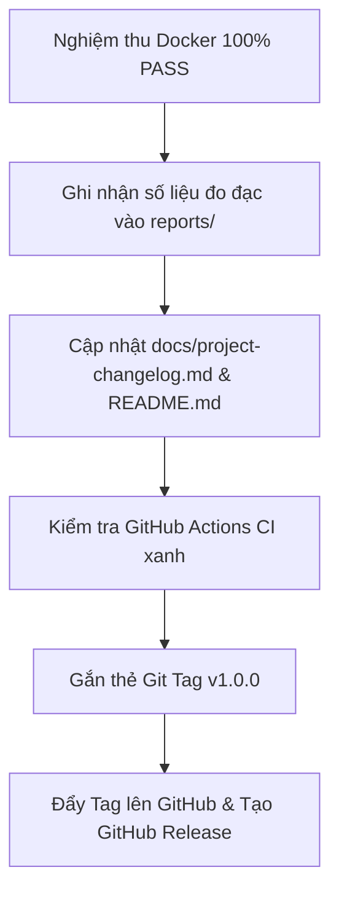

# Kế hoạch Kiểm thử Máy thật & Quy trình Đóng gói Phát hành v1.0.0

**Dự án:** OneBee OS (DA3 — Hệ điều hành & Tự động hóa mã nguồn mở)  
**Tác giả:** Dương Minh Thiện <thien20071005@gmail.com>  
**Căn cứ kỹ thuật:**
- `onebee-os-ban-giao.md` (Tài liệu bàn giao ngày 14/10/2026)
- `docs/kiem-thu-tren-may-that.md` (Phiếu kiểm thử máy thật Nhóm A, B, C, D, E)
- `docs/huong-dan/thu-nghiem-tren-may-ao.md` (Quy trình kiểm thử môi trường ảo hóa)
- Trạng thái mã nguồn: Nhánh `main` đã hoàn tất toàn bộ các bản vá N13, N4, N8, N9, N5, N2, N6, N7, N10 và tính lũy nghiệm apt (`changed_when: false`).

---

## I. Tổng kết Nghiệm thu Môi trường Giả lập (Docker Acceptance)

| Hạng mục kiểm thử | Môi trường | Kết quả nghiệm thu | Ghi chú kỹ thuật |
| :--- | :---: | :---: | :--- |
| **Bản vá N13 (CORS HTTP)** | Docker Runner | **ĐẠT** | Cho phép IP LAN và `box.<mã>.onebee.internal:3000` |
| **Bản vá N4 (Gia hạn CA trước backup)** | Docker Runner | **ĐẠT** | Gia hạn CA trước khi kiểm tra gắn ổ sao lưu ngoài |
| **Bản vá N8 & N9 (Xoay khóa & Khóa file)** | Docker Runner | **ĐẠT** | Đồng bộ khóa sang trạm online, bọc `with_lock` |
| **Bản vá N5 (Chặn redirect CA công cộng)** | Docker Runner | **ĐẠT** | `urllib` chỉ tin chứng chỉ nội bộ OneBee CA |
| **Bản vá N2 (Dọn CA cũ khỏi cert9.db)** | Docker Runner | **ĐẠT** | Tìm và xóa chứng chỉ cũ qua SHA-256 fingerprint |
| **Bản vá N6 & N7 (Tailscale & IPv6 REJECT)** | Docker Runner | **ĐẠT** | Lọc ở `mangle/PREROUTING`, REJECT IPv6 tức thì |
| **Bản vá N10 (Đồng bộ tài liệu docs/)** | Kho mã nguồn | **ĐẠT** | Chuẩn 12 dòng, biến bắt buộc, lệnh thực tế |
| **Nghiệm thu Desktop Mint 22.3** | Container Mint 22.3 | **100% ĐẠT** | Lần 1 `changed=36`, Lần 2 `changed=0 failed=0`, Office chuẩn |
| **Nghiệm thu Box Runner toàn diện** | Container Ubuntu 24.04 | **100% ĐẠT** | 5 container backend + Caddy portal + Uptime Kuma + 9 n8n workflows |

---

## II. Kế hoạch Kiểm thử trên Phần cứng Thực tế (Real Hardware Test Plan)

Sau khi hoàn tất nghiệm thu container, các kịch bản sau sẽ được thực hiện trực tiếp trên thiết bị phần cứng thực tế theo đúng Phiếu kiểm thử `docs/kiem-thu-tren-may-that.md`:

### Kịch bản H1: Kiểm thử OneBee Box trên máy chủ vật lý
- **Thiết bị:** Máy tính mini PC / máy chủ x86_64 (tối thiểu 4 nhân, 16 GB RAM, ổ SSD NVMe/SATA).
- **Hệ điều hành nền:** Ubuntu Server 24.04 LTS (cài mới hoàn toàn từ USB).
- **Các bước thực hiện:**
  1. Cấu hình IP tĩnh hoặc IP DHCP cố định trên router (`onebee_box_dia_chi`).
  2. Sao chép mã nguồn repo hoặc tải gói cài đặt `onebee-box-install.sh`.
  3. Chạy cài đặt Lần 1: Xác nhận toàn bộ 5 container backend khởi động, Caddy portal lắng nghe cổng 80/443.
  4. Chạy cài đặt Lần 2: Xác nhận tuyệt đối `changed=0 failed=0`.
  5. **Đo đạc hiệu năng AI thực tế:**
     - Mô hình: `gemma4:e2b-it-qat` chạy trên Ollama.
     - Dùng script `tests/do-dac/do-may.py` hoặc công cụ benchmark đo tốc độ sinh từ (token/giây), mức RAM chiếm dụng lúc rảnh và khi có tải.
     - Lưu kết quả đo đạc thực tế vào `reports/ai/do-dac-box-that.md`.

### Kịch bản H2: Kiểm thử OneBee Desktop trên máy trạm văn phòng vật lý
- **Thiết bị:** Laptop hoặc PC văn phòng (tối thiểu 8 GB RAM, bàn phím tiếng Việt).
- **Hệ điều hành nền:** Linux Mint 22.x (giao diện Cinnamon).
- **Các bước thực hiện:**
  1. Chạy bộ cài `onebee-desktop-install.sh` kết nối tới IP máy Box thật.
  2. Kiểm tra bộ gõ tiếng Việt IBus Bamboo:
     - Gõ tiếng Việt kiểu Telex/VNI trong LibreOffice Writer, Calc, Impress.
     - Lưu file và kiểm tra định dạng mặc định `.docx`, `.xlsx`, `.pptx`.
     - Gõ tiếng Việt trong thanh địa chỉ và ô tìm kiếm của Firefox.
  3. Kiểm tra bảo mật trình duyệt Firefox:
     - Mở Firefox, vào trang quản trị Box: Xác nhận ổ khóa xanh / chứng chỉ tin cậy không cảnh báo lỗi.
     - Kiểm tra chứng chỉ: Đúng Issuer là `OneBee CA - <ma_don_vi>`.
  4. Kiểm tra các tiện ích người dùng:
     - Chạy lệnh CLI `hoi "Xin chào"` từ terminal.
     - Chạy lệnh `onebee-bao-tinh-trang` xác nhận gửi thông tin máy lên n8n của Box thành công.

### Kịch bản H3: Mạng LAN hỗn hợp & Thiết bị ngoại vi
- **Máy trạm Windows 10/11:**
  1. Mở File Explorer, kết nối `\\<IP-Box>\chung`: Xác nhận đăng nhập thành công qua giao thức SMB 3.1.1 có mã hóa.
  2. Tải chứng chỉ `http://<IP-Box>/onebee-ca.crt` về máy Windows, nhập vào kho "Trusted Root Certification Authorities".
  3. Mở Edge/Chrome vào `https://<IP-Box>:3000`: Xác nhận truy cập an toàn không báo lỗi SSL.
- **Máy in & Scan mạng LAN:**
  1. Xác nhận các luồng in mạng (cổng 9100/IPP 631) trong LAN không bị tường lửa Box làm ảnh hưởng.

### Kịch bản H4: Diễn tập Phục hồi thảm họa thực tế (Disaster Recovery)
- **Chuẩn bị:** Ổ cứng di động USB cắm vào Box tại `/mnt/onebee-sao-luu`.
- **Thực hiện sao lưu:** Chạy lệnh `sudo onebee-box sao-luu`, xuất khóa an toàn bằng `sudo onebee-box in-khoa > khoa-dan-tu.txt`.
- **Giả lập thảm họa:** Format trắng ổ cứng máy Box, cài đặt lại Ubuntu Server 24.04 từ đầu.
- **Khôi phục thảm họa:**
  1. Cắm lại ổ cứng di động USB chứa bản sao lưu.
  2. Dùng file `khoa-dan-tu.txt` chạy lệnh `sudo onebee-box khoi-phuc-toan-bo`.
  3. Xác nhận:
     - Toàn bộ dữ liệu Samba, lịch sử n8n, CSDL Open WebUI phục hồi 100%.
     - Chứng chỉ CA gốc và trung gian giữ nguyên vân tay SHA-256.
     - Các máy trạm không cần thao tác lại mà vẫn kết nối bình thường.

---

## III. Quy trình Đóng gói & Phát hành v1.0.0 (Release Checklist)



### Các bước Claude Code cần thực hiện:

1. **Bước 1 — Thu thập số liệu đo đạc vào thư mục `reports/`**:
   - Tạo file `reports/nghiem-thu-v1-docker.md` ghi nhận kết quả test nghiệm thu tự động.
   - Khi có số liệu đo đạc phần cứng thật, lưu vào `reports/ai/do-dac-box-that.md`.

2. **Bước 2 — Cập nhật tài liệu sản phẩm**:
   - Cập nhật `docs/project-changelog.md` với mục phát hành `[1.0.0] - 2026-10-14`:
     - Liệt kê toàn bộ các tính năng cốt lõi (Box, Desktop Mint, Samba mã hóa, AI cục bộ, n8n, Uptime Kuma, Restic backup, Quản lý tập trung).
     - Liệt kê các bản sửa lỗi bảo mật và ổn định: N13, N4, N8, N9, N5, N2, N6, N7, N10 và lũy nghiệm apt.
   - Rà soát `README.md` loại bỏ các chú thích tạm thời.

3. **Bước 3 — Kiểm tra trạng thái Git & CI**:
   - Kiểm tra `git status`: Không còn file rác hoặc thay đổi chưa commit.
   - Kiểm tra GitHub Actions trên GitHub repo đảm bảo tất cả jobs đều xanh.

4. **Bước 4 — Gắn thẻ Tag và phát hành v1.0.0**:
   ```bash
   git tag -a v1.0.0 -m "Phát hành OneBee OS v1.0.0: Hệ điều hành & Máy chủ AI văn phòng mã nguồn mở"
   git push origin v1.0.0
   ```
   - Tạo GitHub Release tương ứng với tag `v1.0.0`, đính kèm tóm tắt tính năng và hướng dẫn cài đặt 1 lệnh.
