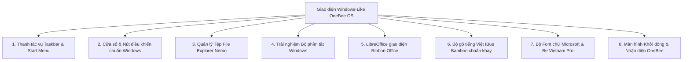

# Kế hoạch Thiết kế UI/UX OneBee OS Desktop: Trải nghiệm Quen thuộc như Windows

**Dự án:** OneBee OS (DA3 — Hệ điều hành & Tự động hóa mã nguồn mở)  
**Tác giả dự án:** Dương Minh Thiện <thien20071005@gmail.com> · HTX OneBee  
**Căn cứ tài liệu:**
- Thư mục hồ sơ hội thi: `/Users/ht/Desktop/Thi/DA3-Hoan-thien-28-9`
  - `DA3-Cam-nang-noi-dung-HD1-HD2-HD3.docx`: Thông điệp "Máy cũ chạy mới — Dữ liệu ở nhà", bộ nhận diện (Xanh đêm `#0E1B2C`, Mật ong `#F5A524`, Xanh ngọc `#2DD4BF`), đối tượng kế toán HTX, thầy cô, chủ cửa hàng.
  - `DA3-OneBee-OS-Pitch-ban-ket.pptx` (Slide 10): *"Máy trạm Linux: Ubuntu/Mint, LibreOffice, bộ gõ tiếng Việt, giao diện quen như Windows"*.
  - `DA3-Brochure-OneBee-OS-A4-gap3.pdf`: *"Bộ cài chuẩn OneBee OS, giao diện quen thuộc như Windows, bộ gõ tiếng Việt, không phí bản quyền, 0đ rào cản làm quen"*.

---

## I. Mục tiêu & Triết lý Thiết kế

### 1. Vấn đề cốt lõi
Sau ngày **14/10/2025**, Windows 10 chính thức bị dừng cập nhật bảo mật. Hàng triệu máy tính tại các HTX, trường học, hộ kinh doanh không đủ điều kiện phần cứng để nâng cấp lên Windows 11.
Rào cản lớn nhất khi chuyển đổi sang Linux không phải là kỹ thuật, mà là **thói quen thao tác của người dùng văn phòng**. Nếu giao diện xa lạ, người dùng sẽ ngại thay đổi và có xu hướng tiếp tục dùng phần mềm lậu hoặc hệ thống không an toàn.

### 2. Triết lý: "0 Giây Bỡ Ngỡ — Mở Máy Là Làm Được Việc"
- Bố cục màn hình, thao tác chuột, thanh tác vụ, trình đơn bắt đầu và phím tắt phải **tương đồng tối đa với Windows 10/11**.
- Tích hợp sẵn bộ gõ tiếng Việt, bộ font chữ văn phòng chuẩn, bộ phần mềm văn phòng lưu mặc định `.docx`, `.xlsx`, `.pptx`.
- Giữ nguyên màu sắc nhận diện thương hiệu OneBee OS (sang trọng, công nghệ, thân thiện).

---

## II. 8 Trụ cột UI/UX Chuyển đổi "Windows-Like" trên Linux Mint Cinnamon

### 1. Thanh tác vụ (Taskbar / Panel) & Trình đơn Bắt đầu (Start Menu)
- **Vị trí thanh tác vụ:** Nằm cố định ở đáy màn hình (Bottom Panel), chiều cao 40px chuẩn.
- **Nút Start Menu:**
  - Nằm ở góc dưới cùng bên trái.
  - Sử dụng biểu tượng tổ ong lục giác OneBee OS `>_` (`logo-onebee-os.svg`).
  - Mở bằng phím `Super` (phím có logo Windows trên bàn phím vật lý).
- **Bố cục Start Menu:**
  - Ô tìm kiếm ngay trên đầu: mở menu là con trỏ tự động nhảy vào ô tìm kiếm để gõ tên ứng dụng hoặc tài liệu.
  - Khu vực ứng dụng yêu thích ghim sẵn (Favorites): Trình duyệt, Soạn thảo văn bản, Bảng tính, Trình quản lý tệp, Cài đặt hệ thống, Trợ lý AI OneBee.
  - Phân loại danh mục ứng dụng: Văn phòng, Internet, Đồ họa, Hệ thống, Quản trị OneBee.
  - Nút nguồn (Tắt máy, Khởi động lại, Đăng xuất, Khóa máy) đặt ở vị trí quen thuộc góc trái.
- **Biểu tượng ghim sẵn trên thanh tác vụ (Pinned Apps):**
  - Trình quản lý tệp (Nemo)
  - Trình duyệt Web (Firefox)
  - Soạn thảo văn bản (LibreOffice Writer - Word)
  - Bảng tính (LibreOffice Calc - Excel)
  - Trình chiếu (LibreOffice Impress - PowerPoint)
  - Trợ lý AI OneBee (`hoi`)
- **Khay hệ thống góc phải (System Tray):**
  - Đồng hồ số hiển thị định dạng giờ:phút kèm ngày/tháng/năm Việt Nam.
  - Biểu tượng mạng (Ethernet / Wi-Fi), biểu tượng âm lượng loa.
  - Biểu tượng chuyển đổi bộ gõ tiếng Việt (hiển thị rõ chữ `VN` hoặc `EN`).
  - Nút **"Show Desktop"** (Hiện màn hình nền) nằm ở góc ngoài cùng bên phải, nhấp vào thu nhỏ toàn bộ cửa sổ.

---

### 2. Cửa sổ ứng dụng & Bộ điều khiển (Window Controls & Theme)
- **Vị trí nút điều khiển cửa sổ:** Nằm ở **góc trên bên phải** của thanh tiêu đề cửa sổ theo đúng thứ tự:
  1. `_` (Thu nhỏ - Minimize)
  2. `□` (Phóng to / Khôi phục - Maximize/Restore)
  3. `✕` (Đóng - Close, đổi màu đỏ nổi bật khi rê chuột)
- **Kiểu dáng cửa sổ:** Bo góc nhẹ nhàng (border-radius 8px), đổ bóng mượt mà, hỗ trợ chế độ Tối (Dark mode) và Sáng (Light mode).
- **Bộ màu thương hiệu OneBee OS:**
  - Nền chính: Xanh đêm `#0E1B2C`
  - Màu nhấn (Accent color): Mật ong `#F5A524` (thanh trượt, nút chọn, highlight)
  - Màu bổ trợ AI / Trạng thái: Xanh ngọc `#2DD4BF`
- **Bộ Icon (Icon Theme):**
  - Sử dụng bộ icon trực quan phong cách hiện đại (Mint-Y hoặc Papirus tùy biến): thư mục màu vàng ấm / xanh, ổ đĩa phân vùng rõ ràng, biểu tượng tài liệu phân biệt rõ màu xanh biển (Word), xanh lá (Excel), cam (PowerPoint).

---

### 3. Trình quản lý Tệp (File Explorer - Nemo)
- **Tên hiển thị thân thiện trên Desktop:**
  - "Máy tính này" (This PC) — mở xem các phân vùng ổ đĩa và thư mục gốc.
  - "Thùng rác" (Recycle Bin) — tự động đổi icon khi có file bên trong.
  - "Thư mục cá nhân" (Tên người dùng) — chứa Tài liệu, Tải về, Hình ảnh.
  - "Chia sẻ nội bộ (OneBee Box)" — truy cập 1 chạm tới thư mục dùng chung Samba.
- **Thanh bên điều hướng (Left Navigation Sidebar):**
  - Mục "Truy cập nhanh" (Quick Access).
  - Mục "Thiết bị & Ổ đĩa" (Drives & Partitions).
  - Mục "Mạng LAN" (Network Shares).
- **Thao tác chuột:** Mở tệp/thư mục bằng đúp chuột (Double click), chọn tệp bằng đơn chuột (Single click).

---

### 4. Chuẩn hóa Bộ phím tắt Windows (Windows Shortcut Muscle Memory)
Người dùng không cần học lại phím tắt, tất cả các tổ hợp phím quen thuộc đều hoạt động 100%:

| Tổ hợp phím | Chức năng tương ứng |
| :--- | :--- |
| `Win` (Super) | Mở / Đóng Trình đơn Bắt đầu (Start Menu) |
| `Win + E` | Mở Trình quản lý tệp "Máy tính này" (File Explorer) |
| `Win + D` | Thu nhỏ tất cả cửa sổ / Hiện màn hình Desktop |
| `Win + L` | Khóa màn hình làm việc tức thì (Lock Screen) |
| `Alt + Tab` | Chuyển đổi qua lại giữa các cửa sổ ứng dụng (có xem trước) |
| `F2` | Đổi tên tệp hoặc thư mục đang chọn |
| `Delete` | Xóa tệp chuyển vào Thùng rác |
| `Shift + Delete` | Xóa vĩnh viễn tệp không qua Thùng rác |
| `PrintScreen` | Chụp toàn bộ màn hình |
| `Win + Shift + S` | Cắt và chụp một vùng màn hình tùy chọn |
| `Ctrl + Shift + Esc` | Mở Trình theo dõi hệ thống (Task Manager) |
| `Ctrl + C / V / X / Z` | Sao chép, Dán, Cắt, Hoàn tác chuẩn |

---

### 5. Bộ ứng dụng Văn phòng LibreOffice giao diện Ribbon (Tabbed Notebookbar)
- Mặc định LibreOffice dùng giao diện thanh công cụ cổ điển khiến người dùng MS Office bỡ ngỡ.
- **Nâng cấp sang giao diện Ribbon (Tabbed Notebookbar):**
  - Chia tab giống hệt Microsoft Office: `Trang đầu` (Home), `Chèn` (Insert), `Bố trí` (Layout), `Tham chiếu` (References), `Xem` (View).
  - Biểu tượng nút bấm lớn, trực quan, có mô tả tiếng Việt.
- **Định dạng tệp mặc định khi Lưu (Save):**
  - Soạn thảo văn bản: `.docx` (Microsoft Word 2010–365)
  - Bảng tính: `.xlsx` (Microsoft Excel 2010–365)
  - Trình chiếu: `.pptx` (Microsoft PowerPoint 2010–365)

---

### 6. Bộ gõ Tiếng Việt IBus Bamboo chuẩn khay hệ thống
- Tự động kích hoạt ngay khi người dùng đăng nhập vào màn hình Desktop.
- Biểu tượng khay hệ thống hiển thị rõ ràng: `VN` (đang bật gõ tiếng Việt) và `EN` (đang tắt).
- Phím tắt chuyển đổi chế độ gõ nhanh: `Ctrl + Shift` hoặc `Alt + Shift`.
- Bảng mã: Unicode dựng sẵn chuẩn quốc gia; Kiểu gõ: Telex 2 hoặc VNI.
- Hoạt động mượt mà trong LibreOffice, trình duyệt Firefox/Chrome, cửa sổ dòng lệnh và thanh tìm kiếm Start Menu.

---

### 7. Bộ Font chữ Văn phòng Microsoft & Font Thương hiệu
- Tích hợp gói font Microsoft chuẩn để mở văn bản từ máy Windows không bao giờ bị lỗi font hoặc tràn dòng:
  - `Times New Roman`, `Arial`, `Calibri`, `Cambria`, `Tahoma`, `Verdana`, `Segoe UI`.
- Tích hợp bộ font thương hiệu: `Be Vietnam Pro` (font chữ thiết kế chuẩn mực cho giao diện tiếng Việt).

---

### 8. Màn hình Khởi động (Boot Splash) & Đăng nhập (Login Screen)
- **Màn hình khởi động Plymouth:** Logo OneBee OS lục giác phát sáng tinh tế trên nền xanh đêm `#0E1B2C`, thanh tiến trình tải êm ái, ẩn toàn bộ dòng chữ kỹ thuật của nhân Linux.
- **Màn hình đăng nhập Slick Greeter:** Khung nhập mật khẩu chính giữa, hình nền thương hiệu OneBee, nút chọn người dùng trực quan, chuyển đổi ngôn ngữ/bộ gõ ngay trên màn hình khóa.

---

## III. Kế hoạch Triển khai Kỹ thuật qua Ansible (Implementation Plan)

Toàn bộ các thiết lập trên sẽ được mã hóa thành các tác vụ tự động trong vai trò `desktop/ansible/roles/theme` và `desktop/ansible/roles/office` thông qua các cơ chế chuẩn của GNOME / Cinnamon:
- `gsettings` / `dconf` schema overrides (lưu tại `/usr/share/glib-2.0/schemas/zz_onebee-*.gschema.override`).
- File cấu hình desktop shortcut, panel applets JSON.
- Cấu hình LibreOffice `registrymodifications.xcu`.

### Giai đoạn 1: Chuẩn hóa Gsettings & Bố cục Desktop (Task UI-01)
1. Tạo file schema override `zz_onebee-cinnamon.gschema.override`:
   - Đặt vị trí nút điều khiển cửa sổ: `button-layout=':minimize,maximize,close'`.
   - Đặt phím tắt Windows: `show-desktop=['<Super>d']`, `run-dialog=['<Super>r']`, `file-manager=['<Super>e']`.
   - Đặt desktop icons: bật `computer-icon-visible=true`, `trash-icon-visible=true`, `home-icon-visible=true`.
2. Cấu hình Cinnamon Panel Applets:
   - Start Menu OneBee ở vị trí `panel1:left:0`.
   - Window List (danh sách cửa sổ nhóm) ở `panel1:left:2`.
   - Systray, IBus Bamboo, Network, Sound, Calendar ở `panel1:right`.
   - Show Desktop ở `panel1:right:last`.

### Giai đoạn 2: Cấu hình Ribbon Notebookbar cho LibreOffice (Task UI-02)
1. Tự động áp dụng cấu hình giao diện `Tabbed` (Ribbon) cho toàn bộ tài khoản người dùng:
   - Thiết lập `ToolbarMode` thành `1` (Notebookbar).
   - Đặt định dạng mặc định Writer thành MS Word 2007-365 XML (`.docx`).
   - Đặt định dạng mặc định Calc thành MS Excel 2007-365 XML (`.xlsx`).
   - Đặt định dạng mặc định Impress thành MS PowerPoint 2007-365 XML (`.pptx`).

### Giai đoạn 3: Màn hình Đăng nhập & Boot Splash OneBee (Task UI-03)
1. Cấu hình LightDM / Slick Greeter:
   - Sử dụng hình nền OneBee OS tại `/usr/share/backgrounds/onebee/onebee-wallpaper.png`.
   - Logo OneBee tại ô đăng nhập.
2. Thiết lập chủ đề khởi động Plymouth (nếu hệ thống hỗ trợ đồ họa).

### Giai đoạn 4: Bộ kiểm thử hồi quy & Xác minh giao diện (Task UI-04)
1. Viết script kiểm tra tự động `tests/desktop/check-ui-windows-layout.py`:
   - Xác minh các khóa gsettings đã được ghi đè chính xác.
   - Xác minh phím tắt `Win+E`, `Win+D`, `Win+L`.
   - Xác minh LibreOffice lưu file có đúng cấu hình Tabbed Ribbon.
2. Kiểm tra tính lũy nghiệm: Chạy lại `onebee-desktop-install.sh` lần 2 đảm bảo `changed=0 failed=0`.

---

## IV. Phân công Công việc cho Claude Code & Antigravity

- **Antigravity**: Tiếp tục duy trì giám sát tiến trình test Box runner nền, chuẩn bị tài liệu kỹ thuật và mẫu cấu hình dconf/gsettings.
- **Claude Code**: Nhận nhiệm vụ triển khai trực tiếp các file schema override và cấu hình LibreOffice vào `desktop/ansible/roles/theme` và `desktop/ansible/roles/office`.
