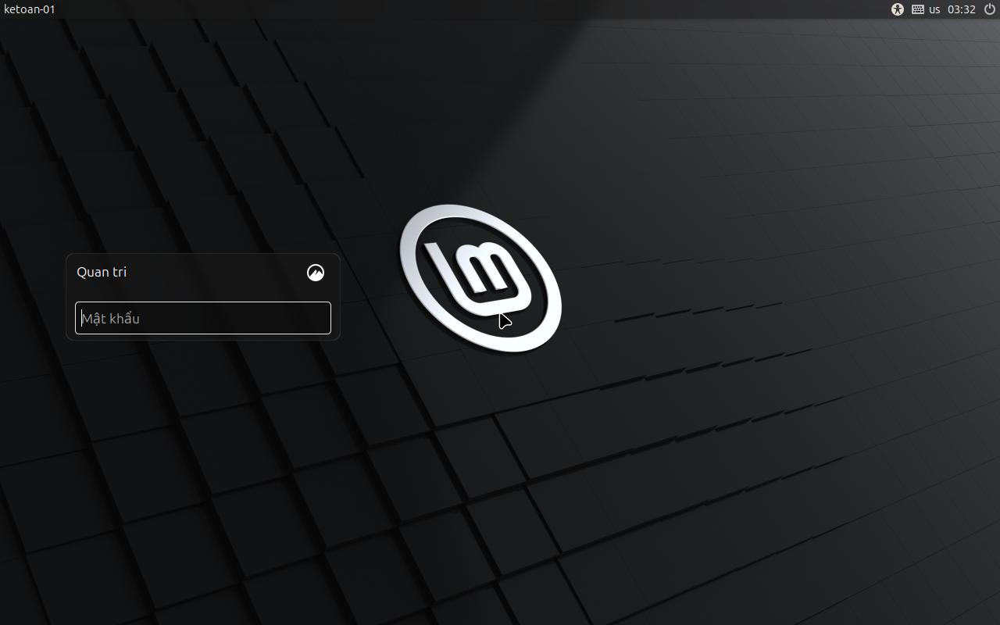
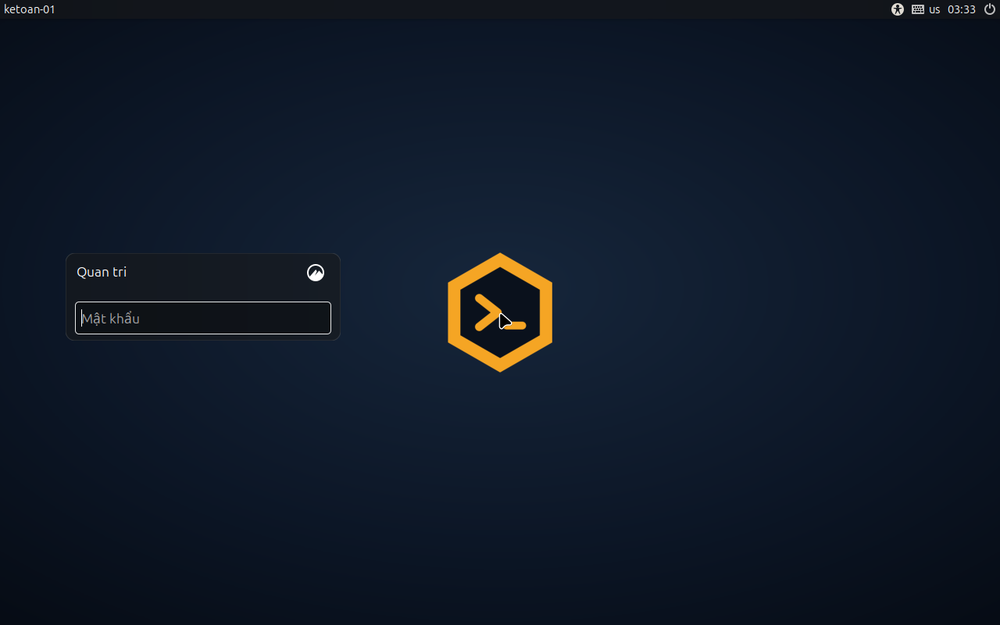
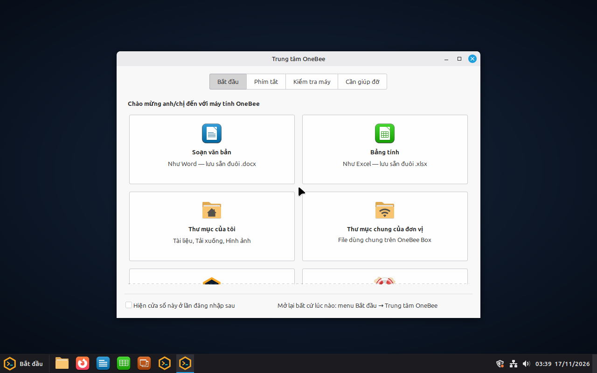
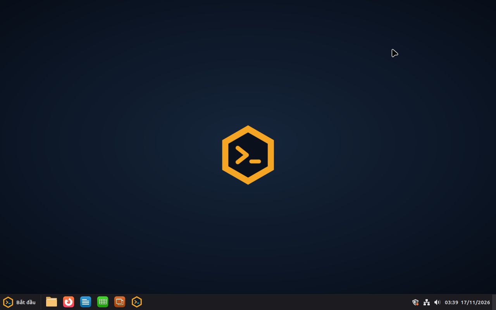
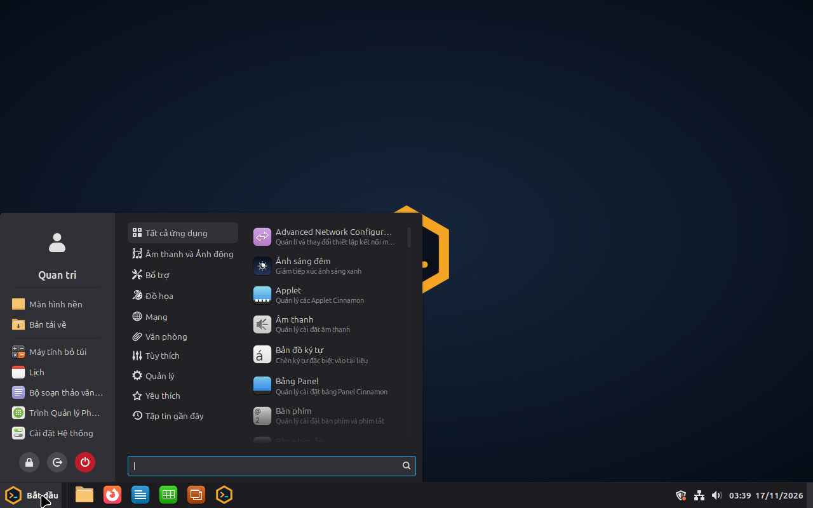
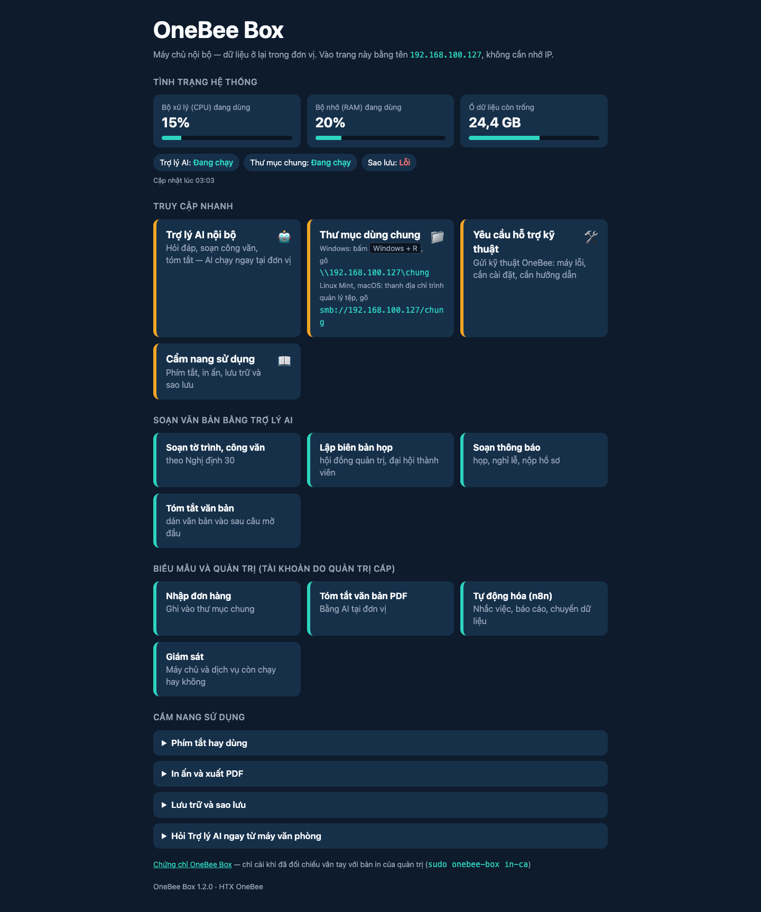
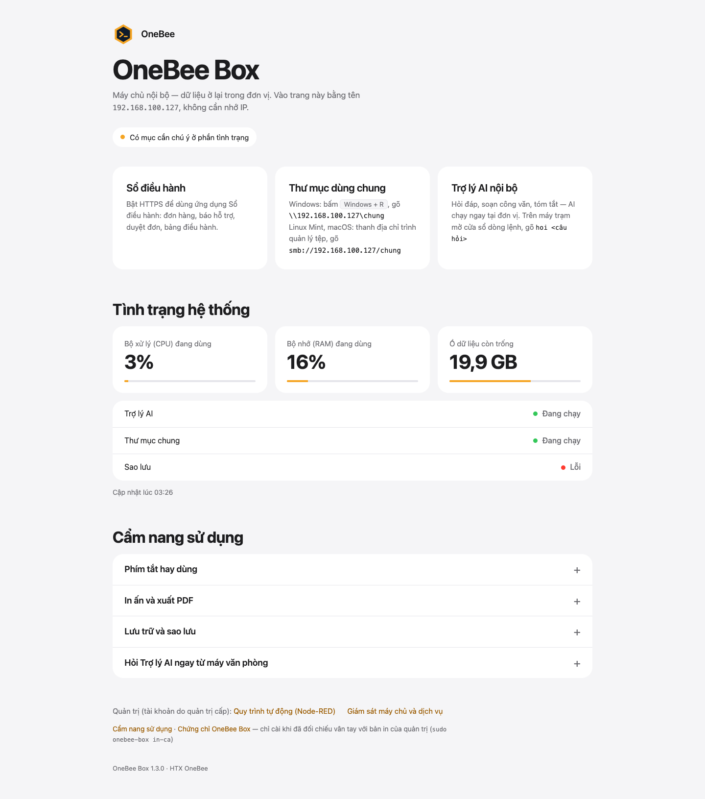

# Kiểm thử bản 1.3.0: máy trạm sạch hoàn toàn và nâng cấp Box (17/11/2026)

Kết quả ngắn: cài từ đầu đến cuối trên máy sạch **đạt** (sau một lần chạy lại vì mạng), Box thật **đã nâng cấp lên 1.3.0 và hiện giao diện mới**. Có **một lỗi thật** ở bản 1.3.0 được tìm ra trên Box (mục 4) và một ô sao lưu đỏ do Box thử chưa gắn ổ.

Mọi số liệu dưới đây lấy từ nhật ký và ảnh chụp trong lượt thử, không ước lượng. Môi trường: VMware Fusion trên Mac, Release `v1.3.0`.

## 1. Máy trạm sạch hoàn toàn (VM Mint 22.3 mới, đĩa trống 40 GB)

Máy được tạo mới, cài Mint 22.3 hoàn toàn tự động từ ISO (không người bấm), sau đó chạy **đúng khối lệnh trong README trên `main`**.

| Mốc | Giờ | Kết quả |
|---|---|---|
| Cài Mint tự động | 02:45 → 03:22 (khoảng 37 phút) | Đạt. Máy trắng: không có gói OneBee, không có `/etc/onebee`, có Internet |
| Khối lệnh README, lần 1 | 03:22:54 → 03:28:37 | **Lỗi** `ok=112 failed=1`: hết thời gian chờ khi tải `x11vnc` từ `archive.ubuntu.com` (mạng chập chờn, các kho gói trả 200 ngay sau đó) |
| Chạy lại bộ cài, lần 2 | 03:29:21 → 03:30:21 (1 phút) | Đạt `ok=116 changed=9 failed=0` |
| Chạy lần 3 (kiểm lũy nghiệm) | 03:30:48 → 03:32:00 | Đạt `ok=116 changed=0 failed=0` |
| Khởi động lại | 03:32:30 | Plymouth rồi màn hình đăng nhập mới, khoảng 15 giây sau lệnh |
| Đăng nhập lần đầu | 03:38:20 | Trung tâm OneBee tự mở |

Máy trước khi cài OneBee:

Màn hình đăng nhập **trước** khi khởi động lại vẫn là của Mint (nó đã chạy từ trước khi cài OneBee, nên chưa đổi). Sau khi khởi động lại mới đổi sang bản OneBee:

| Trước khi khởi động lại | Sau khi khởi động lại |
|---|---|
|  |  |

Màn hình khởi động thật (Plymouth), Trung tâm OneBee tự mở, màn hình làm việc và menu Bắt đầu:

Ảnh động toàn bộ quá trình (khoảng 20 giây, có chú thích giờ): [may-sach-tu-dau-den-cuoi.gif](../../docs/huong-dan/anh/may-sach-tu-dau-den-cuoi.gif).

Điều rút ra: khi mạng ngắt giữa chừng, bộ cài dừng với thông báo rõ và **chạy lại là phục hồi** (đúng như thiết kế). Hướng dẫn A đến Z đã thêm dòng này.

## 2. Máy trạm đã từng cài OneBee (nâng cấp)

VM `onebee-mint-22-3-kiem` (đã có `/etc/onebee/may-tram.env`) chạy cùng khối lệnh: `ok=141 changed=23 failed=0`; chạy lại lần hai `ok=139 changed=0 failed=0`. Hình nền trùng SHA256 với bản trong gói, Plymouth là chủ đề `onebee`.

## 3. Box thật: nâng cấp 1.2.0 → 1.3.0

Box là VM Ubuntu Server 24.04.5 (`192.168.100.127`). Trước khi nâng cấp đã chụp snapshot VM `truoc-nang-cap-box-1.3.0`. Cách làm: `git pull --ff-only` trong `~/onebee` (giữ lại hai giá trị khai báo đơn vị), rồi `sudo ./box/onebee-box-install.sh`.

- Bắt đầu 03:01, xong khoảng 03:25 (khoảng 25 phút). `ok=163 changed=64 failed=0`.
- Chân trang đổi từ `OneBee Box 1.2.0` thành `OneBee Box 1.3.0`.

| Giao diện cũ (1.2.0) | Giao diện mới (1.3.0, chế độ sáng) |
|---|---|
|  |  |

Chế độ tối và điện thoại: [ảnh tối](../../docs/huong-dan/anh/07-box-giao-dien-toi.png), [ảnh điện thoại](../../docs/huong-dan/anh/08-box-giao-dien-dien-thoai.png).

Dòng **Sao lưu: Lỗi** màu đỏ trên ảnh là do Box thử này chưa gắn ổ sao lưu ngoài (chẩn đoán ghi: "Chưa gắn ổ vào /mnt/onebee-sao-luu"), không phải do bản mới.

## 4. Lỗi thật tìm thấy trên Box 1.3.0

`sudo onebee-box chan-doan` báo **LỖI**: `onebee-quy-trinh` (động cơ quy trình Node-RED) "đang chạy nhưng không khỏe (unhealthy)", kéo dài sau 15 phút.

- **Biểu hiện:** Node-RED vẫn chạy bình thường (nhật ký: "Server now running at http://127.0.0.1:1880/quy-trinh/", "Started flows"). Chỉ phép kiểm tra sức khoẻ của Docker thất bại.
- **Nguyên nhân:** dịch vụ `quy-trinh` trong `box/ansible/roles/box-stack/templates/docker-compose.yml.j2` không khai báo `healthcheck`, nên dùng kiểm tra mặc định của image (`node /healthcheck.js`). Script đó đọc `/data/settings.js`, trong khi OneBee đặt cấu hình ở `/cau-hinh/settings.js` (`command: ["--settings", "/cau-hinh/settings.js"]`). Kết quả: `Error: Cannot find module '/data/settings.js'` ở mọi lần kiểm tra.
- **Ảnh hưởng:** hiện chưa dịch vụ nào chờ trạng thái khỏe của `quy-trinh` (không có `service_healthy` nào trỏ tới nó), nên chỉ có cảnh báo giả trong `chan-doan`. Nhưng người dùng chạy `chan-doan` sẽ thấy một dòng LỖI không có thật.
- **Hướng sửa đề xuất:** thêm `healthcheck` riêng cho dịch vụ `quy-trinh`, kiểm tra thẳng cổng `1880` tại đường dẫn `/quy-trinh/`, kèm bài kiểm hồi quy. Cần phát hành 1.3.1.
- **Vì sao CI không bắt được:** chưa xác định. CI `box=true` đã xanh; cần xem lại xem nó có đọc trạng thái sức khoẻ của container hay không.

Tổng kết của `chan-doan` lượt này: 3 lỗi, 2 cảnh báo. Ngoài lỗi `quy-trinh`, hai lỗi còn lại và một cảnh báo thuộc mục 7 (bản sao lưu) vì chưa gắn ổ sao lưu, là bình thường với Box thử. Cảnh báo thứ hai chưa được xem chi tiết.

## 5. Chưa làm / câu hỏi mở

- Chưa thử trọn quy trình trên **Box thật có ổ sao lưu ngoài** (khôi phục, `sao-luu`, `khoi-phuc-thu`).
- Chưa có quyết định sửa lỗi ở mục 4 (cần phát hành 1.3.1).
- Chưa kiểm cài trên **máy vật lý**: mọi lượt thử đều trên máy ảo VMware.
